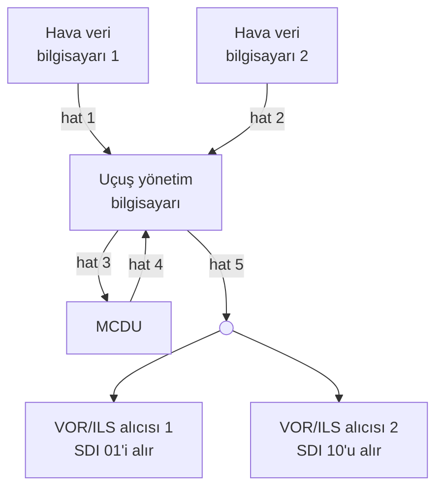

Bir yolcu uçağında hava veri bilgisayarı hava hızını hesapladığında bu değeri tek başına kullanmaz: birincil uçuş göstergesi, otopilot ve uçuş yönetim sistemi de aynı değeri ister. Bu birimler farklı üreticilerden gelir, ama hepsi aynı dili konuşur. Sivil havacılıkta kırk yılı aşkın süredir bu dilin adı ARINC 429'dur.

Bu yazıda ARINC 429'u kablodan bite kadar anlatıyoruz: hatların nasıl bağlandığını, sinyalin nasıl taşındığını, 32 bitlik kelimenin nasıl okunduğunu ve verinin BNR ile BCD olarak nasıl kodlandığını.

{/* truncate */}

## ARINC 429 nedir?

ARINC 429, sivil uçaklarda aviyonik birimler arasında sayısal veri taşımak için tanımlanmış bir veri yolu standardıdır. Tam adı Mark 33 Digital Information Transfer System'dir (DITS). Havayollarının ortak standart kuruluşu ARINC (Aeronautical Radio, Inc.) tarafından 1977'de yayımlandı ve 1980'lerin başında hizmete giren ilk sayısal aviyonikli uçak kuşağıyla yaygınlaştı. Bugün hizmetteki sivil uçakların büyük çoğunluğunda bulunur.

Standart üç katmanı birlikte tanımlar: kablo ve elektriksel sinyal, kelimenin yapısı ve hangi etiketin hangi veriyi taşıdığı. Aşağıda bu sırayla ilerliyoruz.

## Topoloji: bir hat, bir verici

ARINC 429'un temel kuralı basittir: **bir hatta yalnızca bir verici bulunur.** Bu verici en çok 20 alıcıyı besleyebilir ve veri yalnızca vericiden alıcılara doğru akar. Hatta tek konuşan olduğu için çakışma yaşanmaz, sırayı yöneten bir hakeme gerek kalmaz ve bir kelimenin ne zaman geleceği önceden bellidir.

Alıcılar hatta iki biçimde bağlanır:

- **Yıldız (star):** Her alıcının kablosu ayrı ayrı vericiye kadar gelir. Kablo daha uzundur ama her alıcı bağımsızdır; bir alıcının kablosundaki sorun ötekileri etkilemez.
- **Bus drop:** Tek bir ana kablo alıcıların yanından geçer, her alıcı ona kısa bir stub ile bağlanır. Kablo tasarrufu sağlar; stub'lar uzadıkça yansımalar artacağı için kısa tutulur.

Veri tek yönde aktığı için iki birimin karşılıklı konuşması iki ayrı hat ister. Bir aviyonik birimin arkasında bu yüzden genellikle birkaç verici ve çok sayıda alıcı portu bulunur. Örnek bir kurulum:

Uçuş yönetim bilgisayarı ile kokpitteki tuş takımlı ekranı MCDU arasında iki hat vardır, çünkü veri iki yöne de akar. Hat 5 ise iki seyrüsefer alıcısını aynı anda besler; her alıcı yalnızca kendi SDI değerini taşıyan kelimeyi alır. SDI'ya aşağıda döneceğiz.

## Kablo

ARINC 429 hattı, ekranlı bükümlü çift kablodur (shielded twisted pair). İki iletkene A hattı ve B hattı denir; bilgi, ikisi arasındaki gerilim farkında taşınır. Bükümlü yapı, dışarıdan gelen gürültünün iki iletkene aynı biçimde binmesini sağlar; fark alındığında bu gürültü büyük ölçüde birbirini götürür. Ekran (shield) genellikle iki uçta ve her ara bağlantıda topraklanır; uçak üreticisinin kablolama standardı bu kuralı değiştirebilir.

Kablonun karakteristik empedansı yaklaşık 75 Ω'dur (bazı kaynaklarda 78 Ω). Vericinin çıkış empedansı da 75 Ω seçilmiştir ve iki hatta eşit bölünür; böylece hattın verici ucu kabloya uyumlu olur ve yansımalar orada sönümlenir. Alıcılar ise yüksek empedanslıdır (en az 12 kΩ), bu yüzden hattı yüklemez. RS-485 gibi veri yollarının aksine, ARINC 429'da hat sonuna sonlandırma direnci (termination) konmaz.

Standart kesin bir kablo uzunluğu vermez. Sınırı kablo kapasitesi, alıcı sayısı ve hız birlikte belirler; düşük hızlı hatlar daha uzun kabloya izin verir.

## Sinyal yapısı

ARINC 429, iki kutuplu sıfıra dönüşlü (bipolar return-to-zero) kodlama kullanır. Hatta üç seviye vardır: HI, NULL ve LO. Bir bit 1 ise gerilim bitin ilk yarısında HI'ye, 0 ise LO'ya çıkar; bitin ikinci yarısında her durumda NULL'a döner.

Bu yapının üç sonucu vardır:

- **Saat hattı gerekmez.** Her bit bir darbeyle başladığı için alıcı zamanlamayı sinyalin kendisinden çıkarır (self-clocking).
- **Kelime sınırı boşluktan anlaşılır.** İki kelime arasında en az 4 bit süresi boyunca hat NULL'da kalır; alıcı bu sessizlikten sonra gelen ilk darbeyi yeni kelimenin bit 1'i sayar.
- **Gürültüye pay bırakılır.** Verici ±10 V üretir, alıcı ise +6,5 V üstünü HI, −6,5 V altını LO, ±2,5 V arasını NULL sayar. Aradaki bölgeler kablodaki zayıflama ve gürültü için bırakılmış paydır.

Fark gerilimi A ve B hatlarına bölünür: HI'de A hattı toprağa göre +5 V'a, B hattı −5 V'a gider; LO'da tersi olur.

Kenarların dikliği de standartta tanımlıdır. Çok dik kenarlar kabloda yansımaya ve çevredeki kablolara elektromanyetik girişime (EMI) yol açar; bu yüzden yükselme ve düşme süreleri kasıtlı olarak yavaş tutulur.

| Özellik | Yüksek hız | Düşük hız |
|---|---|---|
| Bit hızı | 100 kbit/s ±%1 | 12–14,5 kbit/s |
| Bit süresi | 10 µs | yaklaşık 69–83 µs |
| Darbe süresi | bit süresinin yarısı (5 µs) | bit süresinin yarısı |
| Yükselme ve düşme süresi | 1,5 ±0,5 µs | 10 ±5 µs |
| Verici seviyeleri (A − B) | HI +10 V, NULL 0 V, LO −10 V | aynı |
| Alıcı eşikleri | HI +6,5…+13 V, NULL ±2,5 V, LO −6,5…−13 V | aynı |

Bir hattın hızı tasarımda seçilir; aynı hatta iki hız karışmaz. Gerçek bir hattan alınmış ölçümde de aynı yapı görülür: etiket, SDI, veri, SSM ve parity alanları art arda gider, ardından kelime arası boşluk gelir.

## 32 bitlik kelime

ARINC 429'da veri 32 bitlik kelimeler (word) hâlinde gönderilir. Her kelime beş alandan oluşur; alanların bir örnek kelimede nasıl dolduğunu aşağıdaki BNR bölümünde göreceğiz:

| Bitler | Alan | Ne işe yarar? |
|---|---|---|
| 1–8 | Etiket (label) | Kelimenin hangi parametreyi taşıdığını söyler; sekizlik tabanda (octal) yazılır |
| 9–10 | SDI | Kelimenin hangi alıcıya yönelik olduğunu ya da hangi kaynaktan geldiğini belirtir |
| 11–29 | Data | Asıl değer; BNR, BCD ya da Discrete olarak kodlanır |
| 30–31 | SSM | Verinin durumunu (ve BCD'de işaretini) söyler; anlamı veri türüne göre değişir |
| 32 | Parity | Hata denetim biti |

### Etiket

Etiket, alıcının kelimeyi tanımasını sağlar. Örneğin etiket 206 Computed Airspeed'i (hesaplanmış hava hızı), etiket 260 tarihi taşır; yazının başındaki osiloskop görüntüsünde çözümlenen kelime bir tarih kelimesidir. Standart, etiketlerin anlamını, kodlamasını, birimini ve çözünürlüğünü tanımlar. Bir ekipmanın hangi etiketleri hangi sıklıkla gönderdiği ise o ekipmanın arayüz kontrol dokümanında (interface control document, ICD) yazılır.

Yeni başlayanların en sık takıldığı nokta gönderim sırasıdır. Kelime bit 1'den başlayarak gönderilir; Data alanı en düşük anlamlı bitten başlar. Etiketin en anlamlı biti ise bit 1'dedir, yani etiket ters sırayla gider. Lojik analizörde etiketi okurken bitleri ters çevirmek gerekir.

### SDI

SDI (source/destination identifier) iki işe yarar. Bir verici aynı hatta birden çok özdeş alıcıyı besliyorsa SDI kelimenin hangi alıcıya yönelik olduğunu söyler: yukarıdaki örnekte 1 numaralı alıcı yalnızca SDI 01'li kelimeleri alır. Birden çok kaynağın verisini toplayıp tek hatta yeniden yayınlayan bir birimde ise SDI, kelimenin hangi kaynaktan geldiğini belirtir. Alıcının hangi SDI'ya yanıt vereceği çoğunlukla birimin takıldığı yuvadaki konnektör pinleriyle ayarlanır. SDI gerekmeyen kelimelerde bu iki bit veri için kullanılabilir.

### Parity

Bit 32, kelimedeki 1'lerin toplam sayısını tek yapacak biçimde ayarlanır (odd parity). Alıcı tek sayıyı bulamazsa kelimeyi atar. Parity tek bitlik hataları yakalar ama düzeltemez; ARINC 429'da hata düzeltme yoktur. Veriler belirli aralıklarla yeniden gönderildiği için bozuk kelimenin yerini kısa süre sonra yenisi alır.

## Veri kodlama: BNR, BCD ve Discrete

Bit 11–29 arasındaki Data alanı üç biçimde kodlanır. SSM'nin anlamı da bu biçime göre değişir; bu yüzden ikisini birlikte anlatıyoruz.

### BNR (binary)

BNR'de değer ikiye tümleyen (two's complement) ikili sayıdır:

- Bit 29 işaret bitidir (sign): 0 Plus, 1 Minus.
- Değerin en anlamlı biti bit 28'dedir. Her parametrenin kaç anlamlı bit kullandığı (significant bits) ve aralığı (range) etiketin tanımında yazar.
- Çözünürlük (resolution), en düşük anlamlı bitin değeridir. Kullanılmayan alt bitler pad olarak sıfır bırakılır ya da Discrete bit olarak kullanılır.

Örnek: Computed Airspeed (etiket 206) 14 anlamlı bitle ve 0,0625 knot çözünürlükle gönderilir. 250 knot için 250 / 0,0625 = 4000 hesaplanır ve bu sayı bit 28–15'e yazılır:

Şekilde etiket alanı 0110 0001 olarak görünür: sekizlik 206'nın ikili karşılığı olan 10 000 110'un ters çevrilmiş hâli. 1'lerin sayısı zaten tek (11) olduğu için parity biti 0'dır.

BNR kelimelerde SSM şöyle okunur:

| Bit 31 | Bit 30 | SSM (BNR) |
|---|---|---|
| 0 | 0 | Failure Warning |
| 0 | 1 | No Computed Data |
| 1 | 0 | Functional Test |
| 1 | 1 | Normal Operation |

- **Failure Warning:** Kaynak arızalı; değer kullanılmaz.
- **No Computed Data:** Kaynak sağlam ama şu an geçerli bir değer hesaplayamıyor (örneğin sensör henüz hazır değil).
- **Functional Test:** Değer bir testin ürünüdür, gerçek ölçüm değildir.
- **Normal Operation:** Değer geçerlidir.

Yazılım açısından kelimenin en önemli iki biti bunlardır: değer ne kadar makul görünürse görünsün, SSM Normal Operation demiyorsa kullanılmaz. Tek bir ARINC 429 sinyalinin arayüz tanımı kitaptaki [Sistem Bağlamında Yazılım](/kitap/baglam/sistem-baglaminda-yazilim) bölümünde bu gözle incelenir.

### BCD (binary-coded decimal)

BCD'de her ondalık basamak ayrı bir bit grubunda tutulur. Data alanı beş basamak taşır: en anlamlı basamak bit 27–29'daki 3 bittedir (0–7), kalan dört basamak 4'er bitlik gruplardır (bit 23–26, 19–22, 15–18, 11–14). Telsiz frekansı, tarih ve saat gibi ekranda doğrudan gösterilen değerler için kullanılır; alıcı basamakları dönüştürmeden yazdırabilir.

BCD'de ayrı bir işaret biti yoktur; işaret ya da yön SSM'de taşınır. Bu yüzden SSM tablosu BNR'den farklıdır:

| Bit 31 | Bit 30 | SSM (BCD) |
|---|---|---|
| 0 | 0 | Plus, North, East, Right, To, Above |
| 0 | 1 | No Computed Data |
| 1 | 0 | Functional Test |
| 1 | 1 | Minus, South, West, Left, From, Below |

BCD'de Failure Warning kodu yoktur: kaynak arızalandığında o etiketi göndermeyi keser. Alıcı da etiket belirli bir süre gelmezse veriyi bayat sayar. BNR'de 11 "her şey yolunda" demekken BCD'de "eksi ya da güney" demektir; iki tabloyu karıştırmak sık yapılan bir hatadır.

### Discrete

Discrete kelimelerde her bit ayrı bir açık/kapalı durumu bildirir: bir sistemin hangi modda olduğu, bir anahtarın konumu, bir uyarının etkin olup olmadığı. Discrete kelimelerin SSM tablosu da BNR'den farklıdır; standartta 00 Verified Data, Normal Operation, 11 ise Failure Warning anlamına gelir. Kaynaklar ve ekipmanlar arasında bu tabloda farklılık görüldüğü için Discrete kelimede SSM'nin anlamı her zaman ekipmanın ICD'sinden doğrulanır.

## Neden hâlâ kullanılıyor?

ARINC 429 yavaştır ve her verici için ayrı kablo ister; yeni nesil uçaklarda büyük veri trafiği bu yüzden Ethernet tabanlı [AFDX](2023-08-23-afdx-nedir.mdx) ağlarına taşındı. Ama ARINC 429 kaybolmadı. Basitliği, deterministik yapısı, her yerde bulunan test ekipmanı ve kırk yılı aşkın hizmet deneyimi onu hâlâ cazip kılıyor. AFDX kullanan uçaklarda bile birçok sensör ve ekipman ARINC 429 ile bağlanır; veriyi ağa aktarma işini ağ geçitleri (gateway) yapar.

## Özet

- Bir hatta tek verici ve en çok 20 alıcı bulunur; veri tek yönde akar. Alıcılar yıldız ya da bus drop biçiminde bağlanır.
- Hat, yaklaşık 75 Ω'luk ekranlı bükümlü çift kablodur; vericide 75 Ω çıkış empedansı vardır, hat sonunda sonlandırma yoktur.
- Sinyal iki kutuplu ve sıfıra dönüşlüdür: HI, NULL ve LO seviyeleri; saat hattı yoktur, kelimeler arasında en az 4 bitlik boşluk bulunur.
- 32 bitlik kelime beş alandan oluşur: etiket, SDI, Data, SSM ve parity. Etiket ters bit sırasıyla gönderilir.
- SSM'nin anlamı veri türüne bağlıdır: BNR'de 11 Normal Operation, BCD'de 11 Minus demektir.

## Daha fazla okumak için

- [Aviyonik Nedir?](2023-08-21-aviyonik-nedir.mdx): ARINC 429'un bağladığı sistemlere genel bir bakış.
- [AFDX Nedir?](2023-08-23-afdx-nedir.mdx): ARINC 429'un yerini alan Ethernet tabanlı aviyonik ağ.
- Cary R. Spitzer, Uma Ferrell, Thomas Ferrell (ed.) — [Digital Avionics Handbook](/kutuphane/aviyonik-sistemler/spitzer-digital-avionics-handbook): ARINC 429'u ve öteki veri yollarını ayrı bölümlerde anlatan başvuru kitabı.
