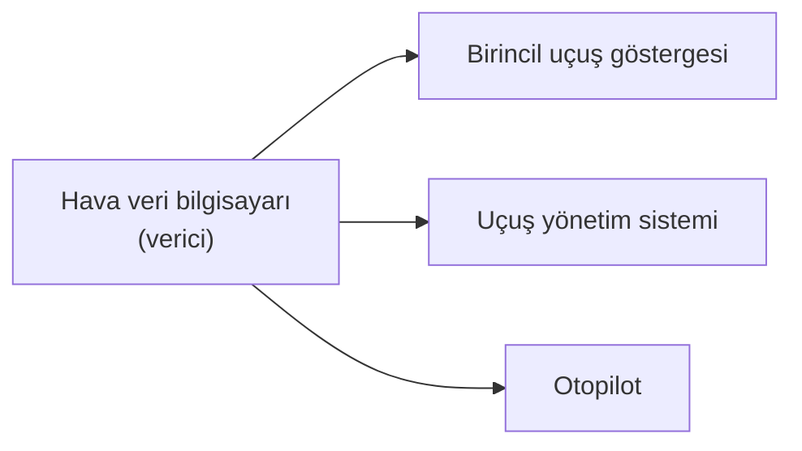

Bir yolcu uçağında hava veri bilgisayarı hava hızını hesapladığında bu değeri tek başına kullanmaz: birincil uçuş göstergesi, otopilot ve uçuş yönetim sistemi de aynı değeri ister. Bu birimler farklı üreticilerden gelir, ama hepsi aynı dili konuşur. Sivil havacılıkta kırk yılı aşkın süredir bu dilin adı ARINC 429'dur.

Bu yazıda ARINC 429'un nasıl bir veri yolu olduğunu, 32 bitlik kelimesinin nasıl okunduğunu ve neden bugün de yaygın olduğunu anlatıyoruz.

{/* truncate */}

## ARINC 429 nedir?

ARINC 429, sivil uçaklarda aviyonik birimler arasında sayısal veri taşımak için tanımlanmış bir veri yolu standardıdır. Havayollarının ortak standart kuruluşu ARINC (Aeronautical Radio, Inc.) tarafından 1977'de yayımlandı ve 1980'lerin başında hizmete giren ilk sayısal aviyonikli uçak kuşağıyla yaygınlaştı. Bugün hizmetteki sivil uçakların büyük çoğunluğunda bulunur.

## Nasıl çalışır?

ARINC 429'un temel kuralı basittir: **bir hat, bir verici.** Her verici kendi bükümlü çift kablosunu (twisted pair) sürer ve bu hatta en çok 20 alıcı bağlanabilir. Veri yalnızca tek yönde akar; iki birimin karşılıklı konuşması için iki ayrı hat gerekir.

Bu yaklaşımın iyi yanı, hatta çakışma olmamasıdır. Hatta konuşan tek bir verici olduğu için sırayı yöneten bir hakeme gerek yoktur ve verinin ne zaman geleceği önceden bellidir. Bedeli ise kablodur: her verici için ayrı bir hat çekilir.

Sinyal, iki kutuplu sıfıra dönüşlü (bipolar return-to-zero) kodlamayla taşınır: 1 biti için hattaki gerilim farkı yaklaşık +10 V'a, 0 biti için −10 V'a çıkar ve her bitin ikinci yarısında sıfıra döner. Her bitte sıfıra dönüldüğü için ayrı bir saat hattı gerekmez; alıcı zamanlamayı sinyalin kendisinden çıkarır. Hız iki seçenekten biridir: yüksek hızda 100 kbit/s, düşük hızda 12,5 kbit/s.

## 32 bitlik kelime

ARINC 429'da veri 32 bitlik kelimeler (word) hâlinde gönderilir. Kelimeler arasında en az 4 bit süresi boşluk bırakılır; alıcı yeni kelimenin başladığını bu boşluktan anlar. Her kelime beş alandan oluşur:

| Bitler | Alan | Ne işe yarar? |
|---|---|---|
| 1–8 | Etiket (label) | Kelimenin hangi parametreyi taşıdığını söyler; sekizlik tabanda yazılır |
| 9–10 | SDI | Aynı veriyi gönderen birden çok kaynak varsa (örneğin sol ve sağ sistem) hangisinin kastedildiğini belirtir |
| 11–29 | Veri | Asıl değer; türüne göre BNR, BCD ya da ayrık bitler |
| 30–31 | SSM | Verinin geçerli olup olmadığını, gerekirse işaretini söyler |
| 32 | Parity | Hata denetim biti |

### Etiket

Etiket, alıcının kelimeyi tanımasını sağlar. Örneğin etiket 206 hesaplanmış hava hızını, etiket 260 tarihi taşır; yazının başındaki osiloskop görüntüsünde çözümlenen kelime bir tarih kelimesidir. Bir ekipmanın hangi etiketleri hangi sıklıkla gönderdiği, o ekipmanın arayüz kontrol dokümanında (interface control document, ICD) yazılır.

Yeni başlayanların en sık takıldığı nokta gönderim sırasıdır: kelimenin geri kalanı en düşük anlamlı bitten başlayarak gönderilir, ama etiket en anlamlı bitinden başlayarak, yani ters sırayla gider.

### SSM

İşaret/durum matrisi (sign/status matrix, SSM), alıcıya veriye güvenip güvenemeyeceğini söyler. BNR verisi için dört durum vardır:

| SSM | Anlamı |
|---|---|
| 11 | Normal çalışma: veri geçerli |
| 10 | İşlevsel test: veri test amaçlı, gerçek ölçüm değil |
| 01 | Hesaplanmış veri yok: kaynak şu an değer üretemiyor |
| 00 | Arıza uyarısı: kaynak arızalı |

Yazılım açısından kelimenin en önemli iki biti bunlardır: değer ne kadar makul görünürse görünsün, SSM "normal çalışma" demiyorsa kullanılmaz. Tek bir ARINC 429 sinyalinin arayüz tanımı kitaptaki [Sistem Bağlamında Yazılım](/kitap/baglam/sistem-baglaminda-yazilim) bölümünde bu gözle incelenir.

### Veri türleri

- **BNR (ikili, binary):** Değer ikiye tümleyen ikili sayıdır, bit 29 işarettir. Her parametrenin bir çözünürlüğü vardır: hava hızı 0,0625 knot çözünürlükle gönderiliyorsa 250 knot, 250 / 0,0625 = 4000 sayısı olarak yazılır.
- **BCD (ikili kodlanmış ondalık, binary-coded decimal):** Her ondalık basamak ayrı bir bit grubunda tutulur; telsiz frekansı ve tarih gibi doğrudan gösterilen değerlerde kullanılır.
- **Ayrık (discrete):** Her bit ayrı bir açık/kapalı durumu bildirir; örneğin bir sistemin hangi modda olduğunu.

### Parity

Bit 32, kelimedeki 1'lerin toplam sayısını tek yapacak biçimde ayarlanır (tek parity). Alıcı tek sayıyı bulamazsa kelimeyi atar. Parity tek bitlik hataları yakalar ama düzeltemez; ARINC 429'da hata düzeltme yoktur. Veriler belirli aralıklarla yeniden gönderildiği için bozuk kelimenin yerini kısa süre sonra yenisi alır.

## Neden hâlâ kullanılıyor?

ARINC 429 yavaştır ve çok kablo ister; yeni nesil uçaklarda büyük veri trafiği bu yüzden Ethernet tabanlı [AFDX](2023-08-23-afdx-nedir.mdx) ağlarına taşındı. Ama ARINC 429 kaybolmadı. Basitliği, her yerde bulunan test ekipmanı ve kırk yılı aşkın hizmet deneyimi onu hâlâ cazip kılıyor. AFDX kullanan uçaklarda bile birçok sensör ve ekipman ARINC 429 ile bağlanır; veriyi ağa aktarma işini ağ geçitleri (gateway) yapar.

## Özet

- Bir hatta tek verici, en çok 20 alıcı; veri tek yönde akar.
- Hız 100 ya da 12,5 kbit/s; saat hattı yoktur, zamanlama sinyalin içindedir.
- 32 bitlik kelime beş alandan oluşur: etiket, SDI, veri, SSM, parity.
- SSM "normal çalışma" demiyorsa veri kullanılmaz.

## Daha fazla okumak için

- [Aviyonik Nedir?](2023-08-21-aviyonik-nedir.mdx): ARINC 429'un bağladığı sistemlere genel bir bakış.
- [AFDX Nedir?](2023-08-23-afdx-nedir.mdx): ARINC 429'un yerini alan Ethernet tabanlı aviyonik ağ.
- Cary R. Spitzer, Uma Ferrell, Thomas Ferrell (ed.) — [Digital Avionics Handbook](/kutuphane/aviyonik-sistemler/spitzer-digital-avionics-handbook): ARINC 429'u ve öteki veri yollarını ayrı bölümlerde anlatan başvuru kitabı.
