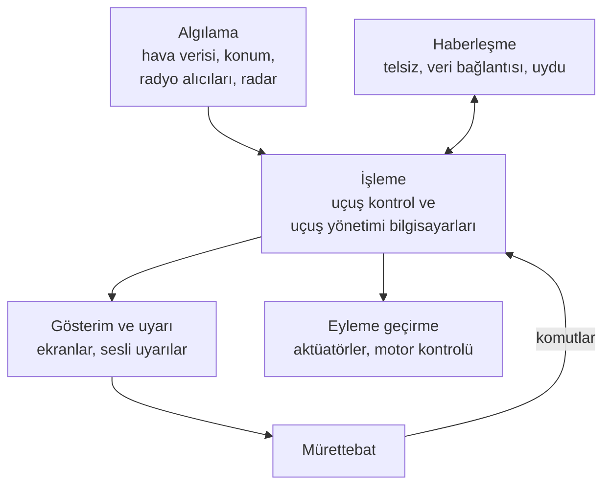

Bir yolcu uçağı konumunu uydulardan hesaplar, çevresindeki trafiği izler, pilotun kumandadaki hareketini bilgisayarlar üzerinden kanatlara iletir ve sisli havada pisti yerdeki vericilerin yardımıyla bulur. Bunların hiçbiri kanadın ya da motorun işi değildir; hepsi uçağın elektroniğinin, yani **aviyoniğin** işidir.

Bu yazıda aviyoniğin ne olduğunu, uçaktaki başlıca aviyonik sistemleri ve onları sıradan elektronikten ayıran şeyi anlatıyoruz.

{/* truncate */}

## Aviyonik nedir?

Aviyonik (avionics), hava araçlarında kullanılan elektronik sistemlerin ortak adıdır. Sözcük, İngilizce aviation (havacılık) ve electronics (elektronik) sözcüklerinin birleşmesinden doğmuştur: **avi**ation + electr**onics** = **avionics**. Terimi 1949'da Aviation Week dergisinin editörlerinden gazeteci Philip J. Klass türetmiştir.

Aviyonik yalnızca yolcu uçaklarında bulunmaz; askerî uçaklar, helikopterler, insansız hava araçları (İHA), uydular ve uzay araçları da aviyonik taşır. Bugün bu sistemlerin büyük bölümü, bilgisayarlardan ve onların üzerinde çalışan yazılımlardan oluşur.

## Aviyonik ne iş yapar?

Hangi uçakta olursa olsun aviyoniğin işi aynı döngüyle özetlenebilir: sensörler uçağın ve çevrenin durumunu **algılar**, bilgisayarlar bu veriyi **işler**, sonuç ya ekranlarda mürettebata (flight crew) **gösterilir** ya da aktüatörler aracılığıyla **eyleme** dönüşür. Telsizler de uçağı yerle ve diğer uçaklarla **haberleştirir**.

Mürettebat bu döngünün içindedir: ekranda gördüğüne göre karar verir, komutlarını yine aviyonik üzerinden uçağa iletir.

## Başlıca aviyonik sistemler

### Haberleşme

Pilotlar hava trafik kontrolüyle (ATC) çoğunlukla VHF telsizle konuşur. VHF'nin menzili görüş hattıyla (line of sight) sınırlı olduğu için okyanus üzerinde HF telsiz ve uydu haberleşmesi kullanılır. Rutin talimatlar ise giderek artan biçimde sesle değil, veri bağlantısı (data link) üzerinden ekrana yazılı mesaj olarak gelir.

### Seyrüsefer

Seyrüsefer (navigasyon) sistemleri "neredeyim, nereye gidiyorum?" sorusunu cevaplar. En bilineni GPS gibi uydu sistemleridir. Ama uçak tek bir kaynağa güvenmez. Ataletsel seyrüsefer sistemi (inertial navigation system, INS), jiroskop ve ivmeölçerlerle konumu dışarıdan hiçbir sinyal almadan takip eder. Yerdeki VOR ve DME istasyonları istasyona göre yönü ve uzaklığı, ILS ise inişte piste giden yolu verir. Bu kaynaklar birlikte kullanılır; biri bozulduğunda diğerleri işi sürdürür.

Türkiye'deki istasyonları [Türkiye navigasyon haritasında](/araclar/navigasyon/turkiye-navigasyon-haritasi) görebilirsiniz.

### Gözetim

Gözetim sistemleri "çevremde ne var, beni kim görüyor?" sorusuna bakar. Transponder, yer radarının sorgusuna uçağın kimliği ve irtifasıyla cevap verir; ADS-B ise uçağın konumunu sorgu beklemeden yayınlar. Trafik uyarı ve çarpışma önleme sistemi (traffic alert and collision avoidance system, TCAS) yakındaki uçakları izler, çarpışma riski varsa pilota "tırman" ya da "alçal" der. Hava radarı önündeki fırtınaları, arazi uyarı sistemi (terrain awareness and warning system, TAWS) de yaklaşan dağları ve yeri gösterir.

### Uçuş kontrolü ve uçuş yönetimi

Modern yolcu uçaklarında pilotun kumanda hareketi kablolarla değil, elektrik sinyalleriyle iletilir; buna fly-by-wire denir. Bilgisayarlar komutu yorumlar, uçağın güvenli sınırları aşmasını engeller ve aktüatörlere iletir. Kumanda yüzeylerini hareket ettiren aktüatörler çoğu uçakta hâlâ hidroliktir; fly-by-wire'ın kaldırdığı şey hidrolik değil, mekanik bağlantıdır.

Otopilot uçağı seçilen yönde, irtifada ya da rotada tutar. Uçuş yönetim sistemi (flight management system, FMS) ise rotayı, yakıtı ve varış zamanını hesaplayan, otopilota yol gösteren planlayıcıdır.

### Göstergeler

Eskiden her bilgi için kokpitte ayrı bir ibreli gösterge vardı. Bugünkü cam kokpitte (glass cockpit) bu bilgiler birkaç ekranda toplanır. Birincil uçuş göstergesi (primary flight display, PFD) yapay ufku, hızı, irtifayı ve yönü tek ekranda gösterir; yanındaki ekranlar rotayı, motor değerlerini ve uyarıları. Sitenin [ana sayfasındaki](/) canlı gösterge, sadeleştirilmiş bir PFD'dir.

### Diğer sistemler

- **Motor kontrolü:** Tam yetkili sayısal motor kontrolü (full authority digital engine control, FADEC), motorun yakıtını yöneten bilgisayardır.
- **Kayıt cihazları:** Halk arasında "kara kutu" denen uçuş veri ve kokpit ses kaydedicileri; aslında turuncudurlar.
- **Kabin ve askerî görev sistemleri:** Koltuk ekranlarından atış kontrol radarına kadar uçağın görevine özgü elektronik.

## Sistemler birbiriyle nasıl konuşur?

Uçaktaki aviyonik birimler veri yollarıyla birbirine bağlıdır. Sivil uçaklarda uzun yıllardır en yaygını ARINC 429'dur: bir verici, birkaç alıcıya tek yönlü veri gönderir. Askerî uçaklarda MIL-STD-1553, yeni nesil yolcu uçaklarında ise Ethernet tabanlı AFDX kullanılır. Bu ağlarda önemli olan yalnızca hız değil, verinin en geç ne zaman ulaşacağının önceden bilinmesidir. Ayrıntılar için [ARINC 429](2023-08-21-arinc-429.mdx) ve [AFDX](2023-08-23-afdx-nedir.mdx) yazılarına bakabilirsiniz.

## Federe mimariden IMA'ya

İlk sayısal uçaklarda her işlevin kendi bilgisayarı, yazılımı ve kabloları olan ayrı bir kutusu vardı; buna federe mimari (federated architecture) denir. Kutu sayısı arttıkça ağırlık ve kablo da arttı. Boeing 777 ile başlayan entegre modüler aviyonik (integrated modular avionics, IMA) ise birçok işlevi ortak bilgisayarlarda çalıştırır; uygulamaları birbirinden yazılım bölümlemesi (software partitioning) ayırır.

## Aviyoniği farklı kılan ne?

Aynı işlemci bir oyun konsolunda da, bir uçak bilgisayarında da bulunabilir. Farkı üç şey yaratır:

- **Emniyet:** Bir aviyonik sistemin hatası can kaybına yol açabilir. Bu yüzden yazılım, arızasının sonucu ne kadar ağırsa o kadar titiz geliştirilir (Seviye A'dan E'ye): fly-by-wire en üst, kabin eğlence sistemi en alt seviyededir.
- **Zorlu ortam ve uzun ömür:** Aviyonik ekipman soğukta, sıcakta, titreşimde, yıldırım ve güçlü elektromanyetik alanlar altında çalışmak ve uçakla birlikte 25–30 yıl hizmet vermek zorundadır.
- **Sertifikasyon:** Bir aviyonik sistem, sertifikasyon otoritesinin (Türkiye'de SHGM, Avrupa'da EASA, ABD'de FAA) kabul ettiği kanıtlar sunulmadan uçağa takılamaz. Yazılım için bu kanıtın çerçevesini DO-178C çizer.

## Sonuç

Aviyonik, uçağın algılayan, hesaplayan, gösteren ve haberleşen yanıdır; bu sistemler uçuş boyunca aynı veriyi paylaşarak birlikte çalışır. Aviyoniğin değeri de giderek yazılıma kayıyor. Bu yazılımın nasıl geliştirildiğini sitedeki [kitapta](/kitap), [Sistem Bağlamında Yazılım](/kitap/baglam/sistem-baglaminda-yazilim) bölümünden başlayarak okuyabilirsiniz.

## Daha fazla okumak için

- Mike Tooley — [Aircraft Digital Electronic and Computer Systems](/kutuphane/aviyonik-sistemler/tooley-aircraft-digital-electronic): yeni başlayanlar için en erişilebilir kitap.
- Ian Moir, Allan Seabridge, Malcolm Jukes — [Civil Avionics Systems](/kutuphane/aviyonik-sistemler/moir-civil-avionics-systems): sivil aviyonik sistemlere kapsamlı bir giriş.
- Cary R. Spitzer, Uma Ferrell, Thomas Ferrell (ed.) — [Digital Avionics Handbook](/kutuphane/aviyonik-sistemler/spitzer-digital-avionics-handbook): başvuru kitabı.
