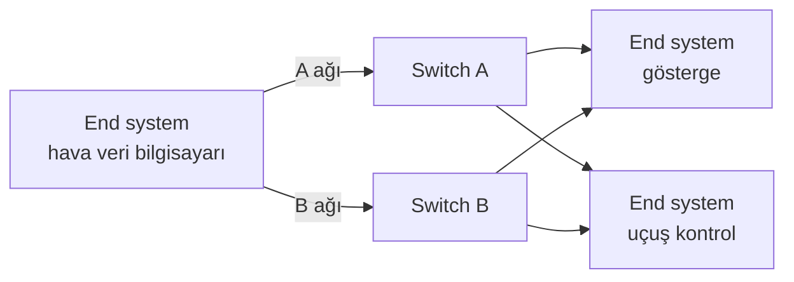

[ARINC 429](2023-08-21-arinc-429.mdx) her verici için ayrı bir kablo çeker ve saniyede en çok 100 kilobit taşır. Uçaklardaki sistem sayısı ve veri miktarı arttıkça bu yaklaşım hem ağırlık hem bant genişliği açısından sınırına dayandı. Çözüm, ofis ağlarından tanıdığımız Ethernet'i aviyoniğe uyarlamaktı. Ama sıradan Ethernet'in bir eksiği vardı: verinin ne zaman ulaşacağını garanti etmez.

AFDX, Ethernet'e bu garantiyi ekleyen aviyonik ağdır. Bu yazıda AFDX'in nasıl çalıştığını ve sıradan Ethernet'ten neyle ayrıldığını anlatıyoruz.

{/* truncate */}

## AFDX nedir?

AFDX (Avionics Full-Duplex Switched Ethernet), Airbus'ın A380 için geliştirdiği, switch'li Ethernet tabanlı aviyonik ağdır. Standart hâli ARINC 664 Part 7'dir; AFDX adı Airbus'ındır, başka üreticiler aynı standardı başka adlarla anar. A380, A400M ve A350 ile Boeing 787 bu ağı kullanır.

Fiziksel katmanda bildiğimiz Ethernet vardır: 100 Mbit/s hız, bakır kablo, standart Ethernet frame'leri. Fark, ağın kurallarındadır.

## Sıradan Ethernet neden yetmez?

Bir ofis ağında birçok bilgisayar aynı anda veri gönderdiğinde switch'in kuyrukları dolar, frame'ler bekler ya da düşer. Ortalamada her şey hızlıdır, ama tek bir frame'in en kötü durumda ne kadar gecikeceği bilinmez. Bir video görüşmesi için bu kabul edilebilir; uçuş kontrol bilgisayarına giden hava hızı verisi için değil.

Aviyonikte asıl soru "ne kadar hızlı?" değil, "en geç ne zaman?" sorusudur. Bu, [gerçek zamanlı sistemler](2026-07-03-gercek-zamanli-sistemler.mdx) yazısında anlatılan determinizmin ağdaki karşılığıdır. AFDX bu soruyu üç fikirle cevaplar: tam çift yönlü bağlantılar, virtual link'ler ve çift ağ.

## Tam çift yönlü bağlantılar

AFDX'te ağa bağlanan her aviyonik birime end system denir. Her end system bir switch'e kendi kablosuyla bağlanır ve bu kablo iki yönde aynı anda veri taşır (tam çift yönlü, full-duplex). Kabloyu paylaşan başka cihaz olmadığından çarpışma (collision) yaşanmaz.

Switch'ler de ofistekilerden farklıdır: hangi verinin nereye gideceğini kendiliğinden öğrenmez, uçak tasarlanırken hazırlanıp yüklenen sabit tablolara göre yönlendirir. Ağda tasarımda öngörülmemiş hiçbir trafik dolaşmaz.

## Virtual link: ağın içindeki ARINC 429 hatları

AFDX'in kalbi virtual link'tir (VL). Bir virtual link, bir end system'den bir ya da daha çok end system'e giden, tek yönlü mantıksal bir bağlantıdır. Tanıdık geldiyse sebebi var: virtual link, ARINC 429 hattının ağdaki karşılığıdır. Farkı, ayrı bir kablo gerektirmemesidir; aynı Ethernet bağlantısından çok sayıda virtual link geçebilir.

Her virtual link'e uçak tasarlanırken iki sınır verilir:

- **BAG (bandwidth allocation gap):** Aynı virtual link'te art arda gönderilen iki frame arasındaki en kısa süre. 1, 2, 4, 8, 16, 32, 64 ya da 128 ms olabilir.
- **Lmax:** Bu virtual link'teki en büyük frame boyu (en çok 1518 bayt).

Bu iki sayı virtual link'in kullanabileceği bant genişliğini belirler. Örneğin BAG'i 8 ms, Lmax'ı 200 bayt olan bir virtual link en çok 200 × 8 bit / 8 ms = 200 kbit/s kullanabilir. End system bu sınırı aşmamak için frame'leri sıraya koyar. Switch de her virtual link'i denetler ve sınırı aşan frame'i atar; böylece arızalanıp kontrolsüz veri basan bir birim ağın geri kalanını boğamaz.

Her virtual link'in bant genişliği ve her switch'in kuyruğu bilindiği için bir frame'in en kötü durumda ne kadar gecikeceği uçak uçmadan önce hesaplanabilir. AFDX'i deterministik yapan budur: garanti, ağın tasarımında verilir.

## Çift ağ: A ve B

AFDX'te aslında iki bağımsız ağ vardır. Her end system iki ayrı kabloyla iki ayrı switch'e bağlıdır: A ağına ve B ağına. Verici her frame'i iki ağdan aynı anda gönderir ve frame'e bir sıra numarası ekler. Alıcı, aynı sıra numaralı iki kopyadan ilk gelen geçerli kopyayı kullanır, ötekini atar.

Bir kablo kopsa ya da bir switch arızalansa veri öteki ağdan gelmeye devam eder; alıcıdaki uygulama bunu fark etmez bile.

## Gerçek bir uçakta: A380

Şekil, A380'in AFDX ağını gösterir (kaynak: Boulanger vd., "A time synchronization protocol for A664-P7", DASC 2018). Kırmızı kutular switch'ler, beyaz kutular end system'lerdir; ağ uçuş kontrolü, kokpit, motorlar, enerji, yakıt ve kabin bölgelerini birbirine bağlar.

Bu ağ, entegre modüler aviyoniğin (integrated modular avionics, IMA) omurgasıdır. Ortak bilgisayarlarda çalışan uygulamalar birbirleriyle ve sensörlerle AFDX üzerinden haberleşir; uygulamanın kendi tarafında bu haberleşme ARINC 653'ün sampling port ve queuing port'ları olarak görünür. Ayrıntısı kitaptaki [Yazılım Bölümlemesi](/kitap/ozel-konular/yazilim-bolumlemesi) bölümündedir.

## ARINC 429 ile karşılaştırma

| Özellik | ARINC 429 | AFDX |
|---|---|---|
| Hız | 12–14,5 ya da 100 kbit/s | 100 Mbit/s |
| Yapı | Her verici için ayrı hat | Switch'li yıldız ağ |
| Veri yolu | Fiziksel hat | Virtual link |
| Determinizm | Tek verici olduğu için kendiliğinden | BAG ve switch denetimiyle tasarımda |
| Yedeklilik | Gerekirse ayrı hat çekilir | A ve B ağları yerleşik |

## Özet

- AFDX, deterministik olacak biçimde kuralları sıkılaştırılmış, switch'li Ethernet'tir (ARINC 664 Part 7).
- Her bağlantı tek yönlü bir virtual link'tir; bant genişliğini BAG ve Lmax belirler.
- Switch'ler sabit tablolarla çalışır ve sınırı aşan trafiği atar.
- Her frame A ve B ağlarından birlikte gider; alıcı ilk gelen geçerli kopyayı kullanır.

## Daha fazla okumak için

- [ARINC 429 Nedir?](2023-08-21-arinc-429.mdx): AFDX'ten önceki ve hâlâ yaygın olan aviyonik veri yolu.
- [Aviyonik Nedir?](2023-08-21-aviyonik-nedir.mdx): federe mimariden IMA'ya geçiş ve aviyonik sistemlere genel bakış.
- Cary R. Spitzer, Uma Ferrell, Thomas Ferrell (ed.) — [Digital Avionics Handbook](/kutuphane/aviyonik-sistemler/spitzer-digital-avionics-handbook): AFDX'i ve öteki veri yollarını ayrı bölümlerde anlatan başvuru kitabı.
