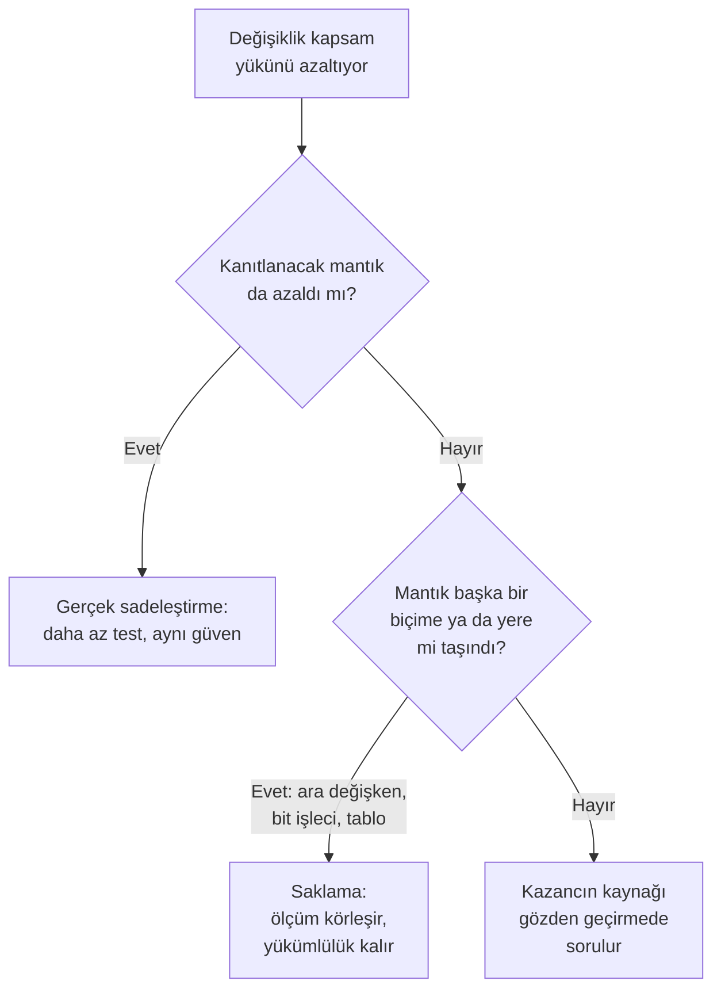

import AracKarti from '@site/src/components/AracKarti';
import {kodla, mcdcIfadesi} from '@site/src/components/McdcAraci/paylasim';

Seviye A bir projede yapısal kapsam analizinden (structural coverage analysis, SCA) kaçış yoktur: değiştirilmiş koşul/karar kapsama (modified condition/decision coverage, MC/DC) her kararın bütün sonuçlarını aldığını ve her koşulun sonucu tek başına değiştirdiğini ister. Ama bunun kaç teste, kaç kapsam boşluğu gerekçesine ve SOI-3'te kaç soruya mal olacağını çoğu zaman test ekibi değil, kodu yazan kişi belirler. Bu yazıda dal ve koşul sayısını baştan küçük tutan kod yazım stillerini; NASA'nın MC/DC rehberinin "yükü azaltmak" ile "mantığı ölçümden saklamak" arasına çektiği çizgiyle birlikte ele alıyoruz.

{/* truncate */}

## Önce çizgiyi çekelim: azaltmak mı, saklamak mı?

Kapsam raporunu daha az emekle tamamlamanın iki yolu vardır ve dışarıdan bakınca birbirlerine çok benzerler.

Birincisi **mantığı gerçekten sadeleştirmektir.** Gereksinim üç koşul istiyorsa kodda beş koşul bulunmaz, aynı soru iki kez sorulmaz, bir değer eşlemesi on iki dallı bir `if` zinciriyle yazılmaz. Test sayısı azalır ama testlerin kanıtladığı şey azalmaz, çünkü kanıtlanacak mantık zaten azalmıştır.

İkincisi **mantığı ölçüm aracının görmediği yere taşımaktır.** Boole değerleri bit işleçleriyle birleştirmek, bir kararı ara değişkenlere bölüp parçaları ayrı ayrı saydırmak ya da bir doğruluk tablosunu (truth table) sabit bir diziye gömmek böyledir. Rapor kısalır, ama doğrulama yükümlülüğü yerinde durur; üstelik araç artık neyin eksik kaldığını söylemez. NASA'nın rehberi de sertifikasyon otoriteleri de bu yolu adıyla anar ve reddeder.

Bu yazının konusu birinci yol. İkincisini ayrı bir başlıkta anlatıyoruz, çünkü bir kod gözden geçirmesinde (review) ikisini ayırt edebilmek en az birincisini uygulamak kadar önemlidir. Pratik bir sınama sorusu şudur: *bu değişiklikten sonra gereksinimi doğrulamak için düşünülmesi gereken mantık azaldı mı, yoksa yalnızca aracın saydığı şey mi?*



## MC/DC'nin faturası nereden gelir?

DO-178C'de karar (decision), koşullardan ve Boole işleçlerinden kurulan herhangi bir Boole ifadesidir; koşul (condition) ise içinde Boole işleci bulunmayan en küçük parçadır. Karar yalnızca bir dallanma noktası, yani dal (branch) üreten bir `if` değildir; bir atamadaki `a && b` de karardır. n koşullu bir kararda MC/DC için en az n+1 test gerekir; bütün kombinasyonları denemek ise 2ⁿ test ister. MC/DC'nin ne olduğunu ve bağımsızlık çifti (independence pair) kavramını [Yapısal kapsam analizi](2024-03-11-yapisal-kapsam-analizi.mdx) yazısında ve kitabın [Yazılım Doğrulama](/kitap/do178c-ile-gelistirme/yazilim-dogrulama#yapısal-kapsam-analizi) bölümünde bulabilirsiniz; burada maliyete odaklanalım.

Bu yazının ana kaynağı, NASA Langley Araştırma Merkezi'nin 2001'de FAA, Boeing ve Rockwell Collins'ten yazarlarla birlikte yayımladığı *A Practical Tutorial on Modified Condition/Decision Coverage* rehberidir \[1\]. NASA konuyu yalnızca havacılık için değil kendi projeleri için de ciddiye alır: NPR 7150.2D, emniyet-kritik olarak belirlenen yazılım bileşenlerinde %100 MC/DC ister (SWE-219) \[6\].

Rehber, Chilenski'nin beş Seviye A hat değiştirilebilir biriminin (line replaceable unit, LRU) kodundan derlediği bir sayımı aktarır \[3\]: Boole ifadelerinin büyük çoğunluğu tek koşulludur (16.491 ifade), iki koşullular 2.262'dir, ama 36 ile 76 arasında koşul taşıyan ifadeler bile vardır. Yani fatura eşit dağılmaz, birkaç yerde toplanır:

| Maliyet kaynağı | Neden pahalı? | Kodda nasıl görünür? |
|---|---|---|
| Çok koşullu karar | Her koşul için ayrı bir bağımsızlık çifti bulunmalı | Uzun mantıksal işleç zincirleri |
| Derindeki karar | İçteki karara ulaşmak için dıştaki bütün kararların doğru kurulması gerekir (kontrol edilebilirlik, controllability) | Dört-beş seviye iç içe `if` |
| Sonucu görünmeyen karar | Kararın sonucu testin gözlediği bir çıkışa ulaşmıyorsa doğru çalıştığı gösterilemez (gözlenebilirlik, observability) | Sonradan maskelenen ara değerler |
| Ulaşılamayan dal | Gereksinim tabanlı testle hiç işletilemez; her biri analiz ve gerekçe ister | Çağıranın zaten sağladığı koşulu yeniden soran savunmacı kod |
| Bağlı koşul | Aynı koşul iki kez geçince biri değiştirilirken öteki sabit tutulamaz (coupled condition) | Bir değişkenin aynı kararda iki yerde geçmesi |

Rehberin "MC/DC uyarıları" bölümü de aynı yere işaret eder: planlama hataları arasında karmaşık tasarımların ve birbirine sıkı bağlı koşulların MC/DC'ye etkisini hafife almayı, MC/DC'yi yanlış anlamanın örnekleri arasında ise onun kodlama standardı ve derleyici seçenekleri üzerindeki etkisini görmemeyi sayar (§4.2.1, §4.2.2). MC/DC bir test sorunu gibi görünür, ama faturası tasarım ve kodlama standardı yazılırken kesilir.

## Yükü gerçekten azaltan stiller

### 1. Kararı gereksinimin biçiminde yazın

NASA rehberi, aynı gereksinimin işlevsel olarak eşdeğer ama yapısal olarak farklı kodlarla yazılabileceğini bir trafik lambası örneğiyle anlatır (§2.2.1). C'ye uyarlayalım:

```c
/* Gereksinim: Kırmızı lamba yanıyorsa dur uyarısı verilir. */
dur_uyarisi = kirmizi_lamba;                  /* 1 koşul: 2 test */

/* Aynı davranış, "öteki ikisi sönükse kırmızı yanıyordur" varsayımıyla */
dur_uyarisi = !yesil_lamba && !sari_lamba;    /* 2 koşul: 3 test */
```

İkinci satır yalnızca bir test fazlası değildir; gereksinimde bulunmayan bir varsayım taşır: her an tam olarak bir lambanın yandığını. Üç lamba birden söndüğünde (bir ampul arızası) ikinci biçim dur uyarısı verir, birincisi vermez; iki kod artık aynı davranmaz. Gereksinimden türetilen testler `kirmizi_lamba` girdisiyle ilgilenir, `yesil_lamba` ve `sari_lamba`'nın bağımsız etkisini göstermek için ayrıca test aramak gerekir. Kapsam raporundaki o boşluk aslında bir tasarım tutarsızlığıdır: yazılmamış bir türetilmiş gereksinim (derived requirement).

Kural basittir: kod gereksinimle aynı soruyu aynı değişkenlerle sorsun. O zaman gereksinim tabanlı testler kapsamı kendiliğinden getirir ve MC/DC'ye bunu teyit etmek kalır. NASA rehberinin bütün yaklaşımı da buna dayanır: kapsam analizi testlerin yeterliliğini denetler, test üretmez.

### 2. Aynı şeyi iki kez sormayın

MC/DC'nin en değerli yan ürünü gereksiz koşulu yakalamasıdır: sonucu tek başına hiçbir zaman değiştiremeyen bir koşul için bağımsızlık çifti kurulamaz.

```c
if (irtifa_gecerli && (irtifa_ft < 500) && (irtifa_ft < 1000)) {
    alcak_irtifa_uyarisi_ver();
}
```

`irtifa_ft < 1000` koşulunun etkisini göstermek için öteki iki koşul doğruyken onun yanlış olduğu bir test gerekir; ama irtifa 500 ft'in altındaysa 1000 ft'in de altındadır. Böyle bir girdi yoktur ve rapordaki boşluk hiçbir testle kapanmaz. Çözüm kapsam testi aramak değil, koşulu silmektir; 1000 ft başka bir gereksinimin eşiğiyse o koşul başka bir kararın parçasıdır. Bu tür anlamsal bağları (iki karşılaştırmanın aynı değişkene bakması) kapsam araçları koşulları bağımsız saydığı için önceden göremez; gözden geçirmede ya da statik analizle bulunurlar.

Aynı koşulun bir kararda iki kez geçmesi de benzer bir sadeleştirme fırsatıdır:

```c
/* Önce: otopilot_bagli iki kez geçer, iki geçiş birbirine bağlıdır */
tut = (otopilot_bagli && irtifa_tut) || (otopilot_bagli && hiz_tut);

/* Sonra: çarpanına ayrılmış, her koşul bir kez */
tut = otopilot_bagli && (irtifa_tut || hiz_tut);
```

Dürüst olalım: maskeleme MC/DC (masking MC/DC) ölçütüyle iki biçim de dört test ister, sayı değişmez. Kazanç başka yerdedir. İlk biçimde `otopilot_bagli`'nın iki geçişi birbirinden bağımsız değiştirilemediği için benzersiz neden MC/DC (unique-cause MC/DC) bu koşulda hiç gösterilemez. İkinci biçimde her koşul tek bir yerde durur, hangi testin neyi kanıtladığı bir bakışta görülür ve aracın hangi MC/DC biçimini desteklediği önemini yitirir. NASA rehberi tam da bu kalıbı, `(A and B) or (A and C)` ifadesini, MC/DC tanımının yarattığı karışıklığın örneği olarak verir (§2.6).

<AracKarti
  yol="/araclar/dogrulama/mcdc-test-seti"
  ek={mcdcIfadesi('(otopilot_bagli && irtifa_tut) || (otopilot_bagli && hiz_tut)', 'maskeleme')}>
  Bağlı koşullu ilk biçimle, maskeleme ölçütünde açılır. Ölçütü benzersiz nedene çevirince iki
  geçişin neden gösterilemediğini görürsünüz; çarpanına ayrılmış biçimi yazıp karşılaştırabilirsiniz.
</AracKarti>

### 3. Birbirini dışlayan bayraklar yerine tek bir durum

```c
if (yerde && !havada) {
    ters_itki_izni_ver();
}
```

`yerde` ile `havada` aynı gerçeğin iki yüzüyse, MC/DC'nin istediği bağımsızlık çiftleri fiziksel olarak imkânsız girdiler ister. `havada`'nın etkisini görmek için `yerde` doğruyken `havada`'yı iki değere de getirmek gerekir, yani hem yerde hem havada olan bir uçak; `yerde`'nin etkisi için de ne yerde ne havada olan bir uçak. Bu kararın iki koşulu da gereksinim tabanlı testlerle kapsanamaz.

İki bayrak gerçekten ayrı kaynaklardan geliyorsa (tekerleklerde ağırlık, weight-on-wheels, anahtarı ve hava verisi bilgisayarı gibi) bu kez çelişki gerçek bir arıza durumudur ve ne yapılacağını gereksinim söylemelidir. İki durumda da çözüm aynıdır: çelişkiyi tek bir yerde çözmek ve sonucu tek bir durum değişkeniyle taşımak.

```c
typedef enum { EVRE_YER, EVRE_HAVA, EVRE_BELIRSIZ } ucus_evresi_t;

/* Çelişki burada, bir kez çözülür; her dal bir gereksinim durumudur. */
ucus_evresi_t evre_belirle(bool tekerlek_yuku, bool hava_verisi_ucusta)
{
    ucus_evresi_t evre = EVRE_BELIRSIZ;

    if (tekerlek_yuku && !hava_verisi_ucusta) {
        evre = EVRE_YER;
    } else if (!tekerlek_yuku && hava_verisi_ucusta) {
        evre = EVRE_HAVA;
    } else {
        /* İki kaynak çelişiyor: evre belirsiz kalır */
    }
    return evre;
}

/* Evreyi kullanan her yerde tek koşul, iki test */
if (evre == EVRE_YER) {
    ters_itki_izni_ver();
}
```

`evre_belirle`'deki koşulların her kombinasyonu artık gerçek bir durumdur ve gereksinimde karşılığı vardır; dört test iki kararın MC/DC'sini birlikte sağlar ve çelişki durumları da bu testlerin içindedir. Evreyi kullanan onlarca karar ise tek koşullu kalır. Fikir genelleşir: birbirini dışlayan durumlar Boole bayraklarıyla değil, bir `enum` ve gerekirse bir durum makinesiyle (state machine) tutulur.

### 4. Savunmacı denetimi sınırda bir kez yapın

Savunmacı programlama (defensive programming) emniyet-kritik kodun vazgeçilmezidir; ama her fonksiyonun başında çağıranın zaten garanti ettiği koşulları yeniden sormak, her seferinde bir ulaşılamayan dal üretir:

```c
static int16_t tork_komutu(const motor_durumu_t *m)
{
    if (m == NULL) {                      /* hiçbir çağıran NULL vermez */
        return 0;
    }
    if (m->devir_rpm > DEVIR_UST_RPM) {   /* giriş katmanı zaten sınırladı */
        return 0;
    }
    /* … asıl hesap … */
}
```

İki `if`'in doğru dalı gereksinim tabanlı testlerle hiç işletilemez. Her biri ya bir sahte çağıranla yazılmış gürbüzlük (robustness) testi ya da kapsam analizinde bir gerekçe ister; yüzlerce fonksiyonda bu, yüzlerce gerekçe demektir (bkz. [Kapsanmayan Kodlar](/kitap/ozel-konular/kapsanmayan-kodlar)).

Daha iyi düzen, dış dünyadan gelen veriyi (veri yolu kelimeleri, kalıcı bellek, ayrık girişler) **sınırda bir kez** doğrulamak ve doğrulanmış veriyi tipiyle taşımaktır:

- Giriş katmanı aralık, geçerlilik ve tutarlılık denetimini yapar; sonucu bir geçerlilik alanıyla ya da yalnızca geçerli değerleri alabilen bir tiple (`enum`, aralığı sınırlı bir değer) iletir. Bu katmanın her dalı bir gereksinim durumudur ve geçersiz girdili testlerle ya da hata enjeksiyonuyla (fault injection) işletilir.
- İçerideki fonksiyonlar küçük yapıları değerle alır; işaretçi yoksa `NULL` denetimi de yoktur.
- Hangi verinin nerede doğrulandığı yazılım tasarımında yazılıdır; gözden geçirme, içerideki bir fonksiyonun doğrulanmamış veriye dokunup dokunmadığına bakar.

Bu, emniyet için konmuş bir denetimi kaldırmanın gerekçesi değildir. Bellek bozulmasına ya da tek olay bozulmasına (single event upset) karşı konmuş bir denetim bir emniyet kararıdır; tasarımda kayıtlı olur ve ulaşılamayan dalı hata enjeksiyonuyla işletilir. `switch`'in `default` dalı da (MISRA C:2012 Kural 16.4) yerinde kalır ve tanım dışı bir değeri deneyen gürbüzlük testiyle işletilir. NASA'nın Jet İtki Laboratuvarı'ndan Gerard Holzmann'ın "Power of Ten" kuralları fonksiyon başına ortalama en az iki doğrulama ifadesi (assertion) önerir \[7\]; DO-178C projesinde bunların her biri hiç alınmayan bir daldır ve tetiklendiğinde ne olacağı (hangi güvenli duruma geçileceği) gereksinimde yazılmadıkça kapsamda boşluk olarak kalır.

### 5. Değer eşlemesini tabloya taşıyın, mantığı değil

Gereksinim zaten bir tabloysa ("uçuş kipine göre veri yolu kodu"), onu bir `switch` ya da `else if` zinciriyle yazmak her satır için ayrı bir karar sonucu üretir. Sabit bir dizi ve tek bir sınır denetimi aynı işi tek kararla görür:

```c
typedef enum { KIP_YER, KIP_KALKIS, KIP_SEYIR, KIP_INIS, KIP_SAYISI } ucus_kipi_t;

static const uint8_t KIP_KODU[KIP_SAYISI] = {
    [KIP_YER] = 0x10u, [KIP_KALKIS] = 0x21u, [KIP_SEYIR] = 0x32u, [KIP_INIS] = 0x43u,
};

uint8_t kip_kodu(ucus_kipi_t kip)
{
    /* İşaretsiz karşılaştırma: bozuk, negatif bir değer de geçersiz sayılır */
    return ((uint32_t)kip < (uint32_t)KIP_SAYISI) ? KIP_KODU[kip] : KIP_KODU_GECERSIZ;
}
```

Kitapta aynı eşlemenin `switch` biçimini ve derleyicinin onu kendiliğinden bir atlama tablosuna nasıl çevirdiğini görmüştük ([Kaynak koda izlenemeyen nesne kodu](/kitap/do178c-ile-gelistirme/yazilim-dogrulama#kaynak-koda-izlenemeyen-nesne-kodu)); tablo biçimi, kaynak kodu derleyicinin üreteceği nesne koduna da yaklaştırır.

Bedeli de bilinmelidir: yapısal kapsam artık "tablonun üçüncü satırı hiç okunmadı" demez. Bu güvence gereksinim kapsam analizine geçer: her satır bir gereksinime izlenir, gereksinim tabanlı testlerle tek tek okunur ve tablonun içeriği gözden geçirilir. Tablo, gereksinimin kendisi tabloyken meşrudur; bir Boole fonksiyonunu tabloya gömmek ise aşağıda anlatılan saklama kalıbıdır.

### 6. Kararları sığ, fonksiyonları tek işli tutun

Beş seviye iç içe bir `if`'in en içteki kararını test etmek için dıştaki dört kararın hepsini doğru kurmak gerekir; her test, ilgilenmediği dört koşulun hazırlığını da taşır. Aynı mantık, her biri kendi düşük seviyeli gereksinimine ve kendi testine sahip küçük fonksiyonlara bölündüğünde içteki karar doğrudan girdileriyle sınanır.

Çoğu kodlama standardı bunu sayıyla sabitler; [kodlama standardı şablonu](/kitap/ekler/sablonlar/kodlama-standardi) örneğin çevrimsel karmaşıklık (cyclomatic complexity) için 10, iç içe derinlik için 4, bir karardaki koşul sayısı için 6 sınırını önerir. Kapsam aracının da sınırları vardır: NASA rehberi, bazı araçların koşul sayısına göre ölçüm yöntemini değiştirdiğini ve bir sınırın ötesindeki ifadeleri kısmen ölçebildiğini ya da hiç ölçmeyebildiğini hatırlatır (§4.1.2.3).

Tek çıkış noktası da (MISRA C:2012 Kural 15.5) bir kapsam meselesidir: MC/DC ve karar kapsama programdaki her giriş ve çıkış noktasının işletilmesini de ister ve erken dönen her `return` ayrı bir çıkış noktasıdır.

Bölmenin bir sınırı var. Fonksiyon bölmek, parçaların kendi gereksinimi varsa ve çıktıları testlerde gözleniyorsa tasarımdır. Tek bir Boole ifadesini yalnızca araç parçaları ayrı saysın diye ara değişkenlere bölmek ise bir sonraki başlığın konusudur.

### 7. Kısa devreyi bilinçli kullanın, sağ tarafa yan etki koymayın

C'nin `&&` ve `||` işleçleri kısa devre değerlendirmesi (short-circuit evaluation) yapar: sonuç belli olunca sağdaki işlenenler hesaplanmaz. NASA rehberi bunun test tasarımına etkisini gösterir (§3.6): dört girdili bir VE kararında ilk yanlış koşuldan sonrakiler "fark etmez" değerleridir. Test sayısı yine n+1'dir, ama her testte kurulması gereken girdi azalır. Kısa devre biçimleri, kapsam nesne kodunda ölçülüyorsa kaynak ile nesne kodu arasındaki denkliği göstermeyi de kolaylaştırır (§2.5.1). Rehber bir uyarı da ekler: bu kolaylık derleyicinin eniyileme açıkken de doğru çalışmasına dayanır.

Bedeli olan şey sağ işlenendeki yan etkidir:

```c
/* Kaçının: kayit_yaz() yalnızca hata_var doğruyken çalışır; kodda görünmeyen bir dal */
if (hata_var && kayit_yaz(hata_kodu)) {
    hata_sayaci++;
}

/* Tercih edin: çağrının koşulu açık bir karar */
if (hata_var) {
    if (kayit_yaz(hata_kodu)) {
        hata_sayaci++;
    }
}
```

Test sayısı aynıdır; fark, bir yan etkinin koşula bağlı olduğunun kodda görünmesidir. MISRA C:2012 Kural 13.5 ilk biçimi zaten yasaklar.

### 8. Derleme zamanında bilinen soruyu çalışma zamanında sormayın

```c
#define ASKERI_KONFIGURASYON (0)

if (ASKERI_KONFIGURASYON) {
    hedef_isaretle();
}
```

Sabit bir kontrol ifadesi sonuçlarından birini hiçbir zaman almaz (MISRA C:2012 Kural 14.3). CAST-10'un aktardığı kapsam ölçütleri bağımsız etkiyi yalnızca sabit olmayan koşullar için ister \[2\], ama hiç çalışmayan dal yine kodda durur ve ölü kod ya da devre dışı bırakılmış kod (deactivated code) olarak ele alınmak zorundadır. Konfigürasyona bağlı davranış ya derleme zamanında seçilir ve her konfigürasyonun imajı ayrı doğrulanır, ya da seçenekle seçilebilir yazılım (option-selectable software) olarak çalışma zamanında seçilir ve her iki değeriyle de test edilir. Ayrıntılar [SCA'da cover edilemeyen kodlar](2023-11-11-sca-cover-edilemeyen-kodlar.mdx) yazısındadır.

## Saklamak azaltmak değildir

Şimdi madalyonun öbür yüzü. Aşağıdaki kalıplar raporu kısaltır ama kanıtlanacak mantığı azaltmaz. NASA rehberi ve ABD, Avrupa ve Kanada otoritelerinin yazılım uzmanlarının üzerinde uzlaştığı CAST-10 yazısı \[2\] bunları açıkça ele alır.

### Kararı ara değişkenlere bölmek

NASA rehberinin en öğretici örneklerinden biri şudur (§2.6). Aynı mantık bir ya da iki ifadeyle yazılabilir:

```c
/* Tek karar */
e = (b || c) && d;

/* Aynı mantık, iki karar */
a = b || c;
e = a && d;
```

Aşağıdaki üç test, iki küçük kararın her biri için MC/DC sağlar:

| Test | `b` | `c` | `d` | `a` | `e` |
|---|---|---|---|---|---|
| 1 | doğru | yanlış | doğru | doğru | doğru |
| 2 | yanlış | doğru | yanlış | doğru | yanlış |
| 3 | yanlış | yanlış | doğru | yanlış | yanlış |

İlk atamada 1–3 çifti `b`'nin, 2–3 çifti `c`'nin etkisini gösterir; ikinci atamada 1–3 çifti `a`'nın, 1–2 çifti `d`'nin. İki parça da tamamdır. Oysa aynı üç test tek kararlı biçim için MC/DC sağlamaz: `c`'nin `e` üzerindeki etkisini gösteren bir çift yoktur. `c`'nin doğru olduğu tek test (2) `d`'nin yanlış olduğu testtir ve orada `e`, `c` ne olursa olsun yanlıştır. Tek kararlı biçim dört test ister ve eksik olan dördüncü test tam da `c`'yi `d` doğruyken sınayan testtir. `c` yanlış sensöre bağlanmış olsaydı ve test yalnızca `e`'ye baksaydı, üç testlik set bunu fark etmeyecekti.

<AracKarti
  yol="/araclar/dogrulama/mcdc-test-seti"
  ek={'d=' + kodla('(b || c) && d', 'maskeleme', [5, 2, 1])}>
  Tek kararlı biçimle ve yukarıdaki üç testle açılır: c koşulunun bağımsızlık çiftinin eksik
  olduğunu ve seti tamamlayacak testi gösterir.
</AracKarti>

CAST-10, Haziran 2002 tarihli bu yazıda otoritelerin "karar" sözcüğünü nasıl okuduğunu anlatır ve konuyu tam bu örnek üzerinden tartışır: karar yalnızca `if`, `while` ya da `switch` gibi dallanma noktaları değil; atamalardaki, parametrelerdeki ve indislerdeki her Boole ifadesidir. Gerekçesi açıktır: karar yalnızca dallanma noktası sayılsaydı, mantık geçici değişkenlere yazılarak MC/DC ile karar kapsama arasındaki fark tamamen ortadan kaldırılabilirdi. Otoriteler bu yüzden standardın tanımının harfiyen okunmasını önerir; mantık programa ve modüllere nasıl dağıtılmış olursa olsun MC/DC'nin onu yakalaması gerektiğini, bütün Boole işlemlerini atama ve bildirim satırlarına taşımanın ise kabul edilemeyeceğini söyler. (CAST yazıları resmî politika değil bilgi amaçlıydı; FAA artık bunları kendi sitesinde yayımlamıyor.)

Yani ara değişkenler MC/DC'den kurtarmaz; her atama kendi başına bir karardır. Ama NASA örneğinin gösterdiği gibi parçaların ayrı ayrı MC/DC'si bütünün MC/DC'sine eşit değildir: test seti küçülür ve koşulların çıkış üzerindeki etkisi artık gösterilmez. Minnesota Üniversitesi'nden Heimdahl, Whalen ve Rajan bunu beş endüstriyel uçuş yönlendirme ve gösterge yönetimi sistemi üzerinde ölçtü: ifadeleri satır içine alınmış (inlined) biçim için üretilen MC/DC test setleri, aynı sistemin ara değişkenli biçimi için üretilenlerden istatistiksel olarak anlamlı biçimde daha çok hata buldu \[4\]. Aynı ekibin sonraki, daha kapsamlı çalışması da MC/DC'nin etkinliğinin uygulamanın yapısına ne kadar duyarlı olduğunu gösterdi \[5\].

Okunabilirlik için adlandırılmış ara değerler kullanmak yine de meşrudur; o zaman iki şeye dikkat edilir:

- **Ara değer gözlenir.** NASA rehberi, birden çok satıra yayılan mantıkta ara sonuçlar test beklentilerinde yoksa etkilerinin çıkışta görünür olduğundan emin olunmasını ister (§3.4). Yukarıdaki örnekte test 2 `a`'nın doğru olduğunu da denetleseydi, yanlış bağlanmış `c` yakalanırdı.
- **Bölme gereksinimi izler.** Ara değişken gereksinimde adı olan bir kavramsa (ör. "alçak irtifa durumu") bölme tasarımdır; yalnızca koşul sayısını düşürmek için konmuşsa gözden geçirmede öyle görünür. Ara değişkenlere yayılan mantığın MC/DC'sinin nasıl değerlendirileceği yazılım doğrulama planında (SVP) yazılı olmalıdır.

### Boole değerlerinde bit işleçleri ve dalsız aritmetik

```c
uyari = basinc_dusuk & motor_calisiyor;          /* iki bool, bit düzeyinde VE */
hiz   = secili * hiz_a + (1 - secili) * hiz_b;   /* seçim mantığı çarpmanın içinde */
```

Birçok kapsam aracı `&` işlecini aritmetik sayar ve ilk satırda karar görmez; derleyici de çoğu zaman dal üretmez. NASA rehberi bu savunmayı adıyla ele alır (§3.7.2): bit işlemlerinin yalnızca aritmetik olduğu ve MC/DC gerektirmediği kabul edilirse, bunun mantıksal sonucu bütün Boole değerlerinin bit olarak yazılmasını zorunlu kılan bir kodlama standardı olur. Bu, MC/DC hedefini fiilen ortadan kaldırır ve rehbere göre hedefin niyetine aykırıdır. Rehberin benimsediği yorum, bir kelimedeki her bitin, bir koşulu temsil ediyorsa, ayrı bir koşul sayılmasıdır (§3.7). MISRA C:2012 Kural 10.1 de Boole türündeki işlenenlerin bit ve aritmetik işleçlerde kullanılmasına izin vermez. İkinci satırdaki gibi dalsız aritmetik hileleri için de hüküm aynıdır: seçim mantığı çarpmanın içine saklanmıştır, yok olmamıştır.

Bit işlemlerinin meşru olduğu yer donanım arayüzüdür: durum kelimeleri, maskeler, paketlenmiş veri. Orada rehberin pratik bir önerisi vardır (§3.7.1): `(durum & 0x3u) != 0u` gibi bir ifadede her bit tek tek değiştirilerek n+1 test yapılır ve ilgilenilmeyen bitler 1'e kurulur. Böylece maskenin yanlışlıkla fazladan bit yakalaması da görünür olur.

### Mantığı doğruluk tablosuna ya da veri bileşenine gömmek

```c
/* Üç kanaldan en az ikisi geçerliyse: her kombinasyon için önceden hesaplanmış sonuç */
static const bool IKI_UCTEN[8] = { false, false, false, true, false, true, true, true };

oylama_gecerli = IKI_UCTEN[((uint32_t)kanal_a << 2) | ((uint32_t)kanal_b << 1) | (uint32_t)kanal_c];
```

Kodda karar yoktur; araç bu satırı tek bir dizi okuması olarak görür ve hiçbir eksik bildirmez. CAST-10 bu tehlikeyi de anar: Boole işlemlerinin tamamı bildirimlere ya da işlevsel sayılmayan bir veri bileşenine taşınırsa kod kapsam ölçütlerinden muafmış gibi görünebilir; yazıya göre bu, doğrulamayı ciddi biçimde zayıflatır ve kabul edilemez. Tablo kullanılacaksa, gereksinimin kendisi bir karar tablosu (decision table) olmalı ve tablonun her satırı test edilmelidir. Bu da MC/DC'den az değil, çoklu koşul kapsama (multiple condition coverage) kadar test demektir; kısayol olarak başlayan şey en pahalı yola dönüşür.

Otoriteler, karar kapsama yerine dal kapsamanın alternatif yöntem olarak önerildiği durumlarda bile, programcının Boole ifadelerini kapsam yükünü azaltmak için bilerek kontrol yapılarının dışına taşımadığının standartlar ve gözden geçirmelerle gösterilmesini ister (CAST-10, §5). Bu kalıplar SOI-3'te aranır; kodlama standardından beklenen, onları teşvik etmesi değil yasaklamasıdır.

## Bir örnek: aynı gereksinim, iki kod

**Gereksinim (örnek):** Alçak irtifa uyarısı, test düğmesine basılıyken ya da uçak havadayken ve geçerli radyo irtifası 500 ft'in altındayken etkin olur.

Projelerde sık görülen bir ilk yazım:

```c
bool alcak_irtifa_uyarisi(const girdi_t *g)
{
    bool uyari = false;

    if (g != NULL) {                                         /* K1 */
        if (g->test_dugmesi) {                               /* K2 */
            uyari = true;
        } else if (g->havada && !g->yerde) {                 /* K3 */
            if (g->irtifa_gecerli && (g->irtifa_ft < 500) &&
                (g->irtifa_ft < 1000)) {                     /* K4 */
                uyari = true;
            }
        } else {
            /* uyarı yok */
        }
    }
    return uyari;
}
```

| Karar | Koşul | Sorun |
|---|---|---|
| K1 | 1 | Hiçbir çağıran `NULL` vermez; yanlış sonucu testle işletilemez |
| K2 | 1 | Yok |
| K3 | 2 | `havada` ile `yerde` birbirini dışlar; iki koşulun bağımsızlık çifti de imkânsız girdi ister |
| K4 | 3 | `irtifa_ft < 1000` sonucu tek başına hiçbir zaman değiştiremez |

Dört karar, yedi koşul ve testle hiçbir zaman kapanmayacak dört kapsam boşluğu: K1'in yanlış sonucu, K3'ün iki koşulu ve K4'ün son koşulu. Testler doğru olsa bile bu boşlukların her biri için analiz, gerekçe ve büyük olasılıkla bir problem raporu yazılacaktır.

Gereksinimi doğrudan izleyen yazım:

```c
/* evre ve irtifa giriş katmanında bir kez doğrulanır (bkz. evre_belirle) */
bool alcak_irtifa_uyarisi(ucus_evresi_t evre, irtifa_t irtifa, bool test_dugmesi)
{
    return test_dugmesi ||
           ((evre == EVRE_HAVA) && irtifa.gecerli && (irtifa.ft < ALCAK_IRTIFA_ESIGI_FT));
}
```

Tek karar, dört koşul ve beş test (eşik 500 ft):

| Test | `test_dugmesi` | `evre == EVRE_HAVA` | `irtifa.gecerli` | `irtifa.ft` | Uyarı | Gösterdiği |
|---|---|---|---|---|---|---|
| 1 | yanlış | doğru | doğru | 499 | doğru | — |
| 2 | yanlış | yanlış | doğru | 499 | yanlış | 1–2: evre |
| 3 | yanlış | doğru | yanlış | 499 | yanlış | 1–3: geçerlilik |
| 4 | yanlış | doğru | doğru | 500 | yanlış | 1–4: eşik |
| 5 | doğru | yanlış | doğru | 499 | doğru | 2–5: test düğmesi |

Bütün girdiler gerçekçidir ve boşluk yoktur. Test 4'ün eşiğin tam üzerinde seçilmesi de tesadüf değildir. NASA rehberi karşılaştırma işleçleri için MC/DC'nin iki testle yetindiğini, ama işlecin ve eşiğin doğru kodlandığını göstermek için eşiğin hemen altında, tam üzerinde ve hemen üstünde üç değer gerektiğini hatırlatır (§3.1.5). 499 ve 500, `<` yerine yanlışlıkla `<=` yazılmasını yakalar; `!=` gibi bir hatayı ancak 501 ft'lik altıncı bir test yakalar. MC/DC'nin saydığı beş test bir alt sınırdır, iyi test setinin kendisi değil.

<AracKarti
  yol="/araclar/dogrulama/mcdc-test-seti"
  ek={mcdcIfadesi('test_dugmesi || ((evre == EVRE_HAVA) && irtifa.gecerli && (irtifa.ft < ALCAK_IRTIFA_ESIGI_FT))')}>
  Sadeleştirilmiş uyarı kararıyla açılır: dört koşulun bağımsızlık çiftlerini ve yukarıdaki beş
  testlik seti gösterir.
</AracKarti>

Yük ortadan kalkmadı, yer değiştirdi: evrenin belirlenmesi ve irtifanın geçerlilik denetimi giriş katmanında duruyor ve oradaki her karar artık gerçek bir gereksinim durumuna karşılık geliyor. Fark şurada: o kararlar bir kez yazılıyor ve bir kez test ediliyor; bu uyarı gibi onlarca fonksiyon ise doğrulanmış veriyle çalışıyor.

## Kodlama standardına ne yazılır?

Bu stillerin kalıcı olması için kişilerin iyi niyetine değil, kodlama standardına (software code standards) bağlanması gerekir. Örnek kurallar:

| Kural | Kazanç | Dayanak |
|---|---|---|
| Karar başına en çok 6 koşul, iç içe derinlik en çok 4, çevrimsel karmaşıklık en çok 10 | Test sayısı ve ulaşılabilirlik sınırlı kalır | NASA §4.2.1; kodlama standardı şablonu |
| Aynı koşul bir kararda iki kez geçmez; gerekiyorsa çarpanına ayrılır | Bağlı koşul kalmaz | NASA §2.6 |
| Birbirini dışlayan durumlar tek bir `enum` ile tutulur | İmkânsız kombinasyon kalmaz | Tasarım standardı |
| Dış veri sınırda bir kez doğrulanır; içerideki fonksiyonlar doğrulanmış tip alır | Ulaşılamayan savunmacı dal azalır | Tasarım standardı |
| Boole işlenenler bit ve aritmetik işleçlere girmez | Kararlar ölçümden kaybolmaz | MISRA C:2012 K 10.1; NASA §3.7.2 |
| Mantıksal işleçlerin sağ işleneninde kalıcı yan etki olmaz | Gizli dal kalmaz | MISRA C:2012 K 13.5 |
| Kontrol ifadesi değişmez olamaz | Hiç alınmayan dal kalmaz | MISRA C:2012 K 14.3 |
| Her fonksiyonun tek çıkışı vardır | Çıkış noktası kapsamı sadeleşir | MISRA C:2012 K 15.5 |
| Boole mantık ara değişkene ya da tabloya yalnızca gereksinimin yapısı öyleyse taşınır; ara değerler testte gözlenir | Saklama önlenir | CAST-10; NASA §3.4 |

Bu kuralların şablon hâli ve gerekçeleri [kodlama standardı](/kitap/ekler/sablonlar/kodlama-standardi) ve [tasarım standardı](/kitap/ekler/sablonlar/tasarim-standardi) şablonlarında, kod gözden geçirmesinde sorulacak maddeler [kaynak kod kontrol listesinde](/kitap/ekler/kontrol-listeleri/kaynak-kod), kapsam boşluklarının nasıl ele alınacağı da [kapsam analizleri kontrol listesinde](/kitap/ekler/kontrol-listeleri/kapsam-analizleri) bulunur.

## Akılda kalanlar

- MC/DC'nin istediği test sayısı bir alt sınırdır, iyi test setinin tarifi değildir. Yükü azaltmak, gereksinimi daha doğrudan ifade eden kod yazmaktır.
- Bağımsız etkisi gösterilemeyen bir koşul ya gereksizdir ya da gereksinimde yazılmamış bir varsayım taşır. İkisi de kodu düzeltme sebebidir, kapsam testi yazma sebebi değil.
- Birbirini dışlayan bayraklar, dağınık savunmacı denetimler ve derin iç içe kararlar faturanın en büyük kalemleridir; çözümleri tasarımdadır.
- Ara değişkene bölmek, bit işleçleri, doğruluk tabloları ve veri bileşenleri mantığı azaltmaz, yalnızca ölçümden saklar. NASA rehberi ve CAST-10 bunu açıkça reddeder ve SOI-3'te aranır.
- NASA rehberinin planlama uyarısının özü şudur: MC/DC'ye hazırlık tasarım ve kodlama standardı yazılırken başlar. O gün verilen kararlar, test aşamasında kaç gün harcanacağını belirler.

## Kaynakça

> \[1\] Kelly J. Hayhurst, Dan S. Veerhusen, John J. Chilenski, Leanna K. Rierson, **A Practical Tutorial on Modified Condition/Decision Coverage**, NASA/TM-2001-210876, NASA Langley Research Center, Mayıs 2001. [https://shemesh.larc.nasa.gov/fm/papers/Hayhurst-2001-tm210876-MCDC.pdf](https://shemesh.larc.nasa.gov/fm/papers/Hayhurst-2001-tm210876-MCDC.pdf)

> \[2\] Certification Authorities Software Team, **CAST-10: What is a "Decision" in Application of Modified Condition/Decision Coverage (MC/DC) and Decision Coverage (DC)?**, Haziran 2002. [https://people.eecs.ku.edu/~saiedian/Teaching/814/Readings/structural-testing-mcdc.pdf](https://people.eecs.ku.edu/~saiedian/Teaching/814/Readings/structural-testing-mcdc.pdf)

> \[3\] John Joseph Chilenski, **An Investigation of Three Forms of the Modified Condition Decision Coverage (MCDC) Criterion**, DOT/FAA/AR-01/18, Nisan 2001. [https://www.faa.gov/sites/faa.gov/files/aircraft/air_cert/design_approvals/air_software/AR-01-18_MCDC.pdf](https://www.faa.gov/sites/faa.gov/files/aircraft/air_cert/design_approvals/air_software/AR-01-18_MCDC.pdf)

> \[4\] Mats P. E. Heimdahl, Michael W. Whalen, Ajitha Rajan, **On MC/DC and Implementation Structure: An Empirical Study**, 27th Digital Avionics Systems Conference (DASC), 2008. [https://doi.org/10.1109/DASC.2008.4702848](https://doi.org/10.1109/DASC.2008.4702848)

> \[5\] Gregory Gay, Ajitha Rajan, Matt Staats, Michael W. Whalen, Mats P. E. Heimdahl, **The Effect of Program and Model Structure on the Effectiveness of MC/DC Test Adequacy Coverage**, ACM Transactions on Software Engineering and Methodology 25(3), 2016. [https://doi.org/10.1145/2934672](https://doi.org/10.1145/2934672)

> \[6\] NASA, **NPR 7150.2D, NASA Software Engineering Requirements**, SWE-219 (madde 3.7.4). [NASA Software Engineering Handbook, SWE-219](https://swehb.nasa.gov/spaces/SWEHBVD/pages/105709626/SWE-219+-+Code+Coverage+for+Safety+Critical+Software)

> \[7\] Gerard J. Holzmann, **The Power of Ten: Rules for Developing Safety-Critical Code**, IEEE Computer 39(6), 2006. [https://doi.org/10.1109/MC.2006.212](https://doi.org/10.1109/MC.2006.212)
