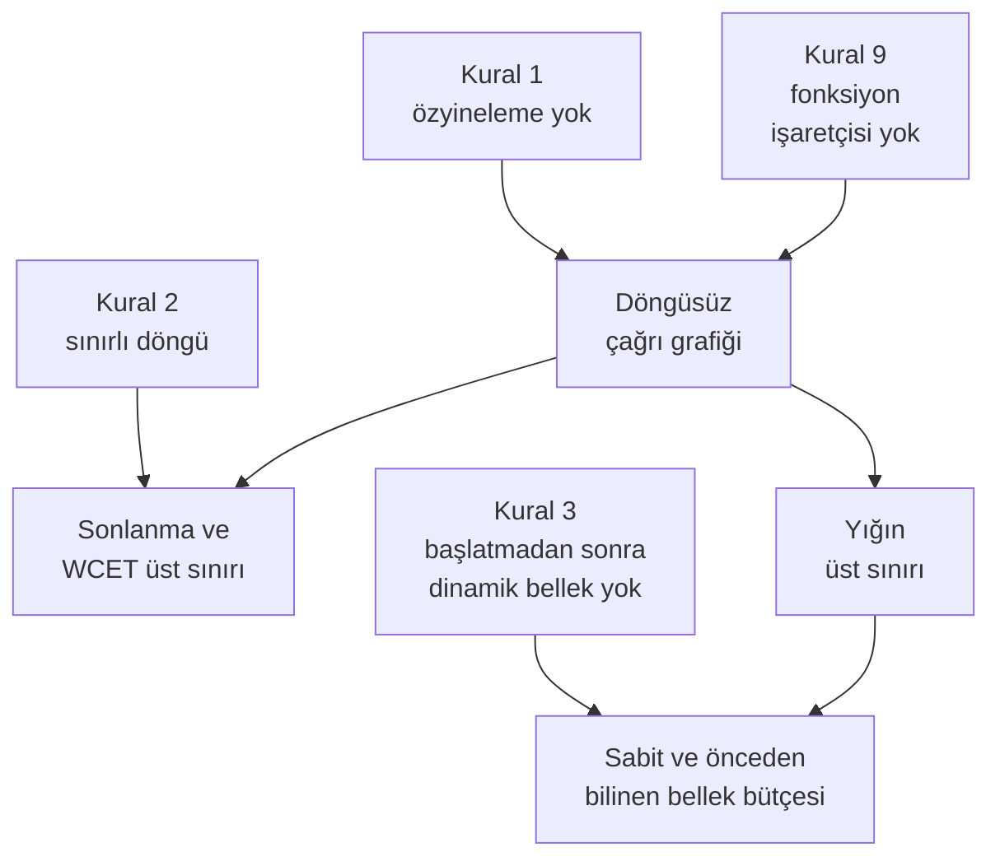

import AracKarti from '@site/src/components/AracKarti';
import {mcdcIfadesi} from '@site/src/components/McdcAraci/paylasim';

Kodlama standartlarının çoğu yüzlerce kuraldan oluşur ve sonunda kimse onları aklında tutamaz: belge rafta durur, kod bildiğini okur. 2006'da NASA'nın Jet İtki Laboratuvarı (Jet Propulsion Laboratory, JPL) bünyesindeki Güvenilir Yazılım Laboratuvarı'ndan Gerard J. Holzmann, IEEE'nin *Computer* dergisinde yayımlanan üç sayfalık bir yazıda tersini önerdi: yalnızca on kural, ama her biri bir araçla denetlenebilen ve kodu analiz edilebilir kılmak için konmuş on kural. Yazının adı "The Power of 10: Rules for Developing Safety-Critical Code"du; bugün kısaca "Power of 10" ya da "NASA'nın on kuralı" diye anılıyor.

Bu yazıda on kuralı tek tek ele alıyor, her birinin kodun hangi özelliğini kanıtlanabilir kıldığını C örnekleriyle gösteriyor ve bir aviyonik projede, DO-178C'nin istediği kodlama standardının (coding standard) neresine oturduğunu tartışıyoruz.

{/* truncate */}

## Neden yalnızca on kural?

Holzmann'ın çıkış noktası bir gözlemdir: kodlama standartları üzerinde pek uzlaşma yoktur, yeni yazılan her standart bir öncekinden uzundur ve çoğu yüzü aşkın kural içerir. Bu kuralların bir kısmı kişisel zevkten (boşluk ve girinti tercihleri), bir kısmı da kurumun geçmişte yaşadığı tek bir hatanın tekrarlanmasını önleme isteğinden doğmuştur. Sonuç tahmin edilebilir: geliştiriciler kuralları bilmez ya da önemsemez. Daha kötüsü, kuralların çoğu araçla denetlenemez; yüz binlerce satırlık bir kodu elle taramak ise gerçekçi değildir.

Önerdiği çözüm dört ölçüte dayanır: kural sayısı küçük olmalı, her kural kolayca anlaşılıp hatırlanmalı, her kural mekanik olarak denetlenebilmeli ve her kuralın gerekçesi kodun bir özelliğini kanıtlamaya hizmet etmelidir. Holzmann kurallarının katı olduğunu, hatta "Drakoncu" bulunabileceğini kendisi de kabul eder; karşılığında yazılımın amaçlandığı gibi çalışacağını çok daha ikna edici biçimde gösterebilmeyi vaat eder.

Kurallar C dilini hedefler. Bunun nedeni pragmatiktir: JPL'de, tıpkı aviyonikte olduğu gibi, kritik kodun büyük kısmı C ile yazılır ve C'nin derleyici, statik analiz ve test aracı ekosistemi olgundur. Dil seçiminin kendisi ayrı bir tartışmadır; kurallar "C ile yazacaksak nasıl yazalım?" sorusuna cevap verir.

:::tip[Kuralların ortak paydası]
On kuralın hiçbiri kodu daha kolay *yazılır* yapmak için konmamıştır. Hepsi kodun bazı özelliklerini daha kolay *kanıtlanır* yapar: her döngünün biteceğini, yığının (stack) taşmayacağını, belleğin tükenmeyeceğini, bir değerin yalnızca belli yerlerden değişebileceğini. Kuralı tartışırken sorulacak soru "bu yasak can sıkıcı mı?" değil, "bu yasak hangi analizi mümkün kılıyor?" olmalıdır.
:::

## On kural bir bakışta

| No | Kural (özet) | Neyi kanıtlanabilir kılar? |
|---|---|---|
| 1 | Kontrol akışı basit tutulur: `goto`, `setjmp`/`longjmp` ve doğrudan ya da dolaylı özyineleme kullanılmaz | Çağrı grafiği döngüsüzdür; yığın kullanımının üst sınırı hesaplanabilir |
| 2 | Her döngünün, bir aracın kanıtlayabileceği sabit bir üst sınırı vardır | Her yürütme sonlanır; yürütme süresi sınırlıdır |
| 3 | Başlatmadan sonra dinamik bellek ayrılmaz | Bellek kullanımı sabittir ve önceden bilinir |
| 4 | Bir fonksiyon tek sayfaya sığar (yaklaşık 60 satır) | Her fonksiyon tek başına anlaşılır ve doğrulanır |
| 5 | Fonksiyon başına ortalama en az iki iddia (assertion) bulunur; başarısız iddia açık bir kurtarma eylemi başlatır | Beklenmeyen durum ortaya çıktığı yerde yakalanır |
| 6 | Veri, olabilecek en dar görünürlük alanında (scope) tanımlanır | Bir değeri bozabilecek satırların sayısı azalır |
| 7 | Dönüş değerleri çağıran tarafından denetlenir, parametreler fonksiyonun içinde doğrulanır | Hata sessizce yutulmaz |
| 8 | Ön işlemci (preprocessor) başlık dosyası eklemek ve basit makrolarla sınırlıdır | Kod okunduğu gibi derlenir; derleme varyantlarının sayısı patlamaz |
| 9 | İşaretçi kullanımı kısıtlıdır: tek düzey dolaylı erişim (dereference), fonksiyon işaretçisi yok | Veri akışı ve çağrı hiyerarşisi araçla izlenebilir |
| 10 | İlk günden en katı uyarı düzeyiyle sıfır uyarı; her gün en az bir statik analiz aracından sıfır bulguyla geçiş | Kurallara uyum sürekli ve mekanik olarak denetlenir |

Kurallar birbirinden bağımsız değildir; birbirine yaslanır. Özyineleme yasağı (1) ile fonksiyon işaretçisi yasağı (9) birlikte, bir aracın çağrı grafiğini (call graph) eksiksiz çıkarmasını sağlar. Döngüsüz bir çağrı grafiği ve sınırlı döngüler (2), en kötü durum yürütme süresine bir üst sınır koymayı mümkün kılar. Öbekten (heap) bellek ayrılmayınca (3) çalışma sırasında bellek ancak yığından alınabilir; yığının üst sınırı da yine döngüsüz çağrı grafiğinden hesaplanır.



## Kural 1: Basit kontrol akışı

`goto`, `setjmp`/`longjmp` ve özyineleme (recursion) yasaktır. İlk ikisi şaşırtıcı değildir: `goto` kontrol akışını okunmaz hâle getirebilir, `longjmp` ise yığın çerçevelerini atlayarak fonksiyonlar arasında sıçrar ve hata işlemeyi görünmez kılar. Asıl sürpriz özyineleme yasağıdır. Gerekçesi şudur: özyineleme yoksa çağrı grafiği döngüsüzdür ve bir analiz aracı, en derin çağrı zincirindeki yığın çerçevelerini toplayarak yığın kullanımının kesin bir üst sınırını verebilir. Özyinelemeli bir fonksiyonda bu sınır girdinin değerine bağlıdır; araç onu ancak ek varsayımlarla bulabilir.

Kural tek çıkış noktası şartı getirmez. Holzmann, erken hata dönüşünün çoğu zaman daha sade çözüm olduğunu açıkça belirtir. Bu, MISRA C'de tavsiye niteliğindeki tek çıkış kuralının projede ayrıca karara bağlanması gerektiğini hatırlatır; iki yaklaşım da savunulabilir, önemli olan standardın hangisini seçtiğini yazmasıdır.

Aviyonik karşılığı doğrudandır: DO-178C doğrulamasının bir parçası olan [yığın kullanımı analizi](/kitap/do178c-ile-gelistirme/yazilim-dogrulama#yığın-kullanımı-analizi), döngüsüz bir çağrı grafiği olmadan ölçüme ve tahmine dayanmak zorunda kalır.

## Kural 2: Her döngünün sabit bir üst sınırı olmalı

Bir döngünün kaç kez döneceğine dair üst sınırı bir aracın statik olarak kanıtlayabilmesi gerekir; kanıtlanamıyorsa kural ihlal edilmiş sayılır. Kuralın neyi önlediğini en iyi anlatan örnek, Holzmann'ın da sitesinde andığı bir olaydır: 31 Aralık 2008'de, yani ilk modelin satışa çıkmasından sonraki ilk artık yılın son gününde, Microsoft'un Zune 30 müzik çalarları aynı gün toplu hâlde donup kaldı. Cihazın güç yönetimi yongası için yazılmış sürücüdeki tarih kodu, gün sayısını yıla çeviren bir döngü içeriyordu. Mantığı aşağıdakine benzer:

```c
/* gun: 1 Ocak 1980'den bu yana geçen gün sayısı (1 = 1 Ocak 1980) */
uint32_t yil = 1980U;

while (gun > 365U)
{
    if (artik_yil_mi(yil))
    {
        if (gun > 366U)
        {
            gun -= 366U;
            yil++;
        }
        /* Artık yılın 366. gününde hiçbir şey değişmez: döngü sonsuza dek döner. */
    }
    else
    {
        gun -= 365U;
        yil++;
    }
}
```

Artık bir yılın 366. gününde `gun` 365'ten büyüktür ama 366'dan büyük değildir; döngü ne `gun`'ü ne `yil`'ı değiştirir. Cihazlar gün boyunca kilitli kaldı; önerilen çözüm pilin bitmesini bekleyip ertesi gün yeniden şarj etmekti.

Sınırlı bir döngü aynı mantık hatasını kendiliğinden düzeltmez, ama hatanın biçimini değiştirir: sonsuz döngü yerine algılanan ve çağırana bildirilen bir hata olur. Üst sınır döngü sayacına bağlıdır, sayaç döngü gövdesinde değiştirilmez ve araç sınırı tek bakışta görür:

```c
#include <stdbool.h>
#include <stddef.h>
#include <stdint.h>

#define BASLANGIC_YILI (1980U)
#define EN_COK_YIL     (200U)   /* döngünün kanıtlanabilir üst sınırı */

static bool artik_yil_mi(uint32_t yil)
{
    return ((yil % 4U) == 0U) && (((yil % 100U) != 0U) || ((yil % 400U) == 0U));
}

/* gun: 1 Ocak 1980'den bu yana geçen gün sayısı (1 = 1 Ocak 1980).
   Dönüş false ise çıktılar yazılmaz; çağıran hatayı işler. */
bool takvim_coz(uint32_t gun, uint32_t *yil_cikti, uint32_t *yilin_gunu)
{
    uint32_t yil = BASLANGIC_YILI;
    uint32_t kalan = gun;
    uint32_t i;
    bool bulundu = false;

    if ((yil_cikti != NULL) && (yilin_gunu != NULL) && (gun > 0U))
    {
        for (i = 0U; (i < EN_COK_YIL) && (!bulundu); i++)
        {
            uint32_t yil_uzunlugu = artik_yil_mi(yil) ? 366U : 365U;

            if (kalan <= yil_uzunlugu)
            {
                bulundu = true;
            }
            else
            {
                kalan -= yil_uzunlugu;
                yil++;
            }
        }

        if (bulundu)
        {
            *yil_cikti = yil;
            *yilin_gunu = kalan;
        }
    }

    return bulundu;
}
```

Kuralın bilinçli bir istisnası vardır: hiç bitmemesi gereken döngüler. Bir döngüsel yürütücünün (cyclic executive) ana çerçeve döngüsü ya da bir görev çizelgeleyicisi (scheduler) böyledir. Holzmann bu durumda kuralın tersinin uygulanmasını önerir: döngünün *sonlanamayacağı* statik olarak kanıtlanabilmelidir. Sınırlı döngülerin aviyonikteki asıl karşılığı ise [en kötü durum yürütme süresi analizidir](/kitap/do178c-ile-gelistirme/yazilim-dogrulama#en-kötü-durum-yürütme-süresi-analizi) (worst-case execution time, WCET): sınırı bilinmeyen bir döngü içeren fonksiyonun WCET'i de bilinemez. Donanım bekleyen döngülere deneme sınırı koymak da aynı kuralın bir uygulamasıdır.

## Kural 3: Başlatmadan sonra dinamik bellek yok

Sistem başlatıldıktan sonra `malloc` ve türevleri kullanılmaz. Gerekçe iki yönlüdür. Birincisi, bellek ayırıcıların süresi ve davranışı öngörülemez: parçalanma (fragmentation) yüzünden aynı istek bir gün karşılanır, ertesi gün karşılanmaz. İkincisi, bellek yönetimi koca bir hata sınıfının kaynağıdır: serbest bırakılmayan bellek, serbest bırakıldıktan sonra kullanılan bellek, ayrılan alanın sınırını aşan yazma, fiziksel olarak bulunmayan miktarda bellek istemek.

Uygulamada bellek ihtiyacı tasarım sırasında belirlenir, tamponlar ve tablolar statik dizi olarak ayrılır ve bağlayıcı haritası (linker map) bellek bütçesini gösterir. Holzmann'ın sitesindeki not, kuralın kolayca denetlenmesi için pratik bir yol önerir: bellek ayırma çağrılarına yalnızca adı `_init` ile biten ve sistem açılışında bir kez çalışan fonksiyonlarda izin vermek.

Kural 1 ile bağlantı burada ortaya çıkar: öbek kullanılmayınca çalışma sırasında bellek ancak yığından alınabilir, özyineleme yoksa yığının üst sınırı da hesaplanabilir. Böylece uygulamanın her koşulda önceden ayrılmış bellek içinde kalacağı kanıtlanabilir. Dinamik bellek kullanmak zorunda kalan projeler için DO-332'nin [dinamik bellek yönetiminin doğrulanması](/kitap/arac-kalifikasyonu-ve-ekler/do332-nesne-yonelimli-teknoloji#dinamik-bellek-yönetiminin-doğrulanması) hakkında söyledikleri, nesne yönelimli olmayan C kodu için de iyi bir kontrol listesidir.

## Kural 4: Bir fonksiyon tek sayfaya sığmalı

Bir fonksiyon, her deyim ve her bildirim ayrı satırda olacak biçimde yazdırıldığında tek sayfayı geçmemelidir; bu, kabaca 60 satır demektir. Gerekçe basittir: her fonksiyon tek başına anlaşılabilen ve doğrulanabilen mantıksal bir birim olmalıdır. Birden çok ekrana yayılan fonksiyonu kafada tutmak zordur ve aşırı uzun fonksiyonlar genellikle kötü yapılandırılmış kodun işaretidir.

Holzmann'ın sitesindeki güncel metin, sayının keyfî kullanılmaması için ölçme yöntemini de tarif eder: kod önce standart bir biçime sokulur (böylece birkaç deyimi tek satıra sıkıştırarak kural aşılamaz), yorumlar ve boş satırlar atılır, sonra fonksiyon adından kapanış süslü parantezine kadar satırlar sayılır. Sınır 50 ile 100 arasında projeye göre seçilebilir.

DO-178C açısından bu kural gözden geçirmenin (review) kalitesini doğrudan etkiler: [Ek F'deki kaynak kod kontrol listesi](/kitap/ekler/kontrol-listeleri/kaynak-kod) gibi bir listeyi tek sayfalık bir fonksiyona uygulamak, üç yüz satırlık bir fonksiyona uygulamaktan çok daha güvenilirdir. Uzunluk sınırı tek başına yetmez; projeler onu genellikle çevrimsel karmaşıklık (cyclomatic complexity) ve iç içe derinlik sınırlarıyla birlikte kullanır (bkz. [kodlama standardı şablonu, kodlama kısıtları](/kitap/ekler/sablonlar/kodlama-standardi#7-kodlama-kısıtları)).

## Kural 5: İddia yoğunluğu

Kodda fonksiyon başına ortalama en az iki iddia (assertion) bulunmalıdır. İddia, gerçek bir çalışmada hiç gerçekleşmemesi gereken anormal bir durumu denetleyen bir Boole testidir: bir ön koşul, bir son koşul, bir parametrenin geçerliliği, bir döngü değişmezi. Kuralın üç ayrıntısı onu sıradan `assert` alışkanlığından ayırır:

- İddia **yan etkisiz** olmalıdır; koşulun değerlendirilmesi programın durumunu değiştirmemelidir.
- İddia başarısız olduğunda **açık bir kurtarma eylemi** yapılır; örneğin fonksiyon çağırana hata döner. Programı durdurmak bir kurtarma eylemi değildir.
- Statik bir aracın asla başarısız olmayacağını (ya da asla tutmayacağını) kanıtlayabildiği iddia kuralı ihlal eder. Yani kodu `assert(true)` ile doldurarak yoğunluk şartı karşılanamaz.

Holzmann'ın makaledeki örneği, dosya adını ve satır numarasını yazdıran bir makrodur; gömülü bir birimde yazdıracak bir yer olmadığından bu çağrı boşa çıkarılır ve iddia saf bir Boole testine dönüşür. Aviyonik bir birimde aynı fikir, hata kodunu tek bir raporlama arayüzüne bildiren küçük bir fonksiyonla uygulanabilir:

```c
#include <stdbool.h>
#include <stddef.h>
#include <stdint.h>

#define LOC_KANAL_SAYISI  (40U)
#define HATA_BOS_ISARETCI ((uint16_t)0x0101U)
#define HATA_KANAL_ARALIK ((uint16_t)0x0102U)

extern const uint32_t LOC_FREKANSLARI_KHZ[LOC_KANAL_SAYISI];

/* Tek raporlama arayüzü: hatayı kaydeder, programı durdurmaz. */
void hata_bildir(uint16_t hata_kodu);

/* İddia: koşul yan etkisiz bir Boole ifadesidir; tutmazsa hata bildirilir. */
static bool iddia(bool kosul, uint16_t hata_kodu)
{
    if (!kosul)
    {
        hata_bildir(hata_kodu);
    }
    return kosul;
}

/* Dönüş false ise *frekans_khz yazılmaz; çağıran son geçerli frekansı korur. */
bool loc_frekansi(uint8_t kanal_no, uint32_t *frekans_khz)
{
    bool gecerli = iddia(frekans_khz != NULL, HATA_BOS_ISARETCI);

    if (gecerli)
    {
        gecerli = iddia(kanal_no < LOC_KANAL_SAYISI, HATA_KANAL_ARALIK);
    }

    if (gecerli)
    {
        *frekans_khz = LOC_FREKANSLARI_KHZ[kanal_no];
    }

    return gecerli;
}
```

İddia burada makro değil fonksiyondur: hem Kural 8'in makrolara getirdiği sınırla hem de MISRA C'nin fonksiyon benzeri makrolar yerine fonksiyon tercih eden yönergesiyle uyumludur. Kurtarma eylemi de bellidir: hata raporlanır, çıktı yazılmaz ve çağıran, gereksinimde tanımlı davranışa (son geçerli frekansı korumak) geçer. Holzmann, kurallarından 5, 6 ve 7'nin sözleşmeli tasarımın (design by contract) faydalarını kısmen taşıdığını da not eder.

Bu kural, aviyonikte en çok tartışma doğuran kuraldır; ayrıntısına aşağıda, [yapısal kapsam ve iddialar](#yapısal-kapsam-ve-iddialar) başlığında dönüyoruz.

## Kural 6: Veri en dar görünürlük alanında

Her veri nesnesi, kullanıldığı en dar görünürlük alanında tanımlanır. Bu, veri gizlemenin (data hiding) en temel biçimidir: görünürlük alanının dışında kalan bir nesneyi kimse okuyamaz ya da bozamaz. Bir değerin yanlış çıktığı durumda da o değeri atayabilecek satır sayısı ne kadar azsa, hatanın kaynağını bulmak o kadar kolaydır. Kural ayrıca bir değişkenin birbiriyle ilgisiz birkaç iş için yeniden kullanılmasını da caydırır.

Pratikteki karşılığı: yalnızca tek bir dosyada kullanılan dosya düzeyindeki veri `static` tanımlanır, başlık dosyasında veri tanımlanmaz, yalnızca bir blokta kullanılan değişken o bloğun başında tanımlanır. DO-178C açısından bu kuralın ödülü, [veri bağlaşımı analizinin](/kitap/do178c-ile-gelistirme/yazilim-dogrulama#veri-bağlaşımı-ve-kontrol-bağlaşımı-analizi) (data coupling) küçülmesidir: bileşenler arasında paylaşılan her global değişken o analize bir satır daha ekler.

## Kural 7: Dönüş değerlerini denetle, parametreleri doğrula

`void` olmayan her fonksiyonun dönüş değeri, onu çağıran her yerde denetlenir; her fonksiyon da aldığı parametrelerin geçerliliğini kendi içinde doğrular. Holzmann bunun en sık çiğnenen kural olduğunu, bu yüzden genel bir kural olarak biraz şüpheli de sayılabileceğini kabul eder. En katı okumasıyla `printf` ve dosya kapatma çağrılarının dönüş değeri bile denetlenmelidir. Hata ile başarı durumunda verilecek tepki aynıysa denetlemenin anlamı yoktur; o zaman dönüş değeri açıkça `(void)`'e dönüştürülür. Böylece değerin unutularak değil, bilerek yok sayıldığı kodda görünür olur.

Kuralın gerekçesi standart C kütüphanesinin kendisidir: `strlen` fonksiyonuna boş işaretçi vermek tanımsız davranıştır ve kütüphane bunu denetlemez. Holzmann'ın sitesindeki not bu yüzden emniyet-kritik standartların çoğunun `string.h`, `stdlib.h`, `stdio.h` gibi başlıkları tümden yasakladığını, gereken fonksiyonların emniyetli sürümlerinin projede yazıldığını ekler. Ayrıca, parametre olarak gelen her işaretçinin kullanılmadan önce boşluk denetiminden, dizi indisi olarak kullanılan her tam sayının da sınır denetiminden geçmesini ister.

Aviyonikte bu kural, hata işlemenin bir gereksinime bağlanmasıyla tamamlanır: dönen hata kodunu denetlemek yetmez, hatanın ardından ne yapılacağı (güvenli değer, geçersizlik işareti, hata raporu) bir gereksinimde yazılı olmalıdır. Kaynak kod gözden geçirmesinde bu, [hata işleme ve savunmacı yapılar](/kitap/ekler/kontrol-listeleri/kaynak-kod#hata-işleme-ve-savunmacı-yapılar) maddeleriyle sorulur.

## Kural 8: Ön işlemciyi sınırla

Ön işlemci yalnızca başlık dosyası eklemek ve basit makrolar tanımlamak için kullanılır. Simge birleştirme (token pasting, `##`), değişken sayıda argüman alan makrolar ve özyinelemeli makro çağrıları yasaktır; her makro tam bir sözdizimi birimine açılmalıdır. Holzmann'a göre C ön işlemcisi, kodun okunurluğunu yok edebilen ve metin tabanlı denetim araçlarını şaşırtan güçlü bir karartma aracıdır.

Kuralın ikinci yarısı koşullu derlemeyle (conditional compilation) ilgilidir ve aviyonik için belki daha önemlidir. Holzmann'ın hesabı basittir: yalnızca on koşullu derleme yönergesi, ilke olarak 2 üzeri 10, yani 1024 farklı kod sürümü üretebilir ve her birinin ayrıca test edilmesi gerekir. Bu yüzden başlık dosyasının iki kez eklenmesini önleyen koruma dışında koşullu derleme ancak gerekçeyle kullanılmalı, her kullanımı bir araç işaretlemeli ve kodda açıklanmalıdır.

DO-178C'de de durum aynıdır: test ve kapsam kanıtı yalnızca derlenip uçağa yüklenen sürüm için geçerlidir; koşullu derlemeyle dışarıda bırakılan kod imaja girmez ve her derleme varyantı ayrı doğrulanır (bkz. [Kapsanmayan Kodlar: sık yapılan yanlış sınıflandırmalar](/kitap/ozel-konular/kapsanmayan-kodlar#sık-yapılan-yanlış-sınıflandırmalar) ve [SCA'da kapsanamayan kodlar](2023-11-11-sca-cover-edilemeyen-kodlar.mdx) yazısı).

## Kural 9: İşaretçileri kısıtla

İşaretçilerde en fazla bir düzey dolaylı erişime izin verilir; dolaylı erişim makro ya da `typedef` arkasına saklanamaz ve fonksiyon işaretçisi kullanılmaz. Gerekçe, işaretçilerin deneyimli programcılar tarafından bile kolayca yanlış kullanılması ve veri akışını özellikle statik analiz araçları için izlenemez hâle getirmesidir.

Fonksiyon işaretçisi yasağının gerekçesi daha incedir: bir çağrının hangi fonksiyona gideceği çalışma zamanında belirleniyorsa, araç çağrı grafiğini eksiksiz çıkaramaz ve özyineleme olmadığını (Kural 1) kanıtlayamaz. Bir komut tablosunu fonksiyon işaretçileriyle kurmak yerine aynı iş, olası hedeflerin kaynak koddan okunduğu bir `switch` ile yapılabilir:

```c
#include <stdbool.h>

typedef enum
{
    KOMUT_OZDENETIM = 0,
    KOMUT_SIFIRLA,
    KOMUT_KAYIT_AL
} komut_t;

bool ozdenetim_baslat(void);
bool durum_sifirla(void);
bool kayit_baslat(void);

bool komut_isle(komut_t komut)
{
    bool sonuc;

    switch (komut)
    {
        case KOMUT_OZDENETIM:
            sonuc = ozdenetim_baslat();
            break;
        case KOMUT_SIFIRLA:
            sonuc = durum_sifirla();
            break;
        case KOMUT_KAYIT_AL:
            sonuc = kayit_baslat();
            break;
        default:
            sonuc = false;   /* tanımsız komut: gereksinimde tanımlı ret */
            break;
    }

    return sonuc;
}
```

Bu kural, gömülü aviyonik dünyasının gerçekleriyle en çok çatışan kuraldır. Kesme vektör tabloları, bir RTOS'ta görev oluştururken verilen giriş fonksiyonu ve ARINC 653'te bir süreç oluşturulurken verilen giriş adresi, doğası gereği fonksiyon adresine dayanır. Holzmann'ın sitesindeki güncel metin de kuralı bu yönde yumuşatmıştır (aşağıdaki tabloya bakın). Fonksiyon işaretçisinin kaçınılmaz olduğu yerlerde, olası hedef kümesinin sabit ve kaynak koddan okunabilir tutulması ve bunun bir sapma kaydıyla belgelenmesi pratik çözümdür; aynı sorunun DO-332 gözüyle ele alınışı kitaptaki [C'de fonksiyon işaretçisiyle dağıtım](/kitap/arac-kalifikasyonu-ve-ekler/do332-nesne-yonelimli-teknoloji#dile-bağlı-olmayan-sorun-cde-fonksiyon-işaretçisiyle-dağıtım) örneğindedir.

## Kural 10: Sıfır uyarı, her gün statik analiz

Kod geliştirmenin ilk gününden itibaren derleyicinin en katı ayarıyla, bütün uyarılar açık olarak derlenir ve tek bir uyarı bile kalmaz. Ayrıca kod her gün en az bir, tercihen birden çok güncel statik analiz aracından geçirilir ve sıfır bulguyla geçmelidir.

Kuralın en çok itiraz edilen yanı, yanlış alarmlar için de geçerli olmasıdır. Holzmann'ın cevabı nettir: derleyici ya da analiz aracı bir yapı karşısında şaşırıyorsa, o yapı daha açık biçimde yeniden yazılmalıdır. Pek çok geliştirici bir uyarının "kesinlikle yanlış" olduğuna inanıp çok sonra uyarının, ilk bakışta görünmeyen bir nedenle haklı olduğunu fark etmiştir.

Aviyonik projede bu kural, kodlama standardındaki uyarı politikasıyla (ör. GCC için `-Wall -Wextra -Wconversion -Werror`) ve statik analiz sonuçlarının doğrulama kanıtı olarak ele alınışıyla somutlaşır. Burada DO-178C'nin bir ayrıntısı önemlidir: statik analiz aracı bir doğrulama faaliyetinin *yerine* geçiyor ve çıktısı ayrıca doğrulanmıyorsa, araç kalifikasyonu (tool qualification) gündeme gelir (bkz. [13. DO-330 ve Yazılım Aracı Kalifikasyonu](/kitap/arac-kalifikasyonu-ve-ekler/do330-arac-kalifikasyonu)).

## 2006 makalesi ve güncel metin

Holzmann kuralları yayımladıktan sonra sitesinde (spinroot.com/p10) her biri için ayrı bir sayfa açtı ve bazılarını, kullanımdan gelen deneyimle parametreli hâle getirdi. Yukarıdaki anlatım 2006 makalesini esas alır; kuralları referans alan bir proje de hangi metni esas aldığını kodlama standardında açıkça yazmalıdır:

| Kural | 2006 makalesi | Yazarın sitesindeki güncel metin |
|---|---|---|
| 4 | Yaklaşık 60 satır | Sınır 50–100 satır arasında seçilir; satırlar standart biçime sokulmuş, yorumsuz kodda sayılır |
| 5 | Fonksiyon başına ortalama en az iki iddia; başarım açısından kritik kodda testten sonra kapatılabilir | M satırı aşan her fonksiyonda en az N iddia (emniyet-kritik kod için önerilen değerler: M=20, N=2); iddialar hiçbir zaman kapatılmaz |
| 8 | Koşullu derleme, bir iki istisna dışında kuşkulu sayılır | Koşullu derleme yalnızca başlık koruması için; kod tabanındaki `#ifdef` sayısı başlık dosyası sayısını geçmez |
| 9 | Tek düzey dolaylı erişim; fonksiyon işaretçisi yasak | İfade başına en fazla bir, gerekçeyle iki düzey; fonksiyon işaretçisi, hedefini analiz aracının her durumda belirleyebildiği basit durumlarda |
| 10 | Her gün statik analiz | Her derlemede statik analiz |

İddiaların testten sonra kapatılmaması yönündeki değişiklik, aviyonik açısından özellikle yerindedir: test edilen kod ile uçan kod aynı olmalıdır. Testten sonra iddiaları derleme dışı bırakmak çalıştırılabilir nesne kodunu (executable object code) değiştirir ve o kod üzerinde toplanmış test ve kapsam kanıtını geçersiz kılar.

## DO-178C gözüyle Power of 10

DO-178C hiçbir kodlama kuralını kendisi koymaz. İstediği, başvuru sahibinin (applicant) planlama aşamasında bir kodlama standardı tanımlaması (§11.8) ve kaynak kodun bu standarda uyduğunun doğrulanmasıdır (Ek A, Tablo A-5, hedef 4). Standardın içeriğini seçmek projeye kalmıştır; çoğu C projesinde kuralların gövdesini [MISRA C](/kutuphane/standartlar-kilavuzlar/misra-c) verir.

Power of 10 tek başına bir kodlama standardı değildir. Veri tipleri ve dönüşümler, aritmetik taşma, adlandırma, izlenebilirlik etiketleri ve eşzamanlılık gibi konulara hiç girmez. JPL de kuralları tek başına kullanmadı: 2009'da yayımlanan *JPL Institutional Coding Standard for the C Programming Language* altı uyum düzeyi tanımlar. İlk dört düzey JPL'in kendi kurallarıdır (dil uyumu, öngörülebilir yürütme, savunmacı kodlama, kod açıklığı) ve Power of 10 kurallarını içerir; son iki düzey MISRA C:2004'ün gerekli (shall) ve tavsiye (should) kurallarıdır. Standart, iki kaynağın da ele almadığı çoklu iş parçacığı risklerine yönelik kurallar da ekler. Holzmann, Curiosity'yi Mars'a indiren Mars Science Laboratory'nin uçuş yazılımının bu riske dayalı standartla ve kurallara uyumun araçla denetlenmesiyle nasıl geliştirildiğini "Mars Code" makalesinde anlatır.

Aviyonik bir proje için mantıklı yol da benzerdir: MISRA C temel kural kümesi olur, Power of 10'un MISRA'dan daha katı olduğu yerler projeye özgü kurallar olarak eklenir. Aşağıdaki tablo her kuralın MISRA C:2012'deki en yakın karşılığını (yalnızca numara) ve DO-178C'de dokunduğu yeri gösterir:

| Kural | MISRA C:2012 karşılığı | DO-178C'de dokunduğu yer |
|---|---|---|
| 1 | K 15.1 (tavsiye), K 17.2, K 21.4 | Yığın kullanımı analizi; kontrol bağlaşımı |
| 2 | Doğrudan karşılığı yok; döngü sayacı için K 14.2 | WCET analizi; gürbüzlük (robustness) |
| 3 | K 21.3, Y 4.12 | Bellek kullanımı analizi; DO-332'nin dinamik bellek hedefleri |
| 4 | Karşılığı yok (proje metriği) | Gözden geçirilebilirlik; düşük seviyeli gereksinim başına test |
| 5 | Doğrudan karşılığı yok | Gürbüzlük testleri; savunmacı dalların yapısal kapsamı |
| 6 | K 8.7, K 8.9 (tavsiye) | Veri bağlaşımı analizi |
| 7 | K 17.7, Y 4.7, Y 4.11, Y 4.14 | Hata işleme gereksinimleri; kaynak kod gözden geçirmesi |
| 8 | K 20.7, K 20.10 (tavsiye), Y 4.9 (tavsiye) | Derleme varyantları; konfigürasyon yönetimi |
| 9 | K 18.5 (tavsiye, iki düzeye izin verir), K 11.1 | Kontrol bağlaşımı; çağrı grafiği; DO-332'nin dinamik dağıtım soruları |
| 10 | Karşılığı yok (MISRA uyumu zaten araçla gösterilir) | Statik analiz kanıtı; araç kalifikasyonu (DO-330) |

Tablodaki "tavsiye" notları önemlidir: MISRA'da tavsiye niteliğindeki ya da daha gevşek tutulan bir konuyu (`goto`, işaretçi düzeyi, ön işlemci operatörleri) Power of 10 kesin yasağa çevirir. Bir proje bu katılığı benimseyecekse, MISRA'nın yeniden sınıflandırma mekanizmasıyla tavsiye kuralını bağlayıcı yapar ya da projeye özgü bir kural yazar; bunun nasıl yapılacağı [kodlama standardı şablonunda](/kitap/ekler/sablonlar/kodlama-standardi#3-temel-kural-kümesi) anlatılıyor.

### Yapısal kapsam ve iddialar

Kural 5, DO-178C ile en çok sürtünen kuraldır ve nedeni yapısal kapsam analizidir (structural coverage analysis). İddianın tanımı gereği "gerçek bir çalışmada hiç gerçekleşmemesi gereken" durumu yakalar; bu yüzden gereksinim tabanlı testler (requirements-based testing) iddianın başarısız dalına normalde hiç ulaşmaz ve kapsam raporunda bu dal işletilmemiş görünür. Bunun üç olgun cevabı vardır:

- **Davranışı gereksinime bağlamak.** İddia başarısız olduğunda ne olacağı (hata raporu, güvenli değer) bir düşük seviyeli gereksinimde yazılıdır. Bu, dalın "nedensiz kod" değil, gereksinimi olan savunmacı bir yapı olduğunu gösterir.
- **Gürbüzlük testiyle ulaşmak.** Birim testinde geçersiz parametre verilerek ya da hata enjeksiyonuyla (fault injection) başarısız dal bilerek işletilir.
- **Ulaşılamayan dalı analizle gerekçelendirmek.** Testle hiçbir biçimde ulaşılamayan savunmacı dallar, [Kapsanmayan Kodlar](/kitap/ozel-konular/kapsanmayan-kodlar) bölümünde anlatıldığı gibi, dayanağı gösterilerek analizle kapatılır.

Holzmann'ın, bir aracın asla başarısız olmayacağını kanıtladığı iddiayı kaldırıp yerine yorum koyma önerisi de bu bakımdan işe yarar: kanıtlanmış bir özelliği koşul olarak tutmak, hiçbir testin ulaşamayacağı bir dal üretmekten başka bir şey yapmaz. Seviye A'da bir de karar boyutu vardır: bileşik bir iddia koşulu, değiştirilmiş koşul/karar kapsama (modified condition/decision coverage, MC/DC) ister ve her koşulun sonucu bağımsız olarak etkilediği gösterilmelidir.

<AracKarti
  yol="/araclar/dogrulama/mcdc-test-seti"
  ek={mcdcIfadesi('(isaretci != NULL) && (kanal_no < KANAL_SAYISI)')}>
  İki koşullu bir iddia kararıyla açılır: her koşulun bağımsızlık çiftini ve MC/DC'yi
  sağlayan en küçük test setini gösterir.
</AracKarti>

### Diğer gerilimler

- **Bitmeyen döngüler.** Döngüsel yürütücünün ana döngüsü Kural 2'nin istisnasıdır; kodlama standardı bu istisnayı adıyla yazmalı ve hangi döngünün "bitmemesi gereken" olduğunu tek bir yerde göstermelidir. Görev kümesinin zaman sınırlarına uyup uymadığı ise ayrı bir sorudur ve çizelgelenebilirlik analiziyle (schedulability analysis) cevaplanır.
- **Eşzamanlılık.** On kural, görevler ya da kesme servis rutinleri (interrupt service routine, ISR) arasında paylaşılan veriye hiç değinmez. Aviyonik bir projede bu boşluk, [paylaşılan verinin korunması](/kitap/ozel-konular/gercek-zamanli-isletim-sistemleri#paylaşılan-verinin-korunması) için tasarım ve kodlama standardına yazılan kurallarla doldurulmalıdır.
- **Standart kütüphane.** Kural 7'nin ruhu, standart C kütüphanesinin denetimsiz fonksiyonlarına güvenmemektir. DO-178C açısından da derleyicinin bağladığı her kütüphane fonksiyonu uçuş kodunun parçasıdır ve aynı doğrulama hedeflerine tabidir; kütüphanenin yasaklanması ya da emniyetli bir alt kümesinin projede yazılması bu iki gerekçeyi birden karşılar.

## Eleştiriler ve sınırlar

Power of 10'a yöneltilen eleştirilerin çoğu haklıdır ve Holzmann'ın kendisi de bunların bir kısmını kabul eder:

- **Sayılar keyfîdir.** 60 satır ya da fonksiyon başına iki iddia, ampirik olarak türetilmiş eşikler değil, makul varsayılanlardır. Yazarın sonradan kuralları parametreli hâle getirmesi bunun kabulüdür.
- **Ölçüt oyuna açıktır.** Uzun bir fonksiyon anlamsız parçalara bölünerek, yoğunluk şartı da işe yaramaz iddialarla karşılanabilir. Holzmann ikincisini, araçla kanıtlanabilen iddiaları yasaklayarak kapatır; birincisini ise ancak gözden geçirme yakalar.
- **C'ye özgüdür.** Bellek güvenliğini derleme zamanında denetleyen bir dilde Kural 3 ve 9'un bir kısmı dilin kendisi tarafından karşılanır; buna karşılık özyineleme ve döngü sınırı kuralları dilden bağımsız olarak yığın ve süre analizine hizmet etmeye devam eder.
- **Kurallar doğruluk getirmez.** Holzmann'ın sitesindeki bir not bunu güzel özetler: kötü yazılmış kod, bu yapılar çıkarıldı diye birden güvenilir olmaz; ama güvenilir kod neredeyse her zaman bu yapılar olmadan yazılır. Kurallar gereksinimlerin, tasarımın ve doğrulamanın yerini tutmaz; yalnızca doğrulamanın ulaşabileceği yeri genişletir.

## Sonuç

Power of 10'un değeri, on maddesinin her birinden çok, kodlama kuralına bakışı değiştirmesindedir. Bir kural "iyi uygulama" olduğu için değil, bir analizi mümkün kıldığı için vardır: özyineleme yasağı yığın sınırını, döngü sınırı sonlanmayı ve WCET'i, dinamik bellek yasağı sabit bellek bütçesini, sıfır uyarı kuralı da bütün bunların her gün mekanik olarak denetlenmesini sağlar.

Holzmann kurallarını otomobildeki emniyet kemerine benzetir: başta biraz rahatsız eder, bir süre sonra alışkanlık olur ve onsuz yola çıkmak düşünülemez hâle gelir. Aviyonik bir projede kodlama standardınızı yazarken ya da gözden geçirirken on kuralı bir sınama listesi gibi kullanabilirsiniz: standardınız, kodunuzun her döngüsünün biteceğini, yığınının taşmayacağını ve belleğinin tükenmeyeceğini kanıtlamanıza izin veriyor mu? Cevap "hayır" ise, eksik olan kural büyük olasılıkla bu on maddenin arasındadır.

## Kaynaklar

- Gerard J. Holzmann — "The Power of 10: Rules for Developing Safety-Critical Code," *Computer* (IEEE), vol. 39, no. 6, s. 95–97, Haziran 2006. DOI: 10.1109/MC.2006.212.
- Gerard J. Holzmann — [The Power of Ten](https://spinroot.com/p10/) (kuralların yazarın sitesindeki güncel metni, kural başına gerekçe ve notlar; makalenin [PDF'i](https://spinroot.com/gerard/pdf/P10.pdf)).
- Gerard J. Holzmann — "Mars Code," *Communications of the ACM*, vol. 57, no. 2, s. 64–73, Şubat 2014. DOI: 10.1145/2560217.2560218.
- Jet Propulsion Laboratory — *JPL Institutional Coding Standard for the C Programming Language*, JPL DOCID D-60411, 2009.
- MISRA — *MISRA C:2012 Guidelines for the use of the C language in critical systems* ve sonraki düzeltmeleri; tanıtımı için [kütüphanedeki MISRA C sayfası](/kutuphane/standartlar-kilavuzlar/misra-c).
- [Zune 30 (Wikipedia)](https://en.wikipedia.org/wiki/Zune_30) — 31 Aralık 2008'deki artık yıl donmasının özeti.
