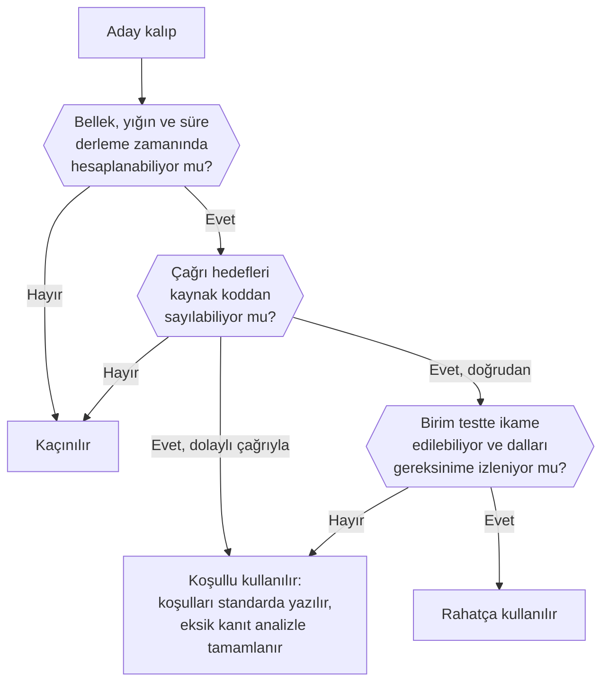

import AracKarti from '@site/src/components/AracKarti';
import {mcdcIfadesi} from '@site/src/components/McdcAraci/paylasim';

Tasarım kalıpları (design patterns; tasarım desenleri diye de anılır), sık karşılaşılan sorunlara denenmiş çözümler sunar. Aviyonik yazılımda bir kalıbın değeri, kodu ne kadar zarif kıldığıyla değil, ortaya çıkan kodun ne kadar kolay doğrulandığıyla ölçülür. Bu yazıda C ile aviyonikte sık kullanılan kalıpları üç gruba ayırıyoruz: rahatça kullanılacaklar, koşullu kullanılacaklar ve kaçınılacaklar. Her kalıp için kısa bir C örneği, DO-178C doğrulamasında karşınıza ne çıkaracağı, tehlikeleri ve en sonda aviyonik yazılımcıya tavsiyeler var.

Masaüstü yazılımında kalıp seçerken sorulan soru genellikle şudur: bu kod yarın kolayca değişebilir mi? DO-178C projesinde buna bir soru eklenir ve çoğu zaman öne geçer: **bu kodun ne yaptığını kanıtlayabilir miyim?** Her kalıp, kodu yazana bir kolaylık getirirken doğrulayana iş bırakır: gereksinim tabanlı test durumları, yapısal kapsam ölçümü, veri ve kontrol bağlaşımı (data and control coupling) analizi, yığın ve en kötü durum yürütme süresi (WCET) analizi. İyi kalıp bu işi küçültür. Konunun kitaptaki karşılığı [Yazılım Tasarımı](/kitap/do178c-ile-gelistirme/yazilim-tasarimi) ile [Kodlama ve Entegrasyon](/kitap/do178c-ile-gelistirme/yazilim-gerceklestirme-kodlama-entegrasyon) bölümleridir; bu yazı oradaki kuralları kalıp gözüyle bir araya getiriyor.

{/* truncate */}

## Bir Kalıbı "DO-178C Dostu" Yapan Nedir?

DO-178C hiçbir kalıbı ne önerir ne de yasaklar. İstediği, tasarımın doğrulanabilir olması ve kodun gereksinime izlenebilmesidir. "Tasarım kalıbı" denince akla ilk gelen, yazarlarına atfen GoF (*Gang of Four*) diye anılan 1994 tarihli kitaptaki yirmi üç kalıptır. Bu kalıplar nesne yönelimli diller için yazılmıştır ve çoğu çalışma zamanında nesne üretmeye, sanal çağrıya ve esnek bağlantılara dayanır. Aviyonik C kodunda ise kalıpları şu beş soruyla tartmak işe yarar:

1. **Belirlenimci (deterministic) mi?** Aynı durum ve girdiyle her seferinde aynı çıktıyı, sınırlı bir sürede üretiyor mu?
2. **Kaynakları derleme zamanında belli mi?** Bellek ve yığın ihtiyacı kaynak koddan ve bağlama haritasından hesaplanabiliyor mu?
3. **Çağrı hedefleri kapalı mı?** Her çağrının gidebileceği fonksiyonlar kaynak koddan sayılabiliyor mu? Kontrol bağlaşımı analizi buna dayanır.
4. **İkame edilebilir ve gözlemlenebilir mi?** Birim testte girdisi verilip çıktısı okunabiliyor mu; donanıma dokunan kısmın yerine, uçuş koduna dokunmadan başka bir şey konabiliyor mu?
5. **Dalları gereksinime izleniyor mu?** Her karar bir düşük seviyeli gereksinime bağlanıyor mu; karar başına koşul sayısı değiştirilmiş koşul/karar kapsamayı (modified condition/decision coverage, MC/DC) makul tutuyor mu?

İlk üç soru bir kalıbın hangi gruba düştüğünü çoğu zaman tek başına belirler:



Aşağıda kitaptaki örnek [tasarım standardının](/kitap/ekler/sablonlar/tasarim-standardi) ve [kodlama standardının](/kitap/ekler/sablonlar/kodlama-standardi) kurallarına sık sık atıf yapacağız. Kural numaraları (TS-…, KS-…) o örnek standartlara aittir; kendi projenizin standardında aynı kural başka bir numarayla durabilir. Kod örnekleri C99'dur ve kısalık için bazı bildirimleri göstermez.

## Rahatça Kullanılacak Kalıplar

Bu gruptaki kalıpların ortak yanı, doğrulamanın ihtiyaç duyduğu bilgiyi kaynak kodda açıkça taşımalarıdır: ne kadar bellek, hangi sırayla, kimin çağırdığı ve kimin yazdığı koddan okunur. Aviyonik projelerinde en sık karşılaşılan kalıplar da bunlardır.

### 1. Tablo Güdümlü Durum Makinesi

**GoF karşılığı:** State. GoF'ta her durum bir sınıftır ve davranış sanal metotla seçilir; C'de aynı fikir bir `enum` ve sabit bir geçiş tablosuyla (transition table), dolaylı çağrı olmadan kurulur.

Kipe bağlı davranış (başlatma, normal, kısıtlı çalışma, güvenli durum; yer ve hava; otomatik pilot kipleri) aviyonikte en çok durum makinesiyle (state machine) ifade edilir. Örnek tasarım standardı bunu kural yapar: kipe bağlı davranış durum makinesiyle verilir ve her durum–olay çifti için ya bir gereksinim yazılır ya da çiftin bilerek yok sayıldığı belirtilir (TS-08).

```c
#include <stdint.h>

typedef enum {
    D_BASLATMA, D_NORMAL, D_KISITLI, D_GUVENLI, DURUM_SAYISI
} durum_t;

typedef enum {
    O_TEST_GECTI, O_SENSOR_KAYBI, O_SENSOR_DONDU, O_CIFT_KAYIP,
    OLAY_SAYISI
} olay_t;

/* Satır: mevcut durum, sütun: olay. Her hücre bir gereksinimdir. */
static const durum_t GECIS[DURUM_SAYISI][OLAY_SAYISI] = {
    /*              TEST_GECTI SENSOR_KAYBI SENSOR_DONDU CIFT_KAYIP */
    /* BASLATMA */ { D_NORMAL,  D_GUVENLI,   D_BASLATMA,  D_GUVENLI },
    /* NORMAL   */ { D_NORMAL,  D_KISITLI,   D_NORMAL,    D_GUVENLI },
    /* KISITLI  */ { D_KISITLI, D_KISITLI,   D_NORMAL,    D_GUVENLI },
    /* GUVENLI  */ { D_GUVENLI, D_GUVENLI,   D_GUVENLI,   D_GUVENLI }
};

durum_t durum_adim(durum_t mevcut, olay_t olay)
{
    durum_t sonraki = D_GUVENLI;   /* tanımsız girdide güvenli durum */

    if (((uint32_t)mevcut < (uint32_t)DURUM_SAYISI) &&
        ((uint32_t)olay < (uint32_t)OLAY_SAYISI)) {
        sonraki = GECIS[mevcut][olay];
    }
    return sonraki;
}
```

**Doğrularken.** Bu kalıbın güzelliği davranışın kodda değil veride durmasıdır; tuzağı da tam buradadır. `durum_adim` içinde iki koşullu tek bir karar vardır ve üç testle MC/DC sağlanır. Oysa bu üç test tablodaki on altı hücreden yalnızca birini dener. Yapısal kapsam aracı tabloyu görmez; tablonun tamlığını gereksinim tabanlı testler ve gereksinim kapsam analizi gösterir. Bu yüzden her hücre bir düşük seviyeli gereksinime bağlanır, her hücre için en az bir test durumu yazılır ve gözden geçirmede tablo satır satır durum diyagramıyla karşılaştırılır. Kitabın [7. bölümünde](/kitap/do178c-ile-gelistirme/yazilim-tasarimi) her geçişi bir gereksinime ve teste bağlanan bir durum diyagramı örneği var.

**Tehlike.** Durum değişince yapılacak işler tabloya fonksiyon işaretçisi olarak konursa kalıp ikinci gruba kayar: artık her hücre bir dolaylı çağrıdır. Çoğu zaman yeni duruma göre bir `switch` ile doğrudan çağrı yapmak yeter. Tablo büyüdükçe (yirmi durum ve on beş olay, üç yüz hücre demektir) gözden geçirme zorlaşır; o noktada kipleri alt makinelere bölmek düşünülür. Küçük makinelerde `switch` tabanlı durum makinesi de aynı ölçüde kabul görür ve daha okunurdur.

### 2. Döngüsel Yürütücü

**GoF karşılığı:** yok; gömülü dünyanın kendi kalıbıdır. Pont'un zaman tetiklemeli (time-triggered) mimari kalıpları bu fikrin üzerine kuruludur.

Bir zamanlayıcı kesmesi her küçük çerçevenin (minor frame) başında bir bayrak kaldırır; ana döngü çerçeve sayacına bakıp o çerçevede çalışacak işleri sırayla çağırır. Ana çerçeve (major frame) bitince döngü başa döner. Kesinti yoktur, öncelik yoktur, kilit yoktur: çalışma sırası tasarım anında yazılır ve her seferinde aynıdır. Bu yüzden döngüsel yürütücü (cyclic executive), aviyonikte en çok tercih edilen çizelgeleme (scheduling) kalıplarından biridir; özellikle tek işlevli ve yüksek yazılım seviyeli birimlerde.

```c
#include <stdint.h>
#include <stdbool.h>

#define KUCUK_CERCEVE_SAYISI  (4U)   /* 4 x 10 ms = 40 ms */

extern volatile bool cerceve_basladi;   /* 10 ms'lik kesme kurar */

void yurutucu_dongusu(void)
{
    uint32_t cerceve = 0U;

    for (;;) {
        while (!cerceve_basladi) {
            /* bekle; kesme gelmezse bekçi köpeği devreye girer */
        }
        cerceve_basladi = false;

        girdi_oku();                         /* her çerçeve: 100 Hz */
        switch (cerceve) {
        case 0U:  kontrol_yasasi(); break;   /* 0 ve 2: 50 Hz */
        case 1U:  navigasyon();     break;   /* 25 Hz */
        case 2U:  kontrol_yasasi(); break;
        case 3U:  bakim_kaydi();    break;   /* 25 Hz */
        default:  hata_bildir(HATA_CERCEVE_NO); break;
        }
        cikti_yaz();

        if (cerceve_basladi) {
            /* sonraki çerçevenin kesmesi iş bitmeden geldi: taşma */
            hata_bildir(HATA_CERCEVE_TASMASI);
        }
        cerceve = (cerceve + 1U) % KUCUK_CERCEVE_SAYISI;
    }
}
```

**Doğrularken.** Kalıbın en büyük kazancı, zaman analizinin bir toplamaya inmesidir: her küçük çerçevedeki işlerin WCET toplamı çerçeve süresini aşmıyorsa kesintili (preemptive) çizelgelemenin tepki süresi analizine (response-time analysis) ve öncelik terslenmesi (priority inversion) kaygısına gerek kalmaz. Örnek standart bir pay da ister: her çerçevenin en kötü yükü çerçeve süresinin %80'ini aşmaz ve taşma algılanıp bildirilir (TS-10). Çalışma sırası sabit olduğu için veri akışı da sabittir; "A, B'den önce mi çalışır?" sorusunun cevabı kaynak koddadır. Taşma sayacı ve çerçeve başına ölçülen süreler entegrasyon testinde ek kanıt olur. Bekçi köpeği zamanlayıcısı (watchdog timer) da kesmenin hiç gelmemesi gibi döngünün takılıp kaldığı durumları yakalar.

<AracKarti yol="/araclar/gercek-zamanli-yazilim/gorev-cizelgeleme">
  Görev kümenizi girip döngüsel yürütücüyü seçin; araç uygun küçük çerçeve adaylarını sınar,
  işleri çerçevelere yerleştirir ve her çerçevenin yükünü gösterir.
</AracKarti>

**Tehlike.** Uzun bir işi (örneğin 30 ms süren bir hesabı) 10 ms'lik çerçeveye sığdırmak için parçalara bölmek gerekir; parçalanan hesap kodu karmaşıklaştırır, ara sonucu yanlış anda okuyan başka bir iş de tutarsız veri görür. Periyotlar birbirinin katı değilse çerçeve tablosu büyür. Küçük bir iş eklemek bile tablonun yeniden dengelenmesini ve zaman analizinin baştan yapılmasını gerektirebilir. Zaman uyumsuz olaylar ancak yoklamayla (polling) görülür, dolayısıyla tepki süresine bir çerçevelik gecikme eklenir. Konunun gerçek zamanlılık tarafını [Gerçek Zamanlı Sistemler](2026-07-03-gercek-zamanli-sistemler.mdx) yazısında anlatmıştık.

### 3. Statik Bellek: Sabit Havuz ve Halka Tampon

**GoF karşılığı:** yok. Gömülü literatürde statik ayırma (static allocation) ve havuz ayırma (pool allocation) kalıpları olarak geçer.

Masaüstü kodunda bir mesaj geldiğinde `malloc` ile yer ayrılır, işi bitince `free` ile bırakılır. Aviyonikte bellek derleme zamanında boyutlanır ya da başlatmada bir kez ayrılır (TS-21, KS-17). Mesaj akışları için en sık kullanılan yapı sabit boyutlu halka tampondur (ring buffer). Aşağıdaki sürümde ARINC 429 kelimelerini bir kesme servis rutini (ISR) yazar, bir görev okur:

```c
#include <stdint.h>
#include <stdbool.h>

#define KUYRUK_BOYU  (16U)   /* varış hızı ve gecikmeden hesaplanır */

typedef struct {
    volatile uint32_t kelime[KUYRUK_BOYU];
    volatile uint32_t yaz;            /* yalnızca üretici yazar */
    volatile uint32_t oku;            /* yalnızca tüketici yazar */
    uint32_t          tasma_sayaci;   /* yalnızca üretici yazar */
} a429_kuyruk_t;

/* ISR'den çağrılır. */
bool kuyruk_ekle(a429_kuyruk_t *k, uint32_t deger)
{
    bool eklendi = false;
    uint32_t sonraki = (k->yaz + 1U) % KUYRUK_BOYU;

    if (sonraki != k->oku) {
        k->kelime[k->yaz] = deger;
        k->yaz = sonraki;
        eklendi = true;
    } else {
        k->tasma_sayaci++;    /* dolu: kelime reddedilir, sayılır */
    }
    return eklendi;
}

/* Görevden çağrılır. */
bool kuyruk_al(a429_kuyruk_t *k, uint32_t *deger)
{
    bool alindi = false;

    if (k->oku != k->yaz) {
        *deger = k->kelime[k->oku];
        k->oku = (k->oku + 1U) % KUYRUK_BOYU;
        alindi = true;
    }
    return alindi;
}
```

Her indisi tek bir taraf değiştirdiği için kilit gerekmez. Bu, bir sonraki kalıbın kuralının küçük bir örneğidir. Kod, tek çekirdekli ve 32 bitlik okuma ile yazmanın bölünmediği bir işlemci varsayar. Çok çekirdekte bellek bariyeri gerekir. Bu varsayımlar da tasarıma yazılır.

**Doğrularken.** Sınır durumları gereksinimden doğar: boş kuyruktan okuma, son boş yere yazma, dolu kuyruğa yazma, indislerin dizinin sonundan başa sarması. Bu sürüm dolu ile boşu ayırmak için bir yeri hep boş bırakır, yani 16 yerlik dizi en çok 15 kelime tutar; böyle bir bir-eksik sınırı tam da testin yakalaması gereken türdendir. Bunlar normal aralık ve gürbüzlük (robustness) testleri olarak yazılır. Dolu kuyrukta ne yapılacağı (yeni kelimeyi reddetmek mi, en eskisini atmak mı) bir gereksinimdir ve tasarımda yazılı olmalıdır. Bellek tarafında kazanç büyüktür: kuyruğun boyu bağlama haritasında görünür, "bellek ayrılamadı" diye bir hata yolu ve onun gereksinimi, testi, kapsamı yoktur.

**Tehlike.** Kuyruk boyunu "yeterince büyük" diye seçmek. Boyut, kaynağın en kısa varış aralığından ve tüketicinin en uzun gecikmesinden hesaplanır; örnek standart bu yüzden olay kaynaklarının en kısa varış aralığını ve kuyrukların sabit derinliğini ister, taşmanın algılanıp tanımlı bir tepkiye bağlanmasını şart koşar (TS-13, TS-14). Sayılıp kimseye bildirilmeyen taşma, sessiz veri kaybıdır.

### 4. Tek Yazan ve Çift Tampon

**GoF karşılığı:** yok.

Görevler arası paylaşılan veride en sağlam kural basittir: her verinin tek yazanı olur; okuyanlar ve koruma yöntemi bir tabloda yazılır (TS-17). Okuyanın yarısı eski, yarısı yeni bir kayıt görmesini önlemek için muteks ilk akla gelen çözümdür ama öncelik terslenmesini ve engellenme süresini (blocking time) analize sokar (bkz. [RTOS bölümü](/kitap/ozel-konular/gercek-zamanli-isletim-sistemleri#paylaşılan-verinin-korunması)). Çok alanlı ve periyodik bir veri için kilitsiz bir seçenek çift tampondur (double buffering): yazan, okuyanların bakmadığı kopyayı doldurur, sonra tek bir kelime yazarak etkin kopyayı değiştirir.

```c
#include <stdint.h>

typedef struct {
    float    irtifa_ft;
    float    hava_hizi_kt;
    uint32_t zaman_damgasi_ms;
} hava_verisi_t;

static volatile hava_verisi_t tampon[2];
static volatile uint32_t      etkin = 0U;   /* okuyanların kopyası */

/* Tek yazan: hava verisi görevi (50 Hz). */
void hava_verisi_yayimla(const hava_verisi_t *yeni)
{
    uint32_t pasif = 1U - etkin;

    tampon[pasif] = *yeni;   /* okuyanlar bu kopyaya bakmıyor */
    etkin = pasif;           /* tek kelime: kopya bir anda değişir */
}

/* Okuyanlar: daha düşük hızlı görevler. */
void hava_verisi_oku(hava_verisi_t *kopya)
{
    *kopya = tampon[etkin];
}
```

**Doğrularken.** Bu kalıbın doğruluğu koddan değil, bir çizelgeleme varsayımından gelir. Okuyan kopyalamaya başladıktan sonra yazan bir kez yayımlarsa sorun yoktur, çünkü yazan öteki kopyaya yazar. İki kez yayımlarsa yazan okunmakta olan kopyanın üzerine yazar ve okuyan yine yarım bir kayıt görür. Kod gözden geçirmesi bu durumun olmadığını gösteremez: varsayım ("okuyanın kopyalaması, yazanın bir periyodundan kısa sürede biter") tasarıma yazılır ve tepki süresi analiziyle gösterilir. Varsayım sağlanamıyorsa kopyalamanın başında ve sonunda okunan bir sıra sayacı (sequence counter) eklenir ya da kuyruk kullanılır. Veri bağlaşımı analizi için de kolaylık vardır: veriyi kimin yazdığı tek bir fonksiyondan bellidir; global veri erişim tablosu ile statik analiz aracının erişim raporu karşılaştırılarak tablonun dışında bir yazma olmadığı gösterilir.

**Tehlike.** Çift tamponu her yere koymak. Tek kelimelik bir veri zaten bölünmeden yazılıyorsa gereksizdir; büyük veride iki kat bellek harcar. Çok çekirdekli işlemcide derleyicinin ve işlemcinin bellek erişimlerini yeniden sıralaması ayrıca ele alınır; orada `volatile` tek başına yetmez.

### 5. Modül, Opak Tip ve Donanım Soyutlama Katmanı

**GoF karşılığı:** Singleton (modül), Facade ve Adapter (donanım soyutlama katmanı).

C'nin sınıfı yok ama dosyası var. Bir `.c` dosyasındaki `static` değişkenleri yalnızca o dosyanın fonksiyonları görür; başlık dosyası yalnızca dışa açık arayüzü gösterir. Bu, Singleton'ın C'deki doğal hâlidir, üstelik tembel başlatma ve iş parçacığı güvenliği gibi Singleton dertleri olmadan: modülün durumu açık bir `_baslat()` fonksiyonuyla kurulur. Birden çok örnek gerekiyorsa opak tip (opaque type) kullanılır: başlıkta yalnızca yapının adı bildirilir, içi `.c` dosyasında kalır. Örnekler `malloc` ile değil, modülün içindeki sabit boyutlu bir diziden verilir.

Donanım soyutlama katmanı (hardware abstraction layer, HAL) aynı fikrin donanıma uygulanmasıdır. Donanım yazmaçlarına yalnızca sürücü katmanı dokunur (TS-01); uygulama katmanı `hal_adc_oku()` gibi bir arayüzü çağırır. Arayüzün arkasında hedefte gerçek yazmaçlar, birim test ortamında ise yer tutucu kod (stub) durur:

```c
/* hal_adc.h: uygulamanın gördüğü tek arayüz */
#include <stdint.h>
#include <stdbool.h>

typedef enum {
    ADC_YAKIT_BASINCI, ADC_YAG_SICAKLIGI, ADC_KANAL_SAYISI
} adc_kanal_t;

/* true: dönüşüm tamamlandı, *ham geçerli */
bool hal_adc_oku(adc_kanal_t kanal, uint16_t *ham);

/* hal_adc_test.c: yalnızca birim test derlemesine bağlanır */
uint16_t test_adc_degeri[ADC_KANAL_SAYISI];
bool     test_adc_hazir = true;

bool hal_adc_oku(adc_kanal_t kanal, uint16_t *ham)
{
    *ham = test_adc_degeri[kanal];
    return test_adc_hazir;
}
```

**Doğrularken.** Test edilen modül (örneğin yakıt basıncı izleme), hedefteki `hal_adc_hedef.c` yerine `hal_adc_test.c` ile bağlanır. Buna bağlama zamanı ikamesi (link-time substitution) denir. Uçuş kodunda tek satır değişmez: test için fonksiyon işaretçisi, `#ifdef TEST` ya da "test kipi" bayrağı eklenmez. Bu önemlidir, çünkü uçuş koduna eklenen her test kancası gereksinimsiz koddur ve kapsam analizinde açıklanması gereken bir dal olur. Yer tutucu kodun uçuş imajına girmediği bağlama haritasıyla gösterilir ([8. bölüm](/kitap/do178c-ile-gelistirme/yazilim-gerceklestirme-kodlama-entegrasyon#entegrasyon-stratejisi-ve-sırası)). Gerçek sürücü ise hedefte, donanım/yazılım entegrasyon testiyle doğrulanır; ikameyle elde edilen kanıt yalnızca ikame edilmeyen modül içindir. Modül sınırı veri bağlaşımı için de iyi bir sınırdır: bileşenin dışa açık fonksiyonları ve okuduğu ya da yazdığı veriler arayüz tablosunda listelenir (TS-27).

**Tehlike.** Soyutlamayı abartmak. Tek işlemci ve tek ADC için üç katmanlı bir soyutlama, gözden geçirenin donanıma ulaşmak için üç dosya gezmesi demektir. Öteki uç da tehlikelidir: her bileşenin her alanı okuyup yazabildiği büyük bir global `struct`, modül sınırını delip veri bağlaşımı analizini anlamsız kılar.

### 6. Değer ve Geçerlilik Çifti

**GoF karşılığı:** yok. Veri yolundaki karşılığı, [ARINC 429](2023-08-21-arinc-429.mdx) kelimesindeki işaret/durum matrisidir (SSM).

Aviyonikte bir değer tek başına bir şey söylemez; geçerli olup olmadığı ve ne kadar taze olduğu da bilinmelidir. Örnek tasarım standardı her arayüz verisi için tazelik sınırı ve geçerlilik bilgisi ister; başka bir bileşenden gelen veri kullanılmadan önce aralık ve tazelik denetiminden geçer (TS-02, TS-03). Kalıp bunu tip düzeyinde zorlar: değer, geçerlilik bilgisinden ayrı taşınmaz. Makullük denetimi (reasonableness check) ve süre sınırlı "son geçerli değer" de aynı yerde yapılır:

```c
#include <stdint.h>
#include <stdbool.h>

#define ALT_PSI          (0.0f)
#define UST_PSI          (100.0f)
#define BAYAT_SINIRI     (3U)     /* 3 x 20 ms: en çok 60 ms */

typedef struct {
    float deger;
    bool  gecerli;
} olcum_t;

static olcum_t  son_olcum;
static uint32_t bayat_cevrim;

void yakit_basinci_baslat(void)
{
    son_olcum.deger   = 0.0f;
    son_olcum.gecerli = false;
    bayat_cevrim      = BAYAT_SINIRI;
}

/* 50 Hz'lik görevden çağrılır. */
olcum_t yakit_basinci_dogrula(float ham_psi, bool kaynak_gecerli)
{
    if (kaynak_gecerli &&
        (ham_psi >= ALT_PSI) && (ham_psi <= UST_PSI)) {
        son_olcum.deger   = ham_psi;
        son_olcum.gecerli = true;
        bayat_cevrim      = 0U;
    } else if (bayat_cevrim < BAYAT_SINIRI) {
        bayat_cevrim++;               /* son geçerli değer korunur */
    } else {
        son_olcum.gecerli = false;    /* süre doldu: geçersiz */
    }
    return son_olcum;
}
```

**Doğrularken.** İlk karar üç koşulludur ve benzersiz neden MC/DC (unique-cause MC/DC) için dört test yeter: önce üç koşul da doğru, sonra her biri tek başına yanlış. Aralık sınırları (0 ve 100 psi tam değerleri ile hemen dışları) gürbüzlük testlerinin aradığı yerlerdir. Bayatlık sayacı ayrı bir zaman davranışıdır ve gereksinim tabanlı testle sınanır: kaynak kesildikten sonra üç çevrim boyunca değer hâlâ geçerlidir, dördüncüde geçersiz olur. Durum fonksiyonun içindeki `static` yerel değişkenlerde saklansaydı, birim testler arasında sıfırlanamazdı. Açık başlatma fonksiyonu her testin aynı durumdan başlamasını sağlar.

<AracKarti
  yol="/araclar/dogrulama/mcdc-test-seti"
  ek={mcdcIfadesi('kaynak_gecerli && (ham_psi >= ALT_PSI) && (ham_psi <= UST_PSI)')}>
  Yukarıdaki kararla açılır: üç koşulun bağımsızlık çiftlerini ve MC/DC'yi sağlayan en küçük
  test setini gösterir.
</AracKarti>

**Tehlike.** "Son geçerli değeri kullan" kuralını süre sınırı olmadan yazmak: veri akışı kesildiğinde yazılım bayat değerle normal çalışıyormuş gibi görünür (kitapta [Hata davranışının tasarımı](/kitap/do178c-ile-gelistirme/yazilim-tasarimi#hata-davranışının-tasarımı)). Bir de geçerlilik bilgisini üretip kimsenin okumaması: tüketici `deger` alanına doğrudan uzanıyorsa kalıp hiçbir şey kazandırmaz. Gözden geçirmede her `.deger` erişiminden önce `.gecerli` denetimi aranır.

## Koşullu Kullanılacak Kalıplar

Bu gruptaki kalıplar yasak değildir, ama doğrulamaya iş ekler. Kullanılacaklarsa kullanım koşulları tasarım standardına yazılır ve gözden geçirmede bu koşullar aranır.

### 7. Sabit Fonksiyon İşaretçisi Tablosu

**GoF karşılığı:** Strategy ve Command.

Fonksiyon işaretçisi (function pointer), C'de çalışma zamanı çok biçimliliğinin (polymorphism) başlıca aracıdır: bir mesaj etiketine göre işleyici seçmek, bir bakım komutunu çalıştırmak, aynı arayüzü sağlayan iki sürücüden birini kullanmak. Kitaptaki [DO-332 bölümü](/kitap/arac-kalifikasyonu-ve-ekler/do332-nesne-yonelimli-teknoloji) iki sensörlü bir dağıtım tablosuyla, sınıf olmadan da "olası bütün hedefler test edildi mi?" sorusunun doğduğunu gösteriyor. Burada başka bir örnek var: bakım terminalinden gelen komutları işleyen bir komut tablosu.

```c
#include <stdint.h>
#include <stddef.h>

typedef uint32_t (*komut_islevi_t)(const uint8_t *veri, uint32_t boy);

typedef struct {
    uint8_t        kod;
    komut_islevi_t islev;
} komut_t;

/* Hedef kümesi kapalıdır: üç fonksiyon, sabit bellekte bir tablo. */
static const komut_t KOMUTLAR[] = {
    { 0x01U, bakim_durum_oku },
    { 0x02U, bakim_hata_kaydi_oku },
    { 0x03U, bakim_hata_kaydi_sil }
};
#define KOMUT_SAYISI  (sizeof(KOMUTLAR) / sizeof(KOMUTLAR[0]))

uint32_t komut_calistir(uint8_t kod, const uint8_t *veri, uint32_t boy)
{
    uint32_t sonuc = KOMUT_TANIMSIZ;
    size_t   i;

    for (i = 0U; i < KOMUT_SAYISI; i++) {
        if (KOMUTLAR[i].kod == kod) {
            sonuc = KOMUTLAR[i].islev(veri, boy);   /* dolaylı çağrı */
            break;
        }
    }
    return sonuc;
}
```

**Doğrularken.** İki soru doğar. Birincisi kontrol bağlaşımıdır: `komut_calistir` içindeki tek çağrı satırı üç ayrı fonksiyona gidebilir. Yapısal kapsam aracı satır bir kez çalıştığında "kapsandı" der; kontrol bağlaşımı analizi ise her hedefin bu çağrı noktasından gerçekten çağrıldığını görmek ister ([Yazılım Doğrulama](/kitap/do178c-ile-gelistirme/yazilim-dogrulama#veri-bağlaşımı-ve-kontrol-bağlaşımı-analizi)). Bu yüzden her komut için ayrı test yazılır ve hedefin çağrıldığı test kaydında görünür. İkincisi analizdir: çağrı grafiği çıkaran yığın ve WCET araçları dolaylı çağrının hedeflerini çoğu zaman kendileri bulamaz. Hedef listesi araca elle verilir ve bu listenin tabloyla tutarlılığı gözden geçirilir. Tablonun `const` olması, yani başlatmadan sonra değişmemesi, örnek standartta bu kalıbın kullanım koşuludur (TS-28).

**Tehlike.** İşaretçiyi çalışma zamanında yazılabilir bir değişkende tutmak: bir bellek bozulması veri hatasını kontrol akışı hatasına çevirir ve yazılım tanımsız bir adrese atlar. Tablonun salt okunur bellekte durduğu bağlama haritasından gösterilir. Bir de "her şey için tablo" eğilimi var: iki seçenekli bir davranış için fonksiyon işaretçisi, düz bir `if`'in vereceği okunurluğu ve kapsam açıklığını boşa harcar.

### 8. Derleme Zamanı Abone Listesi

**GoF karşılığı:** Observer.

GoF'taki Observer'da ilgilenen nesneler çalışma zamanında kendilerini bir listeye kaydeder; olay olunca liste dolaşılır ve her aboneye geri çağırma (callback) ile haber verilir. Aviyonikte bu, listenin uzunluğunu ve çağrı sırasını çalışma zamanına bırakır: WCET koddan hesaplanamaz, hangi aboneye hangi sırayla haber verildiği test edilen konfigürasyona bağlı kalır. Kalıbın aviyonik sürümünde abone listesi derleme zamanında yazılmış sabit bir tablodur ya da daha basiti, düz bir çağrı dizisidir:

```c
/* Uçuş kipi değişince haberdar edilecekler. Sıra tasarımda
   yazılıdır ve çalışma zamanında değişmez. */
void kip_degisti_bildir(ucus_kipi_t yeni_kip)
{
    otopilot_kip_degisti(yeni_kip);
    gosterge_kip_degisti(yeni_kip);
    bakim_kaydi_kip_degisti(yeni_kip);
}
```

Bu sürümde dolaylı çağrı bile yoktur; abone eklemek kaynak kodda görünür bir değişikliktir ve değişiklik etki analizine (change impact analysis) girer.

**Doğrularken.** WCET, abonelerin WCET'lerinin toplamıdır. Çağrı sırası sabit olduğu için sıraya bağlı hatalar (bir abonenin, ötekinin güncellediği veriyi eski hâliyle okuması gibi) testte görülürse her seferinde aynı biçimde görülür.

**Tehlike.** Geri çağırmanın içinden yeni bir olay tetiklemek: abone, bildirim sırasında yeni bir bildirim başlatırsa dolaylı özyineleme ortaya çıkar ve kalıp üçüncü gruba düşer. Kayıt çalışma zamanında yapılacaksa yalnızca başlatmada yapılır; o zaman da kayıt fonksiyonunun başlatma bittikten sonra çağrılmadığı ayrıca gösterilir.

### 9. Savunmacı Programlama

**GoF karşılığı:** yok.

Savunmacı programlama (defensive programming), "olamaz" denen duruma karşı yine de önlem almaktır: bütün `enum` değerleri ele alındığı hâlde yazılan `default` dalı, aralığı garanti edilmiş bir indisin yine de sınanması. Kodlama standartları bunu çoğu zaman zorunlu kılar: örnek standartta her `switch` bir `default` ile biter ve beklenmeyen dal hata işleyicisini çağırır (KS-13).

```c
switch (kip) {
case KIP_YER:     yer_kontrolu();    break;
case KIP_KALKIS:  kalkis_kontrolu(); break;
case KIP_SEYIR:   seyir_kontrolu();  break;
default:
    /* Dayanak: kip değişkeni bellek bozulmasıyla tanımsız
       bir değer alabilir. Gereksinim: DSG-HATA-012
       (tanımsız kipte güvenli duruma geç). */
    hata_bildir(HATA_TANIMSIZ_KIP);
    guvenli_duruma_gec();
    break;
}
```

**Doğrularken.** `default` dalına normal girdiyle ulaşılamaz, bu yüzden yapısal kapsam analizinde kapsanmamış görünür. İki yol vardır. Dal bir gereksinime bağlıysa (yukarıdaki gibi) ona hata enjeksiyonuyla (fault injection) ulaşılır: test, hedefte hata ayıklayıcıyla kip değişkenine tanımsız bir değer yazar ve güvenli duruma geçişi gözler. Testle ulaşılamıyorsa dal analizle gerekçelendirilir ve kaydı tutulur. Gereksinimi ya da tasarım dayanağı olmayan "savunmacı" kod ise aslında gereksiz koddur; savunmacı etiketi açıklanamayan kapsam boşluklarını örtmek için kullanılmaz ([Kapsanmayan Kodlar](/kitap/ozel-konular/kapsanmayan-kodlar)). Konuya [SCA ile kapsanamayan kodlar](2023-11-11-sca-cover-edilemeyen-kodlar.mdx) yazısında da değinmiştik.

**Tehlike.** Her yere savunma koymak. Her fonksiyonun her parametresini her çağrıda denetlemek; kapsam analizinde onlarca açıklanması gereken dal, WCET'te boşa giden süre ve okunurluk kaybı demektir. Savunma, güvenin el değiştirdiği sınırlara konur: başka bir bileşenden, başka bir bölümden ya da donanımdan gelen veriye (TS-03). Bir de savunmanın ne yaptığı önemlidir: "hatayı yut ve devam et" bir savunma değildir. Beklenmeyen dal, tepkiye karar veren tek hata yönetimi bileşenine haber verir (TS-04).

## Kaçınılacak Kalıplar

Bu gruptaki kalıpların ortak noktası, doğrulamanın dayandığı bir varsayımı (sınırlı bellek, sınırlı yığın, sınırlı süre, bilinen kontrol akışı) çalışma zamanına bırakmalarıdır. Her birinin yerine kullanılabilecek bir kalıp ilk iki grupta var.

### Çalışma Zamanında Dinamik Bellek

`malloc` ve `free` ile nesne üreten her yapı (GoF'taki Factory kalıplarının çoğu, bağlı listeler, büyüyen kaplar) üç soruyu cevapsız bırakır: bellek parçalanır mı, ayırma ne kadar sürer, bellek biterse ne olur? Üçüncü sorunun cevabı bir hata yoludur ve o yolun da gereksinimi, testi ve kapsamı gerekir. Dinamik bellek ayırma (dynamic memory allocation) MISRA C:2012'de Kural 21.3 ve Yönerge 4.12 ile yasaktır; örnek standartlar da başlatmadan sonra ayırmayı yasaklar (TS-21, KS-17).

**Yerine:** derleme zamanında boyutlanan diziler ve statik havuz (3. kalıp). Factory'nin asıl ihtiyacı, yani hangi sürücü örneğinin kullanılacağının konfigürasyona bağlı olması, başlatmadaki tek bir seçim noktasıyla karşılanır: önceden ayrılmış örneklerden biri seçilir, yenisi üretilmez.

### Özyineleme

Ağaç dolaşan Composite ve Interpreter kalıpları, ifade ayrıştırıcıları ve iç içe menüler doğal olarak özyinelemeli yazılır. Özyinelemede (recursion) yığın derinliği girdiye bağlıdır ve statik analiz aracı en kötü yığın kullanımını hesaplayamaz (TS-20; MISRA C:2012 Kural 17.2). Dolaylı özyineleme daha sinsidir: A, B'yi çağırır; B de bir olay bildirimi üzerinden yeniden A'yı.

**Yerine:** derinliği bir sabitle sınırlı döngü. Gerçekten ağaç dolaşmak gerekiyorsa boyutu sabit, taşması denetlenen açık bir yığın dizisi.

### setjmp/longjmp ile İstisna Taklidi

C'de istisna (exception) yoktur; `setjmp` ve `longjmp` ile taklit edilebilir. Bu, kontrol akışını fonksiyon sınırlarının üzerinden atlatır: yerel değişkenlerin durumu belirsizleşir, yığın ve kontrol bağlaşımı analizleri atlamayı göremez. MISRA C:2012 Kural 21.4 `setjmp.h` başlığının kullanılmasını yasaklar; örnek tasarım standardı da koşulsuz dallanmayı (TS-26).

**Yerine:** her fonksiyon hata bilgisini dönüş değeriyle verir, çağıran bunu denetler (KS-12); hataya verilecek tepki tek bir hata yönetimi bileşeninde toplanır (TS-04).

### void İşaretçisiyle Kalıtım Taklidi

C'de nesne yönelimli tasarımı taklit etmek mümkündür: yapının ilk alanına "taban sınıfı" koyup işaretçiyi dönüştürmek, `void *` ile her tipi taşıyan jenerik kaplar, fonksiyon işaretçisi tablolarıyla kurulan sanal metot zincirleri. Ama bu, DO-332'nin nesne yönelimli diller için getirdiği doğrulama sorularını (yerel tip tutarlılığı, dinamik dağıtımın her hedefi) dilin hiçbir desteği olmadan geri getirir; üstelik derleyicinin tip denetimi de kaybolur. MISRA C:2012 farklı nesne tiplerinin işaretçileri arasındaki dönüşümü Kural 11.3 ile yasaklar; `void` işaretçisinden nesne işaretçisine dönüşümden de Kural 11.5 ile (öneri düzeyinde) kaçınılmasını ister.

**Yerine:** tip başına ayrı, küçük ve somut arayüzler. Gerçekten çok biçimlilik gerekiyorsa hedef kümesi kapalı bir fonksiyon işaretçisi tablosu (7. kalıp).

### Tembel Başlatma ve Çalışma Zamanında Kurulan Zincirler

Singleton'ın klasik hâli nesneyi ilk kullanımda üretir (tembel başlatma, lazy initialization); Decorator ve Chain of Responsibility işleyici zincirini çalışma zamanında kurar. İlk çağrının ötekilerden uzun sürmesi WCET analizini bozar. Hangi çağrının "ilk" olduğu çalışma sırasına bağlı olduğu için testler de belirsizleşir. Zincirin uzunluğu ve sırası ise koddan okunamaz.

**Yerine:** iki aşamalı yaşam. Başlatma aşamasında her şey açıkça ve sabit sırayla kurulur (`_baslat()` fonksiyonları); çalışma aşamasında yapı değişmez. Örnek standartta görevler, kuyruklar ve muteksler için de aynı kural var (TS-15).

## GoF'tan Aviyonik C'ye: Özet Tablo

| Kalıp | GoF karşılığı | Değerlendirme | Doğrulamada ana kazanç ya da risk |
|---|---|---|---|
| Tablo güdümlü durum makinesi | State | Önerilir | Her hücre bir gereksinim ve test; kapsam aracı tabloyu görmez |
| Döngüsel yürütücü | — | Önerilir | Zaman analizi çerçeve başına toplamaya iner |
| Statik havuz, halka tampon | — | Önerilir | Bellek tükenmesi yolu yok; sınır testleri gereksinimden doğar |
| Tek yazan, çift tampon | — | Önerilir | Kilitsiz; doğruluğu yazılı bir çizelgeleme varsayımına dayanır |
| Modül ve donanım soyutlama katmanı | Singleton, Facade, Adapter | Önerilir | Bağlama zamanı ikamesi; uçuş kodunda test kancası yok |
| Değer ve geçerlilik çifti | — | Önerilir | Bayatlık sınırı ve aralık denetimi testle gösterilir |
| Sabit fonksiyon işaretçisi tablosu | Strategy, Command | Koşullu | Kontrol bağlaşımı her hedefi ister; araçlara hedef listesi verilir |
| Derleme zamanı abone listesi | Observer | Koşullu | Çalışma zamanında kayıt yok; sıra ve WCET sabit |
| Savunmacı programlama | — | Koşullu | Dal gereksinime bağlanır; hata enjeksiyonu ya da analiz gerekir |
| Çalışma zamanında nesne üretimi | Factory Method, Abstract Factory | Kaçınılır | Dinamik bellek; test edilemeyen tükenme yolu |
| Özyinelemeli dolaşma | Composite, Interpreter | Kaçınılır | Yığın üst sınırı hesaplanamaz |
| `setjmp`/`longjmp` ile istisna | — | Kaçınılır | Kontrol akışı analizin dışına çıkar |
| `void *` ile kalıtım taklidi | — | Kaçınılır | Tip denetimi kaybolur; DO-332'nin soruları geri gelir |
| Tembel başlatma, çalışma zamanında zincir | Singleton (klasik), Decorator, Chain of Responsibility | Kaçınılır | İlk çağrının süresi ve zincirin sırası koddan okunamaz |

## Aviyonik Yazılımcıya Tavsiyeler

1. **Kalıbı adlandırın, koşulunu yazın.** Projede kullanılacak kalıplar ve kullanım koşulları tasarım standardında durur. "Fonksiyon işaretçisi serbest" değil, "fonksiyon işaretçisi yalnızca `const` tablolardan, hedef listesi tasarımda" yazılır. Böylece gözden geçiren neyi arayacağını bilir.
2. **Kodu yazmadan önce testini düşünün.** Her kalıp için üç soru sorun: Bunu gereksinimden nasıl test ederim? Kapsamını nasıl ölçerim? Hangi analiz aracım bunu anlamaz? Üçüncü sorunun bir cevabı varsa, o boşluğu neyle kapatacağınızı da şimdi yazın.
3. **Belleği ve süreyi derleme zamanında sabitleyin.** Dizilerin boyutu, kuyrukların derinliği ve döngülerin sınırı sabittir; her biri bir hesapla ya da gerekçeyle tasarımda yazılır.
4. **Dolaylılığı kapalı tutun.** Fonksiyon işaretçisi, geri çağırma ya da abone listesi olsun: her dolaylı çağrının olası hedefleri kaynak koddan sayılabilmeli ve başlatmadan sonra değişmemelidir.
5. **Paylaşılan her verinin tek yazanı olsun.** Kimin yazdığı, kimin okuduğu ve neyle korunduğu bir tabloda durur; statik analizin erişim raporu o tabloyla karşılaştırılır.
6. **Kararları küçük tutun.** MC/DC'de test sayısı koşul sayısıyla büyür: n koşullu bir karar için en az n+1 test gerekir. Altı koşulu aşan bir karar (KS-11) çoğu zaman tasarımın bir kavrama ad vermediğini gösterir; ara sonuca ad verip kararı bölün.
7. **Savunmacı kodu gereksinime bağlayın.** Her savunmacı dalın bir gereksinimi ya da tasarım dayanağı ve bir doğrulama yolu (hata enjeksiyonu ya da analiz) olsun. Yoksa kapsam analizinde ölü ya da gereksiz kod olarak karşınıza çıkar.
8. **Test kancasını uçuş koduna koymayın.** İkameyi bağlama zamanında yapın. `#ifdef TEST`, test kipi bayrağı ya da yalnızca test için eklenen bir fonksiyon işaretçisi, uçuş imajında gereksinimsiz koddur.
9. **Makro hilelerini sınırlayın.** İç içe makrolarla üretilen kodu gözden geçiren, kodu açılmış hâliyle zihninde kurmak zorunda kalır. Makronun içindeki kararlar kapsam raporunda tek satıra sıkışır ve hangisinin kapsanmadığı okunamaz. Tablo üretimi gibi sınırlı ve belgelenmiş kullanımlar dışında düz C tercih edilir.
10. **Kalıbı kontrol listesiyle denetleyin.** Mimari ve kod gözden geçirmelerinde Ek F'deki [yazılım mimarisi](/kitap/ekler/kontrol-listeleri/yazilim-mimarisi) ve [kaynak kod](/kitap/ekler/kontrol-listeleri/kaynak-kod) kontrol listeleri bu yazıdaki kalıpların çoğunu madde madde sorar.
11. **Kalıp kitaplarını DO-178C süzgecinden geçirerek okuyun.** [Douglass'ın kitabı](/kutuphane/gomulu-gercek-zamanli/douglass-design-patterns-c) ve [Pont'un zaman tetiklemeli kalıpları](/kutuphane/gomulu-gercek-zamanli/pont-time-triggered) iyi başlangıçlardır; ama her kalıbı bu yazının başındaki beş soruyla tartın. Bir kalıbın gömülü sistemlerde yaygın olması, Seviye A'da doğrulamasının kolay olduğu anlamına gelmez.

## Sonuç

Aviyonikte iyi tasarım kalıbı zekâsıyla değil, sıradanlığıyla öne çıkar: bir durum tablosu, sabit bir çerçeve sırası, boyu belli bir kuyruk, tek yazanı olan bir veri. Bunların hiçbiri bir yazılım mimarisi konferansında alkış toplamaz; ama her biri bir test durumunu, bir analiz sayfasını ya da bir gözden geçirme bulgusunu ortadan kaldırır. Kalıp seçerken sorulacak soru "bu kod ne kadar esnek?" değil, "bu kodun ne yaptığını otoriteye nasıl gösteririm?" sorusudur. Cevabı kısa olan kalıp, çoğu zaman doğru kalıptır.

## Kaynaklar

- Erich Gamma, Richard Helm, Ralph Johnson, John Vlissides — *Design Patterns: Elements of Reusable Object-Oriented Software* (Addison-Wesley, 1994).
- Bruce Powel Douglass — *Design Patterns for Embedded Systems in C* (Newnes, 2010). Kütüphane tanıtımı: [Design Patterns for Embedded Systems in C](/kutuphane/gomulu-gercek-zamanli/douglass-design-patterns-c).
- Michael J. Pont — *Patterns for Time-Triggered Embedded Systems* (Addison-Wesley, 2001). Kütüphane tanıtımı: [Patterns for Time-Triggered Embedded Systems](/kutuphane/gomulu-gercek-zamanli/pont-time-triggered).
- RTCA — *DO-178C, Software Considerations in Airborne Systems and Equipment Certification* (2011).
- RTCA — *DO-332, Object-Oriented Technology and Related Techniques Supplement to DO-178C and DO-278A* (2011).
- MISRA — *MISRA C:2012, Guidelines for the use of the C language in critical systems*. Kütüphane tanıtımı: [MISRA C](/kutuphane/standartlar-kilavuzlar/misra-c).
