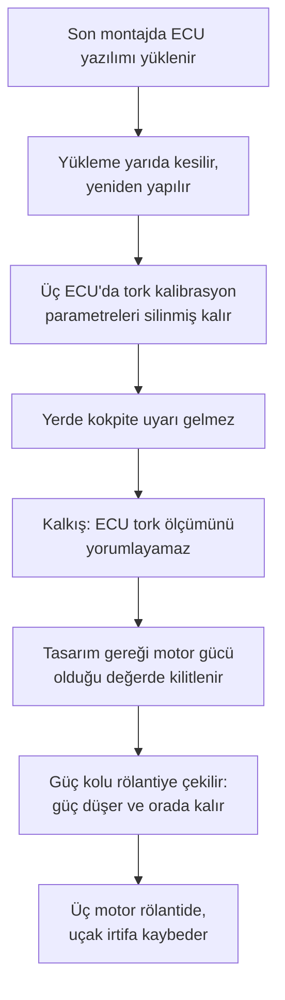

import OlayKunyesi from '@site/src/components/OlayKunyesi';

# A400M, Sevilla (2015): Silinen Kalibrasyon Verisi

Türk Hava Kuvvetleri'ne teslim edilmek üzere üretilen bir A400M, 9 Mayıs 2015'te ilk
uçuşunda Sevilla yakınlarında düştü. Dört motordan üçü kalkıştan hemen sonra güç
kumandasına cevap vermez oldu. Kodda değişen bir satır yoktu: eksik olan, yazılımın son
montajda yüklenmesi sırasında silinen ve her motora özgü olan kalibrasyon verisiydi.

<OlayKunyesi />

:::note[Kaynakların durumu]

İspanyol askerî kaza soruşturma kurulunun (CITAAM) nihai raporu gizlidir ve yayımlanmamıştır.
Bu sayfadaki bilgiler üç tür kaynağa dayanır ve metinde ayrılır: **üreticinin açıklamaları**
(Mayıs ve Haziran 2015'te operatörlere gönderilen bildirimler), **mahkeme kararları**
(Sevilla'daki ceza soruşturmasının kararlarında özetlenen bulgular) ve **basına yansıyan
bilgi** (ağırlıkla Reuters'ın soruşturma belgelerine dayandırdığı haberler). Motorun kontrol
yazılımının iç mantığına ilişkin ayrıntıların çoğu üçüncü türdendir.

:::

## Ne oldu?

Uçak, müşteriye teslimden önce yapılan üretim test uçuşlarının ilkindeydi; uçakta üreticinin
altı kişilik test ekibi vardı. Üreticinin, uçuş kayıt cihazlarının ilk çözümüne dayanarak
operatörlere bildirdiğine göre:

- Kalkıştan sonra 1, 2 ve 3 numaralı motorların gücü olduğu değerde kaldı; motorlar güç
  kolunun normal kumandalarına cevap vermedi.
- Mürettebat güç kollarını uçuş rölantisine (flight idle) çektiğinde üç motorun gücü düştü,
  ama bu kez orada kaldı. Mürettebatın çabalarına rağmen uçuşun sonuna kadar yeniden
  artırılamadı.
- 4 numaralı motor kumandalara normal cevap verdi. Uçağın diğer sistemlerinde bir
  anormallik görülmedi.

Tek motorun gücüyle irtifasını koruyamayan uçak, meydana dönmeye çalışırken havalimanına
birkaç kilometre uzaklıkta yere çarptı.

## Yazılımın rolü

A400M'in turboprop motorlarını tam yetkili sayısal motor kontrolü (full authority digital
engine control, FADEC) yönetir; her motorun kendi elektronik kontrol birimi (ECU) vardır.
Basına yansıyan bilgiye göre zincir şöyle işledi:

**Veri.** Her motorun tork ölçümü, o motora özgü kalibrasyon parametreleriyle anlam kazanır.
Bu parametreler koda gömülü değildir; ECU'ya ayrıca yüklenir. DO-178C'nin diliyle bu,
davranışı koddan bağımsız belirleyen bir parametre verisi öğesidir (parameter data item,
PDI).

**Silinme.** Sevilla mahkemesinin kararında özetlendiği biçimiyle, üç motorun ECU'sundaki
kalibrasyon parametreleri, yarıda kesilen bir yazılım yüklemesinin yeniden yapılması
sırasında öngörülmeyen biçimde silindi ve bu durum hiçbir uyarı üretmedi. Reuters'ın
soruşturma belgelerine dayandırdığı habere göre veri ilk yükleme başarısız olduğunda silinmiş,
sonraki yüklemede de geri konmamıştı.

**Eksik veride davranış.** Basına yansıyan bilgiye göre ECU, bu veri olmadığında motoru
o anki gücünde kilitleyecek biçimde tasarlanmıştı. Mantık tek motor düşünülerek kurulmuştu:
ölçümüne güvenemeyen bir motor, kendi başına güç değiştirmek yerine son bilinen durumda
kalır ve sorun o motorla sınırlanır. Aynı mantık üç motorda birden çalışınca sonuç bir
sınırlama değil, kumanda kaybı oldu: motorlar ya kalkış gücünde ya rölantide kalabiliyordu.

**Uyarı.** Yine basına yansıyan bilgiye göre bu durumun kokpitteki ilk uyarısı tasarım
gereği havada, yaklaşık 400 ft'te veriliyordu; yerde mürettebata bir uyarı gelmiyordu.
Mahkeme kararı da kokpit uyarılarının tehlikenin gerçek boyutunu yansıtmadığını belirtir.

4 numaralı motorun neden etkilenmediğine dair, verisinin silinmemiş olması dışında, kamuya
açık bir açıklama yoktur.

## Neden yakalanmadı?

Kamuya açık bilgiden dört katmanın hatayı geçirdiği görülüyor:

1. **Yükleme süreci verinin yerine ulaştığını doğrulamadı.** Yükleme "tamamlandı" sayıldı,
   ama birimde gerçekten ne olduğu (yazılım **ve** veri) yüklemeden sonra bağımsız bir
   yoldan okunup beklenenle karşılaştırılmadı. Yarıda kesilip yeniden başlatılan yükleme,
   normal akışın dışındaki bir yoldu ve o yol veriyi silebiliyordu.
2. **Birim, eksik veriyle "hazır" göründü.** Kalibrasyon verisi olmayan bir ECU motoru
   çalıştırabildi, kalkış gücü verebildi ve yerde alarm üretmedi. Eksiklik, ancak geri
   dönüşü olmayan noktadan sonra görünür oldu.
3. **Emniyet analizi çoklu arızayı olasılık dışı saydı.** Mahkeme kararına göre birden çok
   motorda aynı anda kalibrasyon kaybı, pratikte yok sayılacak kadar olasılık dışı kabul
   edilmişti. Oysa dört ECU'yu aynı araç, aynı prosedür ve aynı kişi yüklüyordu: arızalar
   bağımsız değildi, ortak bir nedenleri vardı.
4. **Bilinen risk için alınan önlem yetmedi.** Reuters'ın 2017'de soruşturma raporundan
   aktardığına göre motor üreticileri, kazadan aylar önce yükleme hatalarının kalkıştan önce
   uyarı vermeden veri kaybına yol açabileceği konusunda uyarmış, soruşturma da alınan
   önlemleri yetersiz bulmuş ve yükleme sürecinin daha kapsamlı bir risk analizini gerekli
   görmüştü.

Aynı haberlere göre yüklemeyi kimin, hangi araçla ve hangi kurallarla (sivil ya da askerî)
yapacağı konusunda uçak ve motor üreticisi arasında görüş ayrılığı vardı; üretici ile motor
konsorsiyumu, motor yazılımının tasarımının spesifikasyonunu karşılayıp karşılamadığı
konusunda da ayrı düşmektedir. Bu sayfa o tartışmada taraf tutmaz.

## Nasıl önlenebilirdi?

| Zayıf halka | Önlem | Kitapta |
|----|----|----|
| Yükleme sonrası birimin içeriği doğrulanmadı | Yüklemeden sonra birimdeki her yazılım ve veri parçasının kimliği ve bütünlüğü (parça numarası, CRC) birimden geri okunur, onaylı konfigürasyonla karşılaştırılır; karşılaştırma yükleme aracının "başarılı" mesajından bağımsızdır | [18. Sahada Yüklenebilir Yazılım](/kitap/ozel-konular/sahada-yuklenebilir-yazilim) |
| Yarıda kesilen yükleme veriyi tutarsız bıraktı | Yükleme ya tümüyle uygulanır ya hiç uygulanmaz; kesilme, tekrar ve sıra hatası senaryoları yükleme işlevinin gereksinimi ve test case'idir | [18. Sahada Yüklenebilir Yazılım](/kitap/ozel-konular/sahada-yuklenebilir-yazilim) |
| Eksik veri yerde fark edilmedi | Açılışta verinin varlığı, bütünlüğü ve kodla uyumu denetlenir; eksikse birim "hazır" durumuna geçmez, motor çalıştırılamaz ya da kalkıştan önce engelleyici bir uyarı verilir | [22. Konfigürasyon Verisi](/kitap/ozel-konular/konfigurasyon-verisi) |
| Eksik verideki davranış tek motor için tasarlandı | "Veri yoksa ne olur?" sorusu gereksinimde her uçuş evresi için ve uçak seviyesinde cevaplanır; birimin yerel güvenli durumunun uçak için de güvenli olduğu gösterilir | [6. Yazılım Gereksinimleri](/kitap/do178c-ile-gelistirme/yazilim-gereksinimleri) |
| Çoklu arıza bağımsız sayıldı | Ortak neden analizi üretim ve bakım işlemlerini de kapsar: aynı araç, aynı veri, aynı prosedür birden çok kanala dokunuyorsa arızalar bağımsız varsayılmaz | [3. Sistem Emniyet Değerlendirmesi](/kitap/baglam/sistem-emniyet-degerlendirmesi-baglaminda-yazilim) |
| Bilinen riskin önlemi prosedüre bırakıldı | Emniyet analizinin dayandığı her prosedürel önlem, kanıtıyla birlikte izlenen bir gereksinime dönüştürülür; risk yeniden bildirildiğinde analiz yeniden açılır | [2. Sistem Bağlamında Yazılım](/kitap/baglam/sistem-baglaminda-yazilim) |

## Çıkarılacak dersler

1. **Veri de yazılımdır.** Kod aynı kalırken davranışı belirleyen veri, kod kadar sıkı
   kimliklendirilir, yüklenir ve doğrulanır. "Yazılım değişmedi" cümlesi, veri için bir şey
   söylemez.
2. **Yokluk bir hata türüdür.** Gereksinimler çoğu zaman yanlış veriyi düşünür (aralık
   dışı, bozuk CRC), hiç olmayan veriyi düşünmez. Boş, silinmiş ya da varsayılan değerle
   dolu bir veri alanı için davranış açıkça tanımlanmalıdır.
3. **Yükleme, emniyet zincirinin parçasıdır.** Sertifikalı bir yazılım, yanlış yüklenirse
   sertifikalı davranmaz. Yükleme aracı, prosedürü ve hata yolları, yüklenen yazılım kadar
   dikkat ister.
4. **Yerel olarak güvenli, uçak için güvenli demek değildir.** "Son değerde kal" bir motor
   için makul bir güvenli durumdur; üç motor için felakettir. Güvenli durum, birim
   seviyesinde değil işlev seviyesinde tanımlanır.
5. **Yedeklilik ortak nedene karşı korumaz.** Dört motor, dört ECU ve dört ayrı veri kümesi
   vardı; hepsine aynı el dokundu. Bağımsızlık iddiası, üretim hattı ve bakım dâhil bütün
   yaşam döngüsü için gösterilmelidir.
6. **Uyarının zamanı, uyarının kendisi kadar önemlidir.** Müdahale edilebilecek son an
   geçtikten sonra gelen uyarı bilgi verir ama korumaz. Yerde yakalanabilecek bir durum
   yerde bildirilmelidir.

## Sonrasında ne değişti?

- Üretici, kazadan on gün sonra bütün A400M operatörlerine bir bildirim gönderdi: bir
  sonraki uçuştan önce her motorun ECU'su bir kereliğine denetlenecek, motor ya da ECU
  değişiminden sonra da ek denetimler yapılacaktı.
- İspanya, yeni üretilen uçakların test uçuşlarını durdurdu; kısıtlamalar Haziran 2015'te bu
  denetimlerin yapılması koşuluyla kaldırıldı ve teslimatlar yeniden başladı.
- Üretici sonraki açıklamalarında, belirlenen nedenler zincirinin yinelenmemesi için bütün
  sistemleri gözden geçirdiğini bildirdi; yazılımda ve yükleme sürecinde tam olarak neyin
  değiştiği kamuya açıklanmadı.
- Sevilla'daki ceza soruşturması, kazanın tek bir kişiye yüklenemeyecek bir nedenler
  zincirinden doğduğu gerekçesiyle kapatıldı; üst mahkeme 2021'de bu kararı onarken sorunun
  eğitimden değil tasarımdan kaynaklandığını belirtti.

## Kendi projenize sorun

- Birime yüklenen her veri öğesinin (kalibrasyon, seçenek, tablo) bir kimliği ve bütünlük
  denetimi var mı? Yüklemeden sonra kim, hangi araçla doğruluyor?
- Yükleme yarıda kesilirse birim hangi durumda kalır? Bu senaryo test edildi mi?
- Yazılımınız, verisi olmadan açılırsa ne yapar? "Hazır" der mi?
- Veri eksikliğinin uyarısı, operatörün hâlâ bir şey yapabildiği bir anda mı veriliyor?
- Emniyet analizinizde "bağımsız" saydığınız kanallara aynı araç, aynı dosya ya da aynı
  prosedürle mi dokunuluyor?
- Analizinizin dayandığı prosedürel önlemler ("teknisyen kontrol eder") nerede yazılı ve
  uygulandığının kanıtı ne?

## Kaynaklar

- Üreticinin operatörlere gönderdiği kaza bilgilendirme bildirimine ilişkin açıklaması
  (2 Haziran 2015):
  [aviationnews.eu](https://aviationnews.eu/news/2015/06/statement-regarding-accident-information-transmission-ait-to-a400m-operators-as-follow-up-to-aot-of-19-may/)
- Reuters (Haziran 2015), kalibrasyon verisinin silinmesi ve uyarı tasarımı üzerine:
  [Hürriyet Daily News'teki yayını](https://hurriyetdailynews.com/a400m-probe-focuses-on-impact-of-accidental-data-wipe-83748)
- Reuters (Kasım 2017), gizli soruşturma raporundan aktarılan bulgular:
  [investing.com'daki yayını](https://uk.investing.com/news/stock-market-news/airbus-knew-of-software-vulnerability-before-a400m-crash-723844)
- Sevilla mahkemesinin 2021 kararına ilişkin Europa Press haberi (İspanyolca):
  [que.es](https://www.que.es/2021/03/15/premisa-accidente-avion-militar-improbable/)
- İlk ECU denetim bildirimi üzerine FlightGlobal (19 Mayıs 2015):
  [flightglobal.com](https://www.flightglobal.com/a400m-operators-advised-to-check-engine-control-system/116929.article)
- Kısıtlamaların kaldırılması ve teslimatların yeniden başlaması (AP, Haziran 2015):
  [voanews.com](https://www.voanews.com/a/ap-airbus-restarts-a400m-deliveries-as-spain-lift-restrictions/2829289.html)
