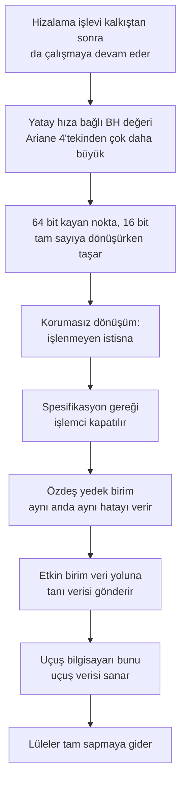

import OlayKunyesi from '@site/src/components/OlayKunyesi';

# Ariane 5, Uçuş 501 (1996): Yeniden Kullanılan Yazılım, Değişen Yörünge

Ariane 5'in ilk uçuşu, kalkıştan yarım dakika kadar sonra roketin rotasından sapıp
parçalanmasıyla bitti. Neden, Ariane 4'ten devralınan ataletsel referans sistemi
yazılımındaki bir sayı dönüşümünün yeni roketin yörüngesinde taşmasıydı. Bu bir uçak
kazası değildir, ama yeniden kullanım, istisna işleme ve özdeş yedek üzerine verdiği
dersler aviyonik yazılım için birebir geçerlidir.

<OlayKunyesi />

## Ne oldu?

Soruşturma kurulunun raporu zamanı kalkıştan değil, ana motorun ateşleme komutundan (H0)
sayar; roket yerden bundan yaklaşık yedi saniye sonra kalkar.

| Zaman | Olay |
|----|----|
| H0 + 36,7 s | Yedek ataletsel referans sisteminin bilgisayarı devre dışı kalır |
| Yaklaşık 0,05 s sonra | Etkin ataletsel referans sistemi aynı biçimde devre dışı kalır |
| Hemen ardından | Uçuş bilgisayarı önce katı yakıtlı iticilerin, sonra ana motorun lülelerini tam sapmaya götürür |
| H0 + 39 s dolayı | Roket 20°'yi aşan hücum açısında aerodinamik yüklerle parçalanmaya başlar; iticiler ayrılır, kendini imha sistemi çalışır |

Roket yaklaşık 4 km irtifada, fırlatma rampasına yaklaşık 1 km uzaklıkta yok oldu.

## Yazılımın rolü

Rokette donanımı ve yazılımı özdeş iki ataletsel referans sistemi (SRI) vardı: biri etkin,
diğeri sıcak yedekti.

**Gerekmeyen işlev.** Taşma, SRI'nin hizalama işlevinde oluştu. Bu işlev yalnızca kalkıştan
önce anlamlıdır. Ariane 4'te, geri sayım son anda durdurulursa hizalamanın hızla
yenilenebilmesi için kalkıştan sonra da bir süre çalışacak biçimde tanımlanmıştı. Ariane
5'te bu ihtiyaç yoktu; işlev, iki roket arasında ortaklığı korumak için olduğu gibi
bırakıldı ve uçuşun yaklaşık ilk 40 saniyesinde çalışmaya devam etti.

**Taşan dönüşüm.** İşlevin ara sonuçlarından biri (raporda BH, yatay sapma), yatay hıza
bağlı bir büyüklüktü ve 64 bit kayan noktadan 16 bit işaretli tam sayıya çevriliyordu.
Ariane 5 yatay hızını Ariane 4'ün yaklaşık beş katı hızla kazanır; değer 16 bite sığmadı.

**Korunmayan değişken.** Kodda bu tür yedi dönüşüm vardı. SRI bilgisayarının iş yükünü
%80'in altında tutma hedefi yüzünden dördü taşmaya karşı korunmuş, BH'nin de aralarında
olduğu üçü korunmamıştı. Gerekçe, bu değerlerin fiziksel olarak sınırlı olduğu ya da geniş
bir emniyet payı bulunduğuydu. Bu gerekçe Ariane 4 yörüngesi için doğruydu ve kaynak kodda
yazılı değildi.

**İstisnada kapanma.** Raporun altını çizdiği nokta şudur: taşma tek başına roketi
düşürmedi. Spesifikasyon, herhangi bir istisnada arızanın veri yoluna bildirilmesini,
durumun belleğe kaydedilmesini ve işlemcinin kapatılmasını istiyordu. Bu kural, rastgele bir
donanım arızası düşünülerek yazılmıştı: arızalı birim kapanır, yedek devralır. Tasarım
hatasında ise yedek de aynı anda kapandı.

**Veri sanılan tanı.** Kapanan etkin birim veri yoluna bir tanı deseni gönderdi; uçuş
bilgisayarı bunu konum ve yönelim verisi olarak yorumladı ve lüleleri uç konuma sürdü.

## Neden yakalanmadı?

1. **Yeni yörünge gereksinimlere girmedi.** Ariane 5'in yörünge verisi, ortak bir kararla
   SRI'nin gereksinim ve spesifikasyonuna dâhil edilmedi. Yazılım, artık geçerli olmayan
   bir çalışma zarfının gereksinimleriyle doğrulandı.
2. **Birim, Ariane 5 koşullarında hiç test edilmedi.** Donanım testlerinin hiçbiri Ariane
   5'in zaman dizisini ve yörüngesini kullanmadı.
3. **Sistem testinde gerçek birim yoktu.** Kapalı çevrim uçuş simülasyonlarında SRI'lerin
   yerine yazılım modelleri kondu. Gerçek birim, gerçek yörüngeyle ilk kez uçuşta karşılaştı.
4. **Varsayım yazılı değildi.** Üç değişkenin neden korunmadığı kodda görünmüyordu; gözden
   geçirmeler bu gerekçenin yeni roket için geçerli olup olmadığını sormadı. Rapor gözden
   geçirme sürecini de katkıda bulunan etkenler arasında sayar.
5. **Yedeklilik yalnızca donanım arızasına karşıydı.** İki birimde aynı yazılım koşuyordu;
   yazılımdan kaynaklanan bir arızanın ikisini birden düşüreceği hesaba katılmamıştı.

## Nasıl önlenebilirdi?

| Zayıf halka | Önlem | Kitapta |
|----|----|----|
| Yazılım yeni platforma, eski gereksinimleriyle taşındı | Yeniden kullanımda önce çalışma zarfı karşılaştırılır: girdilerin aralığı, zamanlama ve görev profili yeni projede yeniden yazılır, eski kanıtın hangi varsayıma dayandığı tek tek sorulur | [24. Yazılım Yeniden Kullanımı](/kitap/ozel-konular/yazilim-yeniden-kullanimi) |
| Gerekmeyen işlev uçuşta çalışmaya devam etti | Yeni projede ihtiyaç duyulmayan işlev ya kaldırılır ya da devre dışı bırakılmış kod olarak ele alınır ve istem dışı çalışmadığı gösterilir | [17. Kapsanmayan Kodlar](/kitap/ozel-konular/kapsanmayan-kodlar) |
| "Bu değer taşmaz" gerekçesi kodda ve gereksinimde yoktu | Her daraltıcı dönüşümün aralık varsayımı gereksinime ya da tasarıma yazılır; koruma kaldırılıyorsa gerekçesi türetilmiş gereksinim olarak emniyet sürecine bildirilir | [7. Yazılım Tasarımı](/kitap/do178c-ile-gelistirme/yazilim-tasarimi) |
| Her istisna aynı biçimde, birimi kapatarak karşılandı | İstisna politikası işlevin kritikliğine göre tanımlanır: emniyeti etkilemeyen bir hesaptaki hata, yönelim verisini kesmemelidir; birim en iyi tahminini vermeyi sürdürür | [6. Yazılım Gereksinimleri](/kitap/do178c-ile-gelistirme/yazilim-gereksinimleri) |
| Tanı verisi uçuş verisiyle aynı kanaldan, ayırt edilemez biçimde gitti | Arayüz, geçerli veri ile arıza bildirimini karıştırılamayacak biçimde ayırır; alıcı, geçerlilik bilgisi olmayan veriyi kullanmaz | [7. Yazılım Tasarımı](/kitap/do178c-ile-gelistirme/yazilim-tasarimi) |
| Testler gerçek birimi ve gerçek yörüngeyi bir araya getirmedi | Gereksinim tabanlı testler hedef donanımda, görevin gerçek profiliyle koşulur; modelle değiştirilen her birim için neyin doğrulanmadan kaldığı kayda geçer | [9. Yazılım Doğrulama](/kitap/do178c-ile-gelistirme/yazilim-dogrulama) |
| Özdeş yedek, ortak tasarım hatasına karşı korumadı | Emniyet değerlendirmesi yazılım kaynaklı ortak arızayı ayrıca ele alır; yedekliliğin hangi arıza türüne karşı işe yaradığı açıkça yazılır | [3. Sistem Emniyet Değerlendirmesi](/kitap/baglam/sistem-emniyet-degerlendirmesi-baglaminda-yazilim) |

## Çıkarılacak dersler

1. **Yeniden kullanılan yazılımın kanıtı, eski bağlamın kanıtıdır.** Kod değişmediği için
   "hiçbir şey değişmedi" demek kolaydır. Değişen, kodun doğru çalıştığı varsayımların
   kümesidir.
2. **Yazılmayan varsayım, gözden geçirilemez.** Bir korumanın bilerek konmadığı, gerekçesiyle
   birlikte kodun ve gereksinimin yanında durmalıdır; aksi hâlde sonraki ekip onu bir karar
   olarak değil, bir boşluk olarak bile göremez.
3. **Yazılım arızası rastgele değildir.** Aynı girdiyi alan özdeş iki kopya aynı anda aynı
   hatayı yapar. Donanım için kurulmuş yedeklilik mantığı, tasarım hatasına karşı kendiliğinden
   koruma sağlamaz.
4. **"Hata olursa dur" her zaman güvenli değildir.** Durmanın güvenli olduğu sistemler
   vardır; uçuşun ortasındaki bir yönelim kaynağı bunlardan biri değildir. Güvenli durum,
   işlevin kaybının sistemdeki sonucuna bakılarak seçilir.
5. **Gerekmeyen kod, risk taşımaya devam eder.** Çalışan ama ihtiyaç duyulmayan bir işlev,
   faydası olmadan arıza üretebilir.
6. **Modelle yapılan test, modelin bildiği kadarını doğrular.** Gerçek birimin yerine konan
   model, o birimin hatasını içermez.

## Sonrasında ne değişti?

Soruşturma kurulunun on dört tavsiyesinin başlıcaları şunlardır: hizalama işlevinin kalkışta
kapatılması ve uçuşta gerekmeyen hiçbir işlevin çalıştırılmaması; kapalı çevrim sistem
testlerinin olabildiğince gerçek donanımla ve gerçekçi girdilerle yapılması; hiçbir sensörün
en iyi tahminini göndermeyi kesmemesi; uçuş yazılımının tamamının örtük varsayımlar ve
değişken aralıkları açısından yeniden gözden geçirilmesi; yörünge verisinin spesifikasyon ve
test gereksinimlerine girmesi; gerekçe belgelerine kod kadar özen gösterilmesi; gözden
geçirmelere, savların özünü inceleyen dış uzmanların katılması.

Kaybedilen Cluster uydularının yerine yapılanlar 2000 yılında başka fırlatma araçlarıyla
yörüngeye yerleştirildi.

## Kendi projenize sorun

- Başka projeden aldığınız bileşenin girdilerinin aralığı, sizin platformunuzda da aynı mı?
  Bunu kim, hangi veriyle gösterdi?
- Kodunuzdaki daraltıcı tür dönüşümlerinin hangileri korumasız ve gerekçesi nerede yazılı?
- Beklenmeyen bir istisnada yazılımınız ne yapar? Bu davranış, işlevin kaybının sistemdeki
  sonucu düşünülerek mi seçildi?
- Yedek kanalınız asıl kanalla aynı yazılımı mı koşuyor? Öyleyse yedeklilik hangi arızaya
  karşı işe yarıyor?
- Arayüzlerinizde alıcı, geçersiz ya da tanı amaçlı veriyi geçerli veriden ayırabiliyor mu?
- Entegrasyon testlerinizde hangi birimler modelle temsil ediliyor ve bu yüzden ne
  doğrulanmadan kalıyor?
- Projenizde çalışan ama artık ihtiyaç duyulmayan bir işlev var mı?

## Kaynaklar

- Ariane 501 Soruşturma Kurulu raporu (19 Temmuz 1996), tam metin:
  [Glasgow Üniversitesi'ndeki kopyası](https://www.dcs.gla.ac.uk/~johnson/teaching/safety/reports/ariane5.html)
- Aynı raporun ESA tarafından yayımlanan taranmış sürümü:
  [esa.int](https://esamultimedia.esa.int/docs/esa-x-1819eng.pdf)
- ESA basın duyurusu, soruşturma raporunun sunumu (23 Temmuz 1996):
  [esa.int](https://www.esa.int/Newsroom/Press_Releases/Ariane_501_-_Presentation_of_Inquiry_Board_report)
- Yerine yapılan uydular için ESA'nın Cluster II sayfası:
  [sci.esa.int](https://sci.esa.int/web/cluster/-/24728-the-cluster-ii-mission)
