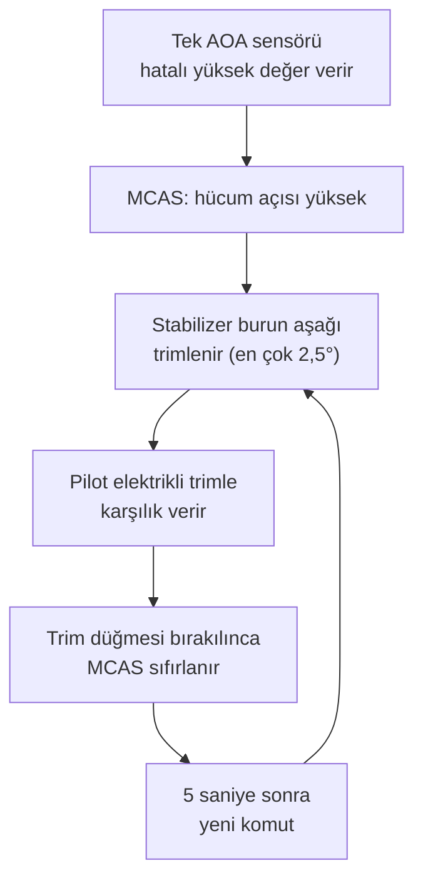

import OlayKunyesi from '@site/src/components/OlayKunyesi';

# Boeing 737 MAX (2018–2019): MCAS ve Tek Sensöre Güvenmek

Beş ay arayla düşen iki Boeing 737 MAX'te, uçuş kontrol bilgisayarındaki MCAS işlevi tek
bir hücum açısı (angle of attack, AOA) sensörünün hatalı verisine dayanarak uçağın burnunu
tekrar tekrar aşağı trimledi. Soruşturma raporlarının hiçbiri MCAS'ta bir kodlama hatası
göstermez: yazılım, kendisinden isteneni yaptı. Yanlış olan, ondan ne istendiği ve bunun
emniyet değerlendirmesinde nasıl ele alındığıydı.

<OlayKunyesi />

## Ne oldu?

**Lion Air 610.** Uçağın sol AOA sensörü bir gün önce değiştirilmişti ve gerçek değerden
yaklaşık 21° fazla gösteriyordu. Bir önceki uçuşta aynı arıza yaşanmış, o mürettebat
stabilizer trim devresini kapatarak uçuşu tamamlamıştı. Kaza uçuşunda kalkıştan sonra
flaplar toplanınca MCAS devreye girdi; mürettebat her seferinde elektrikli trimle karşılık
verdi, MCAS birkaç saniye sonra yeniden komut verdi. Uçak kalkıştan yaklaşık on bir dakika
sonra denize düştü; uçaktaki 189 kişi öldü.

**Ethiopian 302.** Sol AOA değeri kalkıştan hemen sonra gerçek dışı bir değere (74,5°)
sıçradı. MCAS dört kez burun aşağı trim komutu verdi; mürettebat trim devresini kapattığı
için bunlardan biri stabilizer'ı hareket ettirmedi. Uçak kalkıştan yaklaşık altı dakika
sonra yere çarptı; uçaktaki 157 kişi öldü.

İlk kazadan dokuz gün sonra acil bir uçuşa elverişlilik direktifi yayımlandı; ikinci
kazadan üç gün sonra filo uçuştan men edildi ve men kararı 18 Kasım 2020'ye kadar sürdü.

## Yazılımın rolü

MCAS (Maneuvering Characteristics Augmentation System), basında sıkça yazıldığı gibi bir
"stall önleme sistemi" olarak değil, kumanda hissini düzelten bir işlev olarak tasarlandı.
MAX'in daha büyük ve daha önde duran motorları, yüksek hücum açısında lövye kuvvetinin
sertifikasyon kurallarının istediği biçimde artmasını bozuyordu. MCAS, uçuş kontrol
bilgisayarındaki hız trim işlevinin bir uzantısı olarak eklendi: elle uçuşta, flaplar
kapalıyken hücum açısı yükselirse yatay stabilizer'ı burun aşağı yönde trimliyordu.

Üç tasarım özelliği birlikte belirleyici oldu:

- **Tek sensör.** Uçakta iki AOA sensörü vardı, ama her uçuş kontrol bilgisayarı MCAS için
  yalnızca kendi tarafındaki sensörü kullanıyordu. İki değer karşılaştırılmıyordu.
- **Büyüyen yetki.** MCAS başlangıçta yalnızca yüksek hızdaki belirli manevralar için
  düşünülmüştü ve tek etkinleşmede en çok 0,6° trim yapabiliyordu. Mart 2016'da düşük hıza
  da genişletildi; düşük hızda aynı etkiyi elde etmek için yetki 2,5°'ye çıkarıldı.
- **Tekrar.** Pilotun trim düğmesini bırakması MCAS'ı sıfırlıyor, koşul sürüyorsa beş
  saniye sonra yeni bir komut geliyordu. Komutların toplamı için bir sınır yoktu. Endonezya
  raporunun hesabına göre düzeltilmeyen iki etkinleşme, stabilizer'ı burun aşağı sınırına
  götürmeye yetiyordu.

Koda bakıldığında bunların hiçbiri hata değildir; her biri gereksinimde yazan davranıştır.

Raporların yazılım gerçekleştirmesinde gösterdiği tek uyumsuzluk MCAS'ta değil, ekran
yazılımındadır. İki sensör ayrıştığında çıkması gereken AOA DISAGREE uyarısı bütün
uçaklarda standart olarak istenmişti; teslim edilen ekran yazılımı ise bu uyarıyı, isteğe
bağlı satılan AOA göstergesine bağlamıştı. Gösterge filonun küçük bir bölümünde vardı,
dolayısıyla uyarı uçakların çoğunda çalışmıyordu. Üretici bunu 2017'de fark etti, emniyet
sorunu saymadı ve düzeltmeyi 2020'ye planladı. Bu, gereksinim ile gerçekleştirme arasında
doğrulamanın yakalayamadığı gerçek bir farktır.

MCAS'ın ya da uçuş kontrol bilgisayarı yazılımının hangi yazılım seviyesinde geliştirildiği
resmî raporların hiçbirinde yazmaz; raporlar yalnızca yazılımın DO-178B'ye göre
geliştirildiğini belirtir.

## Neden yakalanmadı?

1. **Arıza durumu hafif sınıflandırıldı.** Fonksiyonel tehlike değerlendirmesinde
   (functional hazard assessment, FHA) MCAS'ın istem dışı çalışması normal uçuş zarfında
   majör, operasyonel zarfın tamamında tehlikeli olarak sınıflandırıldı; katastrofik bir
   MCAS arıza durumu tanımlanmadı. Bu sınıflandırma, tek sensöre dayanmayı kabul edilebilir
   kıldı.
2. **Sınıflandırma, pilotun hızlı ve doğru tepkisine dayanıyordu.** Analiz, mürettebatın
   istenmeyen trimi hemen tanıyacağını, karşı trim yapacağını ve gerekirse kaçak stabilizer
   prosedürünü uygulayacağını varsaydı; varsayılan tanıma ve tepki süreleri birkaç saniye
   mertebesindeydi.
3. **Arızanın kendisi değil, yalnızca sonucu denendi.** Simülatör denemelerinde istenmeyen
   trim hareketi verildi; onu üreten hatalı AOA verisi ve bu verinin kokpitte aynı anda
   yarattığı diğer etkiler (lövye sarsıcısı, hız ve irtifa uyuşmazlığı uyarıları)
   canlandırılmadı. Gerçek uçuşlarda mürettebat tek bir trim sorunuyla değil, aynı anda
   gelen bir uyarı yığınıyla karşılaştı.
4. **Gereksinim değişti, analiz geride kaldı.** Yetki 0,6°'den 2,5°'ye çıkarıldığında
   üretici en kritik durumun hâlâ yüksek hız olduğunu değerlendirdi; arıza durumu yeniden
   sınıflandırılmadı. Ortak otorite incelemesine (JATR) göre tekli ve çoklu arıza analizi
   MCAS gereksinimlerinin yalnızca yüksek hızı kapsayan erken bir revizyonu üzerinde
   yapılmıştı; uçak iki revizyon sonrasıyla sertifikalandı ve aradaki fark için belgelenmiş
   bir emniyet analizi yoktu.
5. **İşlev bütün olarak değerlendirilmedi.** Aynı incelemeye göre MCAS'ın belgeleri
   parçalıydı, işlev tamamlanmış ve entegre bir bütün olarak ele alınmadı; varsayımlar
   gereksinimlerden ayrı yönetildi ve gereksinimlerin tamamı izlenebilir değildi. Otoritenin
   uçuş testi ekibi değişiklikten haberdardı, sistem uzmanları ise olmayabilirdi.
6. **Mürettebat işlevi bilmiyordu.** MCAS, üreticinin önerisi ve otoritenin kabulüyle uçuş
   el kitabından ve fark eğitiminden çıkarıldı. Analiz pilotun tepkisine dayanıyordu, ama
   pilota tepki vereceği şeyin adı söylenmemişti.

Raporlar her noktada aynı şeyi söylemez. Etiyopya raporu nedenleri tasarım, değerlendirme,
uyarı ve eğitimde toplar; ABD ve Fransa'nın soruşturma kurumları bu rapora, mürettebatın
elle trim ve itki yönetiminin de nedenler arasında sayılması gerektiği yönünde şerh
düşmüştür. İkinci kazadaki sensör arızasının kaynağı konusunda da (yabancı cisim ya da kuş
çarpması, elektrik arızası) görüş ayrılığı vardır. MCAS'ın rolü konusunda ise raporlar
birleşir.

## Nasıl önlenebilirdi?

| Zayıf halka | Önlem | Kitapta |
|----|----|----|
| Arıza durumu pilot tepkisine dayanılarak hafif sınıflandırıldı | Sınıflandırma, mürettebatın arızayı gerçek kokpit koşullarında (eş zamanlı uyarılar, iş yükü) tanıyıp tanıyamayacağı gösterilerek yapılır; gösterilemiyorsa en kötü sonuç esas alınır | [3. Sistem Emniyet Değerlendirmesi](/kitap/baglam/sistem-emniyet-degerlendirmesi-baglaminda-yazilim) |
| Uçağın kumanda yüzeyine yetkili işlev tek sensöre dayandı | Sınıflandırma doğru yapıldığında mimari de değişir: sensörler karşılaştırılır, ayrışmada işlev kendini devre dışı bırakır ve bunu bildirir | [2. Sistem Bağlamında Yazılım](/kitap/baglam/sistem-baglaminda-yazilim) |
| Yetki ve çalışma zarfı değişince analiz güncellenmedi | Emniyetle ilgili her gereksinim değişikliği, emniyet değerlendirmesine geri beslenir; değişiklik etki analizi "hangi varsayım artık geçerli değil?" sorusunu sorar | [10. Yazılım Konfigürasyon Yönetimi](/kitap/do178c-ile-gelistirme/yazilim-konfigurasyon-yonetimi) |
| Tekrarlı etkinleşmenin toplam etkisi sınırlanmadı | Yetki sınırı tek komut için değil, birikimli etki için gereksinim olarak yazılır ve gürbüzlük testleriyle (sürekli hatalı girdi) doğrulanır | [6. Yazılım Gereksinimleri](/kitap/do178c-ile-gelistirme/yazilim-gereksinimleri) |
| Varsayımlar gereksinimlerden ayrı tutuldu | Emniyet analizinin her varsayımı (pilot tepki süresi, eğitim, uyarının varlığı) izlenen bir gereksinim ya da kısıt olur ve bir kanıta bağlanır | [3. Sistem Emniyet Değerlendirmesi](/kitap/baglam/sistem-emniyet-degerlendirmesi-baglaminda-yazilim) |
| Uyarı, isteğe bağlı bir seçeneğe bağlı kaldı | Seçenek verisinin her bileşimi için gereksinimler doğrulanır; "standart" denen işlev, seçeneksiz konfigürasyonda test edilir | [22. Konfigürasyon Verisi](/kitap/ozel-konular/konfigurasyon-verisi) |
| Bilinen uyumsuzluk yıllarca açık kaldı | Problem raporunun emniyet etkisi, ilk analizin varsayımlarına dönülerek değerlendirilir; erteleme kararı otoriteyle paylaşılır | [12. Sertifikasyon İrtibatı](/kitap/do178c-ile-gelistirme/sertifikasyon-irtibati) |

## Çıkarılacak dersler

1. **Doğru yazılmış kod, yanlış gereksinimi kurtarmaz.** DO-178C, yazılımın gereksinimlerini
   karşıladığını gösterir; gereksinimlerin doğru olduğunu göstermez. O iş sistem süreçlerinin
   ve emniyet değerlendirmesinin işidir ve yazılım ekibi bu sınırın nerede durduğunu
   bilmelidir.
2. **Yazılım seviyesi bir çıktıdır, girdisi arıza durumu sınıflandırmasıdır.** Sınıflandırma
   yanlışsa ondan türeyen her şey (mimari, yedeklilik, doğrulama titizliği) yanlış düzeyde
   kalır ve sonraki hiçbir süreç bunu kendiliğinden düzeltmez.
3. **"Pilot müdahale eder" bir gereksinimdir.** Bir arıza durumunun etkisi insan tepkisiyle
   hafifletiliyorsa o tepki tanımlanmalı, eğitimi verilmeli, uyarısı sağlanmalı ve gerçekçi
   koşullarda gösterilmelidir. Aksi hâlde analizdeki bir satırdan ibarettir.
4. **Küçük görünen parametre değişikliği yeni bir işlev olabilir.** Yetkinin dört katına
   çıkması ve çalışma zarfının genişlemesi bir sayı değişikliği gibi görünür; emniyet
   açısından başka bir işlevdir.
5. **Arıza, sistemin gördüğü biçimde canlandırılmalıdır.** Tek bir sensör arızası birden çok
   işlevi ve uyarıyı aynı anda etkiler. Yalnızca incelenen işlevin çıktısını bozan bir test,
   mürettebatın karşılaşacağı durumu temsil etmez.
6. **Parçalı belge, parçalı anlayış üretir.** Bir işlevin gereksinimi, emniyet analizi ve
   varsayımları ayrı belgelerde, ayrı ekiplerde ve ayrı revizyonlarda yaşıyorsa işlevi bütün
   olarak gören kimse kalmaz.

## Sonrasında ne değişti?

Uçuşa dönüş için yapılan değişiklikler, zayıf halkaların neredeyse birebir karşılığıdır:

- İki AOA sensörü karşılaştırılır; fark 5,5°'yi aşarsa MCAS ve hız trim işlevi uçuşun
  sonuna kadar devre dışı kalır.
- Her yüksek hücum açısı olayında MCAS yalnızca bir kez etkinleşir; pilotun trim düğmesi
  onu yeniden kurmaz.
- Toplam komut, pilotun yalnızca lövyeyle uçağı kontrol edebileceği düzeyle sınırlıdır.
- İki uçuş kontrol bilgisayarı birbirinin trim komutunu izler; tek bilgisayardan gelen
  hatalı komut engellenir.
- AOA DISAGREE uyarısı bütün uçaklarda etkindir.
- Uçuş el kitabındaki prosedürler yenilendi ve simülatör oturumu içeren özel bir eğitim
  zorunlu tutuldu.
- Bütünleşik sistem emniyet değerlendirmesi, pilotun anında müdahalesine dayanmayacak ve
  katastrofik sonuçlu tek nokta arızası bırakmayacak biçimde yeniden yapıldı.

## Kendi projenize sorun

- Yazılımınızın seviyesini belirleyen arıza durumu sınıflandırması hangi varsayımlara
  dayanıyor? Bu varsayımlar bir yerde yazılı ve izleniyor mu?
- Bir işlevin yetkisi, eşiği ya da çalışma zarfı değiştiğinde emniyet değerlendirmesine
  kim, hangi mekanizmayla haber veriyor?
- Tek kaynaklı bir girdiyle kumanda yüzeyine ya da motora komut veren işleviniz var mı?
  Girdi hatalı ama geçerli aralıkta kalırsa ne olur?
- Sürekli hatalı girdi altında işlevin birikimli etkisi sınırlı mı? Bu, bir test case ile
  gösterildi mi?
- Analizinizde operatör tepkisine bırakılan her durum için eğitim, prosedür ve uyarı
  gerçekten var mı?
- Açık problem raporlarınızdan hangileri "emniyet etkisi yok" diye ertelendi ve bu karar
  hangi analize dayanıyor?

## Kaynaklar

- Endonezya Ulusal Ulaştırma Emniyeti Komitesi (KNKT), PK-LQP nihai raporu (Ekim 2019):
  [raporun flightradar24.com'daki kopyası](https://www.flightradar24.com/blog/wp-content/uploads/2019/10/JT610-PK-LQP-Final-Report.pdf)
- Etiyopya Kaza Soruşturma Bürosu, ET-AVJ nihai raporu (Aralık 2022):
  [raporun BEA'daki kopyası](https://bea.aero/fileadmin/user_upload/ET_302__B737-8MAX_ACCIDENT_FINAL_REPORT.pdf)
- NTSB'nin Etiyopya rapor taslağına görüşleri (Mart 2022):
  [ntsb.gov](https://www.ntsb.gov/investigations/Documents/US%20comments%20ET302%20Report%20March%202022.pdf)
- NTSB emniyet tavsiyesi raporu ASR-19-01 (Eylül 2019):
  [ntsb.gov](https://www.ntsb.gov/investigations/AccidentReports/Reports/ASR1901.pdf)
- Ortak Otoriteler Teknik İncelemesi (JATR) raporu (Ekim 2019):
  [faa.gov](https://www.faa.gov/sites/faa.gov/files/2022-08/Final_JATR_Submittal_to_FAA_Oct_2019.pdf)
- ABD Temsilciler Meclisi Ulaştırma Komitesi nihai raporu (Eylül 2020):
  [house.gov](https://democrats-transportation.house.gov/imo/media/doc/final_boeing_737_max_report.pdf)
- FAA, 737 MAX uçuşa dönüş inceleme özeti (Kasım 2020):
  [faa.gov](https://www.faa.gov/sites/faa.gov/files/2022-08/737_RTS_Summary.pdf)
