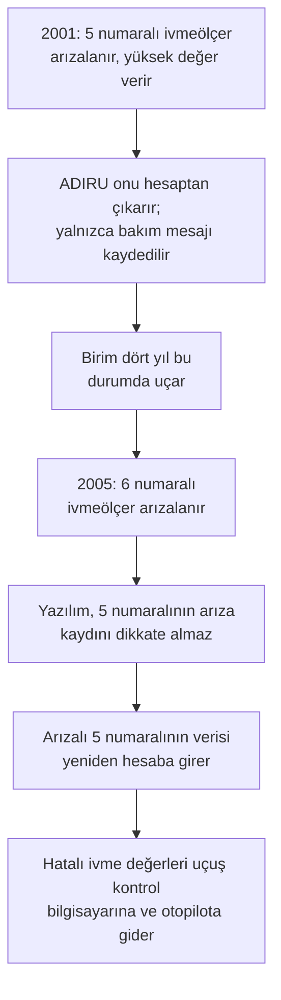

import OlayKunyesi from '@site/src/components/OlayKunyesi';

# Malaysia 124 (2005): Yıllar Önce Arızalanan Sensörün Geri Dönüşü

Perth'ten kalkan bir Boeing 777, tırmanış sırasında otopilottayken kendiliğinden burun
yukarı yöneldi; hava hızı stall uyarısı verecek kadar düştü. Neden, ataletsel ölçüm
biriminin yazılımının, dört yıl önce arızalandığı için dışlanmış bir ivmeölçerin verisini
yeniden kullanmasıydı. Hata, yazılımın arıza yönetimi mantığındaydı ve yıllarca sahada
fark edilmeden durmuştu.

<OlayKunyesi />

:::note[Kaynakların durumu]

Olayın birincil kaynağı Avustralya Ulaştırma Emniyeti Bürosu'nun (ATSB) 2007'de yayımladığı
soruşturma raporudur. Bu sayfa yazılırken rapora doğrudan erişilemedi; olgular FAA'in acil
uçuşa elverişlilik direktifinden ve ATSB raporunu sayfa numarasıyla kaynak gösteren iki
akademik incelemeden alınmıştır. Sayfa, ATSB raporuyla karşılaştırılana kadar bu notu taşır.

:::

## Ne oldu?

Uçak Perth'ten Kuala Lumpur'a gidiyordu ve otopilotla tırmanıştaydı. Mürettebat aynı anda
birbiriyle çelişen göstergelerle karşılaştı: düşük hava hızı uyarısı geldi, birincil uçuş
göstergesi hem aşırı hız hem stall sınırına yaklaşıldığını gösteriyordu, kayma göstergesi
de tam sağdaydı. Uçak burun yukarı yönelip yaklaşık 41.000 ft'e tırmandı; gösterilen hava
hızı 158 kt'ye kadar düştü, stall uyarısı ve lövye sarsıcısı çalıştı.

Kaptan otopilotu devreden çıkarıp burnu indirdi. Otomatik gaz itkiyi artırdı, uçak ikinci
kez burun yukarı yöneldi. Otopilotu yeniden devreye alma denemeleri uçağı yatırıp burun
aşağı yönelttiği için mürettebat uçağı elle uçurarak Perth'e döndü ve indi.

## Yazılımın rolü

Boeing 777'de ivme ve dönüş hızı ölçümlerini, hava verisiyle birlikte ADIRU adlı birim
üretir. Birim arızaya dayanıklı tasarlanmıştır: altı ivmeölçeri vardır, birini kaybettiğinde
onu hesaptan çıkarıp kalanlarla çalışmayı sürdürür. Bu sayede arızalı bir sensör yüzünden
birimin hemen değiştirilmesi gerekmez; bakım ertelenebilir.

**İlk arıza.** 5 numaralı ivmeölçer 2001'de arızalandı ve gerçek dışı yüksek değerler
üretmeye başladı. Birim onu dışladı. Arıza yalnızca bakım personelinin görebildiği bir
mesaj olarak kaydedildi; mürettebata gösterilen bir şey değildi ve tek başına birimin
değiştirilmesini gerektirmiyordu.

**İkinci arıza.** Olay uçuşunda 6 numaralı ivmeölçer arızalandı. Yazılımdaki hata bu
noktada ortaya çıktı: birim, 5 numaralı ivmeölçerin kullanılamaz olduğu bilgisini dikkate
almadı ve onun verisini yeniden hesaba kattı. ATSB raporunu aktaran incelemelere göre
birim güç verilip yeniden başlatıldıktan sonra kayıtlı arıza durumunu denetlemiyordu.

**Sonuç.** Uçuş kayıt cihazı üç eksende de olağan dışı ivme değerleri gösterdi. Bu veri
birincil uçuş bilgisayarına, otopilota ve diğer sistemlere gitti.

**Hatanın yaşı.** FAA'in direktifine göre sorun, 1998'de onaylanan yazılım sürümünden
başlayarak sonraki bütün sürümlerde vardı; yani yaklaşık yedi yıl sahada kaldı. ATSB
raporunu aktaran incelemelere göre kusur ilk yazılımdan beri koddaydı, ama başka denetimler
onu örtüyordu; atölye onarımını kolaylaştırmak için arıza tespit mantığında yapılan bir
değişiklik bu örtüyü kaldırdı.

**Sınırlayan etken.** Uçuş bilgisayarı ADIRU'nun verisini, kendi sensörleri olan ikincil
birimin (SAARU) verisiyle karşılaştırıyordu. ATSB'nin ön raporuna göre bu karşılaştırma ilk
burun yukarı hareketin şiddetini azalttı.

## Neden yakalanmadı?

1. **Senaryo test kümesinde yoktu.** Hatanın ortaya çıkması için üç şeyin sırayla olması
   gerekiyordu: bir ivmeölçerin yüksek değer vererek arızalanması, birimin kapatılıp
   açılması ve ikinci bir ivmeölçerin arızalanması. Aktarılan ATSB bulgusuna göre yazılım
   DO-178B'ye uygun geliştirilmişti, ama testler bileşenin ilk spesifikasyon ve
   gereksinimleriyle sınırlı kalmıştı; bu sıra onların arasında değildi.
2. **Değişikliğin yan etkisi görülmedi.** Arıza tespit mantığındaki değişiklik, bakım
   kolaylığı için yapılmış bir iyileştirmeydi. Değiştirilen kodun, başka bir yerdeki kusuru
   örtmekte olduğu bilinmiyordu.
3. **Ertelenen bakım, gizli arızayı yıllarca taşıdı.** İlk arıza emniyet değil ekonomi
   konusu sayıldığı için birim dört yıl bu durumda uçtu. Arıza toleransı, ikinci arızaya
   kadar geçen süreyi uzattı ve ikisinin birleşmesini mümkün kıldı.
4. **Arıza mürettebattan gizliydi.** Birimin azalmış yedeklilikle çalıştığını yalnızca bakım
   kayıtları gösteriyordu.

## Nasıl önlenebilirdi?

| Zayıf halka | Önlem | Kitapta |
|----|----|----|
| Arıza yönetimi mantığı yalnızca tek arıza için test edildi | Arıza durumları bir durum makinesi olarak gereksinime yazılır; arıza sıraları, güç çevrimi ve yeniden başlatma dâhil geçişler gürbüzlük test case'leriyle kapsanır | [9. Yazılım Doğrulama](/kitap/do178c-ile-gelistirme/yazilim-dogrulama) |
| Kalıcı arıza kaydı açılışta dikkate alınmadı | "Bir kez dışlanan sensör, onarım kaydı olmadan geri alınmaz" açık bir gereksinimdir; açılıştaki ilklendirme, kalıcı bellekteki arıza durumunu okur ve bu davranış ayrıca test edilir | [6. Yazılım Gereksinimleri](/kitap/do178c-ile-gelistirme/yazilim-gereksinimleri) |
| Değişiklik, örttüğü kusuru açığa çıkardı | Değişiklik etki analizi, değiştirilen denetimin başka hangi davranışa dolaylı olarak hizmet ettiğini sorar; arıza tespit mantığındaki her değişiklikte arıza senaryoları yeniden koşulur | [10. Yazılım Konfigürasyon Yönetimi](/kitap/do178c-ile-gelistirme/yazilim-konfigurasyon-yonetimi) |
| Gizli arızayla uçuş süresi sınırsızdı | Emniyet değerlendirmesi, ertelenen arızayla uçulabilecek süreyi ve o sürede ikinci arızanın sonucunu ele alır; sınır bakım programına gereksinim olarak girer | [3. Sistem Emniyet Değerlendirmesi](/kitap/baglam/sistem-emniyet-degerlendirmesi-baglaminda-yazilim) |
| Tek birimin hatalı verisi doğrudan kullanıldı | Bağımsız kaynakla karşılaştırma (bu olayda şiddeti azaltan önlem) emniyet analizinde açıkça yer alır ve "gereksiz" diye kaldırılmaz | [2. Sistem Bağlamında Yazılım](/kitap/baglam/sistem-baglaminda-yazilim) |

## Çıkarılacak dersler

1. **Arıza yönetimi kodu, en az test edilen ve en çok ihtiyaç duyulan koddur.** Normal
   işlev her uçuşta çalışır; arıza yönetimi yıllarca hiç çalışmayabilir. Hatası da ancak
   arıza anında, yani en kötü zamanda ortaya çıkar.
2. **Arıza toleransı, arızayı gizler.** Sistem tek arızayla sorunsuz çalıştıkça arıza
   görünmez olur ve birikir. Tolerans kazandırdığı süre için bir sınır ve bir görünürlük
   mekanizması olmadan tasarlanmamalıdır.
3. **Durum, güç çevriminden sağ çıkmalıdır.** Kalıcı olması gereken bir bilginin (arıza
   kaydı, dışlama kararı) yeniden başlatmada nasıl geri yüklendiği ayrı bir gereksinim ve
   ayrı bir test konusudur.
4. **Gereksinim tabanlı test, gereksinimin sorduğunu cevaplar.** Gereksinimde olmayan arıza
   sırası testte de olmaz. Kapsam ölçütlerini sağlamak, senaryo uzayını kapsamak demek
   değildir.
5. **Bir kusuru örten başka bir denetim, belgelenmemiş bir emniyet mekanizmasıdır.** Onu
   kaldıran ya da değiştiren, bilmeden emniyet mekanizmasını kaldırmış olur.
6. **Benzemez ikinci kaynak işe yarar.** Olayın bir kazaya dönüşmemesinde, farklı sensörlere
   dayanan ikincil birimle yapılan karşılaştırmanın payı vardır.

## Sonrasında ne değişti?

- Uçak üreticisi olaydan günler sonra operatörlere, ikincil birim (SAARU) arızalıyken
  uçağın sefere verilmemesini bildirdi.
- FAA, Ağustos 2005'in sonunda bütün Boeing 777'ler için acil bir uçuşa elverişlilik
  direktifi yayımladı. Direktif yeni bir yazılım değil, hatanın etkin olmadığı **eski**
  sürüme geri dönülmesini istiyordu. Bu, o sürümün daha önce başka bir direktifle
  düzeltilmiş olan bir kusurunun bilerek geri kabul edilmesi anlamına geliyordu; direktif
  bu yüzden uçuş el kitabına ek sınırlamalar getirdi ve kendisini geçici önlem olarak
  tanımladı.

## Kendi projenize sorun

- Arıza yönetimi gereksinimleriniz arıza **sıralarını** tanımlıyor mu, yoksa yalnızca tek
  tek arızaları mı?
- Dışlanan bir sensör ya da kanal hangi koşulda geri alınır? Yeniden başlatma bu koşullardan
  biri mi?
- Kalıcı bellekteki arıza kaydının açılışta okunduğunu ve kullanıldığını gösteren bir test
  case'iniz var mı?
- Yazılımınız azalmış yedeklilikle ne kadar süre çalışabilir? Bu süre bir yerde sınırlanıyor
  ve operatöre gösteriliyor mu?
- Arıza tespit mantığını değiştirdiğinizde hangi regresyon testlerini yeniden koşuyorsunuz?
- Kodunuzda birbirinin eksiğini örten denetimler var mı ve bu bağımlılık belgelenmiş mi?

## Kaynaklar

- ATSB soruşturma raporu 200503722 (Mart 2007):
  [atsb.gov.au](https://www.atsb.gov.au/publications/investigation_reports/2005/aair/aair200503722)
- FAA uçuşa elverişlilik direktifi 2005-18-51 (Federal Register, 9 Eylül 2005):
  [govinfo.gov](https://www.govinfo.gov/content/pkg/FR-2005-09-09/html/05-17762.htm)
- C. W. Johnson ve C. M. Holloway, arıza toleranslı yazılımda arıza maskelemenin tehlikeleri
  üzerine inceleme (2007):
  [NASA teknik raporlar sunucusu](https://ntrs.nasa.gov/api/citations/20070034017/downloads/20070034017.pdf)
- C. W. Johnson, yedekliliğin zararlı olabildiği durumlar üzerine inceleme (2009):
  [Glasgow Üniversitesi](https://www.dcs.gla.ac.uk/~johnson/papers/ISSC09/ADIRU_Accident_Submission.pdf)
