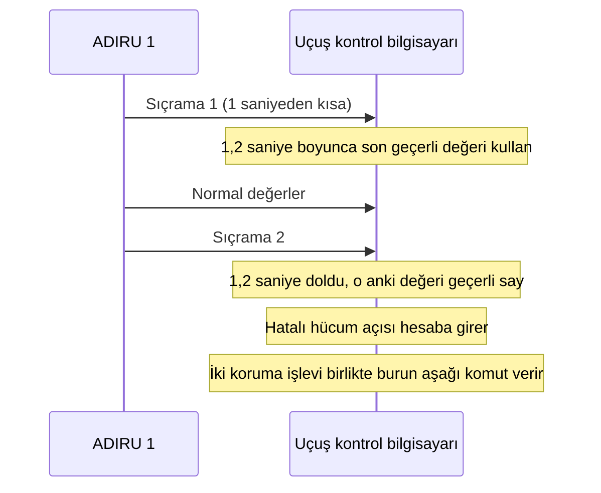

import OlayKunyesi from '@site/src/components/OlayKunyesi';

# Qantas 72 (2008): Geçerli Görünen Hatalı Veri

Seyir irtifasında uçan bir Airbus A330, mürettebatın hiçbir kumandası olmadan iki kez ani
biçimde burun aşağı yöneldi; kemeri bağlı olmayan yolcular ve kabin ekibi tavana çarptı.
Hava verisi biriminin biri, geçerli diye işaretlenmiş hatalı hücum açısı değerleri
gönderiyordu. Uçuş kontrol bilgisayarının bu tür sıçramaları süzen algoritması neredeyse
her durumu karşılıyordu; karşılamadığı tek zamanlama o gün gerçekleşti.

<OlayKunyesi />

:::note[Kaynakların durumu]

Olayın birincil kaynağı Avustralya Ulaştırma Emniyeti Bürosu'nun (ATSB) Aralık 2011'de
yayımladığı nihai rapordur (AO-2008-070). Bu sayfa yazılırken nihai rapora doğrudan
erişilemedi; olgular ATSB'nin ikinci ara raporundan ve nihai raporun bölüm numarasıyla
yapılmış geniş aktarımlarından alınmıştır. Sayfa, nihai raporla karşılaştırılana kadar bu
notu taşır.

:::

## Ne oldu?

Uçak Singapur'dan Perth'e gidiyordu; 303 yolcu ve 12 mürettebat taşıyordu, açık havada
37.000 ft'te otopilotla uçuyordu.

| Zaman (UTC) | Olay |
|----|----|
| 04:40:26 | Üç hava verisi ve ataletsel referans biriminden (ADIRU) biri hatalı veri göndermeye başlar |
| 04:40:28 | Otopilot devreden çıkar; gerçek dışı stall ve aşırı hız uyarıları ile bir dizi arıza mesajı gelir |
| 04:42:27 | Birinci burun aşağı hareket: uçak 8,4° burun aşağı açıya ulaşır, yaklaşık 690 ft kaybeder; yan kumanda kolu ilk iki saniye etkisizdir |
| 04:45:08 | İkinci burun aşağı hareket: yaklaşık 3,5° burun aşağı, 400 ft irtifa kaybı |
| 04:49–04:54 | Mürettebat önce aciliyet, sonra tehlike çağrısı yapar |
| 05:32 | Uçak Learmonth'a iner |

İkinci hareketten sonra uçuş kontrol sistemi korumaların bulunmadığı alternatif yasaya
geçti; mürettebat uçağı elle, yedek göstergelere bakarak indirdi.

## Yazılımın rolü

Zincirin iki halkası vardır: hatalı veriyi üreten birim ve o veriyi kullanan uçuş kontrol
bilgisayarı.

**Hatalı veri.** 1 numaralı ADIRU, hava verisi parametrelerinde aralıklı olarak yanlış
değerler göndermeye başladı. Belirleyici olan, bu değerlerin **geçerli** diye
işaretlenmesiydi. Aktarılan bulgulara göre arıza büyük olasılıkla birimin işlemci
modülünde verinin paketlenmesi ve sıraya konması aşamasındaydı: bir parametre, başka bir
parametrenin değeriyle ya da etiketiyle gönderiliyordu. Uçuş kayıt cihazı, 1 numaralı
hücum açısı değerinde çoğu 50,625° olan 42 sıçrama kaydetti.

**Süzme algoritması.** Uçuş kontrol bilgisayarı çoğu parametrede üç kaynağın ortancasını
kullanır. Hücum açısında ise, sensörlerin gövdedeki yerleşimi nedeniyle 1 ve 2 numaralı
değerlerin ortalamasını alıyor, üç değeri tutarlılık denetimi için kullanıyordu:

- İki değerden biri ortancadan belirgin biçimde saparsa bilgisayar 1,2 saniye boyunca son
  geçerli değeri kullanıyordu.
- Sapma bir saniyeden uzun sürerse o kaynağı kalıcı olarak dışlıyordu.

Bu mantık basamak değişimini, sürekli kayan değeri, tek sıçramayı ve çoklu sıçrama
durumlarının çoğunu karşılıyordu.

**Karşılanmayan durum.** İlk sıçrama bir saniyeden kısa sürerse kaynak dışlanmıyor, yalnızca
1,2 saniyelik bekleme başlıyordu. Bu sürenin dolduğu anda ikinci bir sıçrama varsa
bilgisayar o anki değeri yeniden sorgulamadan geçerli kabul ediyordu. Soruşturmadaki
simülasyonda ilk burun aşağı hareket, yaklaşık 400 milisaniyelik tek bir hatalı girdiyle
yeniden üretilebildi.

**Üst üste binen korumalar.** Hatalı yüksek hücum açısı iki ayrı işlevi aynı anda tetikledi:
yüksek hücum açısı korumasını ve burun yukarı hareketi telafi eden işlevi. İkisinin burun
aşağı komutları toplandı ve en kötü duruma yakın bir irtifa dümeni hareketi üretti.

Birimdeki arızanın kök nedeni belirlenemedi. Aktarılan sonuca göre yazılım hatası, donanım
arızası, sıcaklık, titreşim ve elektromanyetik girişim olası görülmedi; tek olay etkisi
(single event effect, yüksek enerjili bir parçacığın elektronik devrede yarattığı bozulma)
olası tetikleyici olarak incelendi, ama kanıtlanamadı. Aynı birim 2006'da aynı uçakta benzer
bir arıza göstermiş, uçuş kumandalarını etkilememiş ve arıza bulunamamıştı.

## Neden yakalanmadı?

1. **Arıza modu hiçbir analizde yoktu.** Birim üreticisinin arıza modu ve etki analizinde
   "geçerli işaretli, aralıklı ve sık yinelenen hatalı değer" diye bir satır bulunmuyordu.
   Birimin kendi iç testi de arızayı yakalayıp bildirmedi.
2. **Tasarım, sıçramaların seyrek olacağını varsaydı.** Raporun aktarılan bulgusuna göre
   uçak üreticisi 1990'ların başında hücum açısı verisinde sıçrama olabileceğini biliyordu,
   ama bir uçuşta çok az sayıda olmasını bekliyordu. Emniyet değerlendirmesi ve diğer
   geliştirme süreçleri, tek birimden gelen sık sıçramaların etkisini bütünüyle ele almadı.
3. **Zamanlama uzayının bir köşesi boş kaldı.** Algoritma bir durum makinesiydi: bekleme
   süresi, dışlama eşiği ve sıçramanın süresi arasındaki her ilişki ayrı bir yoldur.
   "Beklemenin bittiği anda yeni sıçrama" yolu için bir gereksinim ya da test yoktu.
4. **İki işlevin birleşik etkisi ayrıca sınırlanmamıştı.** Her koruma kendi içinde makuldü;
   aynı hatalı girdiyle birlikte çalıştıklarında komutları toplandı.
5. **Olay son derece seyrekti.** Bu, aynı uçak ailesinin on milyonlarca uçuş saatindeki tek
   olaydı. Seyreklik, hatanın testte ve hizmette görülmemesini açıklar; var olmadığını
   göstermez.

Uçuş kontrol bilgisayarı yazılımının hangi seviyede geliştirildiği bu sayfanın
kaynaklarından doğrulanamadığı için yazılmamıştır.

## Nasıl önlenebilirdi?

| Zayıf halka | Önlem | Kitapta |
|----|----|----|
| Girdinin arıza modları varsayıma dayandı | Arayüz gereksinimi, kaynağın gösterebileceği bütün hata biçimlerini sayar: donmuş değer, sıçrama, yinelenen sıçrama, yanlış etiket, geçerli işaretli hatalı değer; her biri için davranış tanımlanır | [6. Yazılım Gereksinimleri](/kitap/do178c-ile-gelistirme/yazilim-gereksinimleri) |
| Süzme mantığının zaman sınırları test edilmedi | Zamana bağlı her algoritma için süre, eşik ve olay sırası birleşimleri sistematik olarak üretilir; sınır anları (sürenin dolduğu çevrim) ayrı gürbüzlük test case'leridir | [9. Yazılım Doğrulama](/kitap/do178c-ile-gelistirme/yazilim-dogrulama) |
| Bekleme bitince değer yeniden sorgulanmadı | "Bekleme sonrası ilk değer, kabul edilmeden önce aynı tutarlılık denetiminden geçer" bir tasarım kuralıdır; durum makinesinin her geçişi gereksinime izlenir | [7. Yazılım Tasarımı](/kitap/do178c-ile-gelistirme/yazilim-tasarimi) |
| "Geçerli" işareti sorgulanmadan kabul edildi | Kaynağın geçerlilik bildirimi tek savunma olmaz; alıcı kendi makullük denetimini (değişim hızı, fiziksel sınır, diğer kaynaklarla tutarlılık) uygular | [2. Sistem Bağlamında Yazılım](/kitap/baglam/sistem-baglaminda-yazilim) |
| Aynı girdiye bağlı işlevlerin toplam yetkisi sınırsızdı | Emniyet değerlendirmesi, tek bir hatalı girdinin etkilediği bütün işlevleri birlikte ele alır ve toplam komut için bir sınır gereksinimi türetir | [3. Sistem Emniyet Değerlendirmesi](/kitap/baglam/sistem-emniyet-degerlendirmesi-baglaminda-yazilim) |
| Daha önceki benzer arıza "bulunamadı" diye kapandı | Yeniden üretilemeyen arıza, kapatılmış bir problem raporu değil açık bir sorudur; kullanan sistemlerin o arıza moduna dayanıklılığı sorgulanır | [10. Yazılım Konfigürasyon Yönetimi](/kitap/do178c-ile-gelistirme/yazilim-konfigurasyon-yonetimi) |

## Çıkarılacak dersler

1. **En tehlikeli veri, hatalı olduğu hâlde geçerli görünen veridir.** Kaybolan ya da
   geçersiz işaretlenen veriyi sistemler iyi yönetir. Geçerli işaretli yanlış değer, bütün
   savunmaları kapıdan geçer.
2. **Girdinin nasıl bozulacağına dair varsayım, bir gereksinimdir.** "Sıçrama seyrek olur"
   gibi bir beklenti yazılı olmalı, kaynağın arıza analiziyle karşılaştırılmalı ve yanlış
   çıktığında ne olacağı düşünülmelidir.
3. **Süzgeç ve oylama mantığı, emniyet-kritik koddur ve bir durum makinesidir.** Yüzde
   doksan dokuz durumda doğru çalışması, kalan durumun olasılığının düşük olduğunu göstermez;
   yalnızca testte görülmediğini gösterir.
4. **Sınır anları ayrı test edilir.** Zamanlayıcının dolduğu çevrim, eşiğin tam üstü ve
   iki olayın aynı çevrime düşmesi, hataların en sık saklandığı yerlerdir.
5. **Koruma işlevi de zarar verebilir.** Uçağı korumak için eklenen her işlev, yanlış
   girdiyle çalıştığında yeni bir arıza durumudur ve yetkisi buna göre sınırlanır.
6. **Seyrek, olmaz demek değildir.** Filo büyüdükçe ve uçuş saati biriktikçe, tasarımda
   "pratikte olmaz" denen birleşimler bir gün gerçekleşir.

## Sonrasında ne değişti?

- Olaydan sekiz gün sonra uçak üreticisi operatörlere yeni bir prosedür gönderdi: birimden
  arıza mesajı geldiğinde mürettebat ilgili hava verisi ve ataletsel referans kanallarını
  kapatacaktı. Prosedür sonraki aylarda iki kez güncellendi ve uçuşa elverişlilik
  direktifleriyle zorunlu kılındı. Aralık 2008'de başka bir uçakta aynı arıza yaşandığında
  mürettebat yeni prosedürle kanalı yarım dakika içinde kapattı; uçuş kumandaları etkilenmedi.
- Uçuş kontrol bilgisayarı yazılımı değiştirildi: önce aralarında hücum açısının da
  bulunduğu beş parametrenin izleme ve süzme mantığı yenilendi, ardından değişiklik birimden
  gelen bütün parametrelere genişletildi.
- Birimin kendisinde veri iletim hatalarını daha iyi yakalayacak değişiklikler yapıldı.

## Kendi projenize sorun

- Girdi arayüzlerinizin gereksinimi, kaynağın hangi hata biçimlerini gösterebileceğini
  sayıyor mu? Bu liste kaynağın arıza analiziyle karşılaştırıldı mı?
- Geçerli işaretli ama fiziksel olarak olanaksız bir değer geldiğinde yazılımınız ne yapar?
- Süzme, oylama ve arıza onaylama mantığınızdaki her zamanlayıcının dolduğu an için bir
  test case'iniz var mı?
- Bir bekleme ya da bastırma süresi bittiğinde ilk değer yeniden denetleniyor mu?
- Aynı sensöre bağlı kaç işleviniz var ve o sensör yanlış ölçtüğünde komutları toplanıyor mu?
- "Arıza bulunamadı" diye kapanan saha raporlarınızı, o birimin verisini kullanan yazılımın
  ekibi görüyor mu?

## Kaynaklar

- ATSB nihai soruşturma raporu AO-2008-070 (Aralık 2011):
  [atsb.gov.au](https://www.atsb.gov.au/publications/investigation_reports/2008/aair/ao-2008-070)
- ATSB ikinci ara raporu (Kasım 2009):
  [raporun airsafe.com'daki kopyası](http://airsafe.com/plane-crash/atsb-qantas-a330-interim-report2.pdf)
- Nihai rapordan bölüm numarasıyla yapılmış aktarımlar:
  [code7700.com](https://code7700.com/case_study_qantas_72.htm)
- Nihai raporun bulgularının özeti:
  [avherald.com](https://avherald.com/h?article=40de5374/0006&opt=0)
- Soruşturmayı yürüten ATSB araştırmacısının sunumu (2009):
  [asasi.org](https://asasi.org/wp-content/uploads/2021/05/QF72-Learmonth-A330-Pitch-Events-Presented-by-Mike-Walker.pdf)
