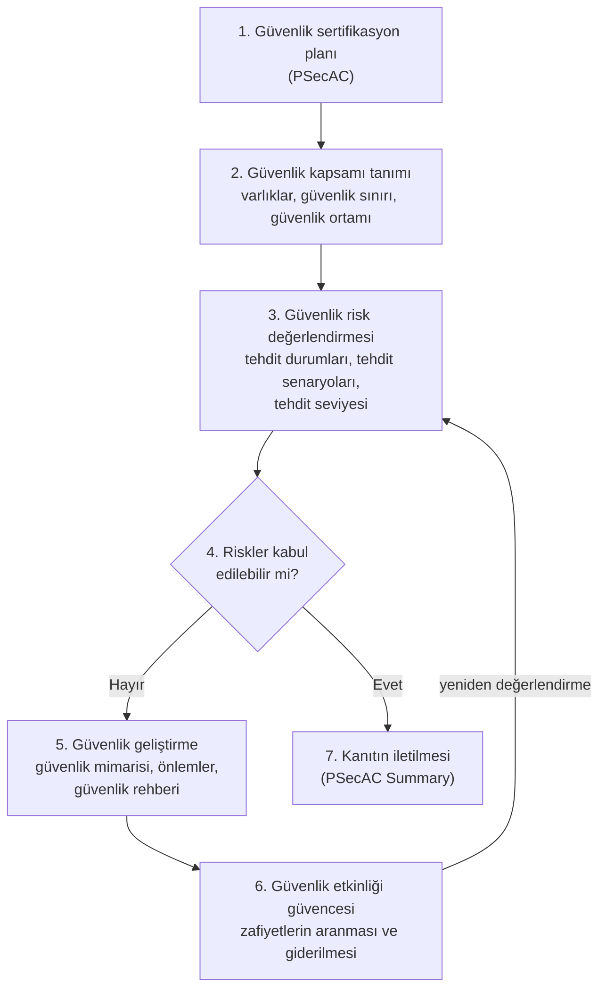
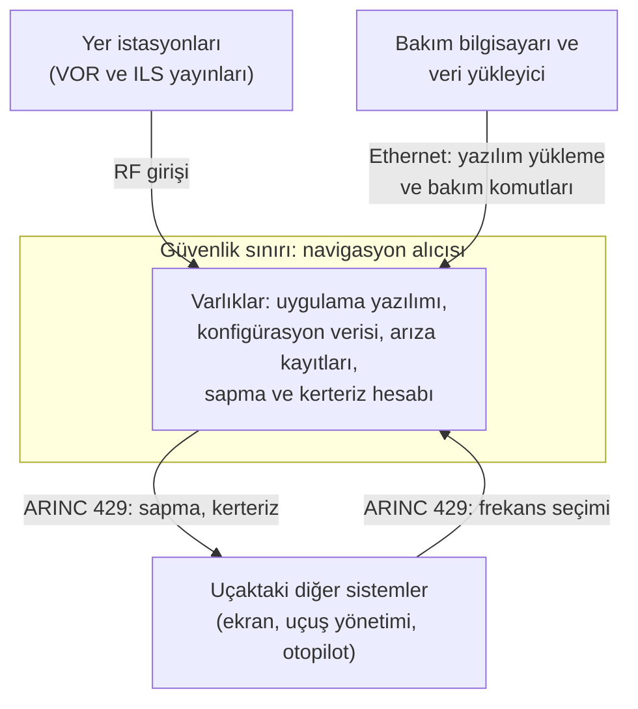

# 27. DO-326A ve Uçuşa Elverişlilik Güvenliği

Uçuşa elverişlilik güvenliği (airworthiness security), uçağın kasıtlı yetkisiz elektronik
etkileşime (intentional unauthorized electronic interaction, IUEI) maruz kaldığında da
emniyetli uçuşa uygun kalmasıdır. Bu bölüm DO-326A'nın tanımladığı güvenlik sürecini, bu
sürecin emniyet değerlendirmesiyle nasıl eşleştiğini, güvenlik kapsamından risk
değerlendirmesine ve güvenlik doğrulamasına kadar temel kavramları ve bunların DO-178C ile
geliştirilen yazılıma yansımasını anlatır.

Kitabın önceki bölümleri hatayı ve arızayı konu alır: mühendisin yanlışı, donanımın
yıpranması, aktarımda bozulan bir bit. Bu bölümün konusu ise bir insanın kasıtlı
eylemidir. Fark küçük görünür ama sonuçları büyüktür:
[18. Sahada Yüklenebilir Yazılım](./18-sahada-yuklenebilir-yazilim.mdx) bölümünde
gösterildiği gibi, kazara bozulmayı yakalayan döngüsel artıklık denetimi (cyclic
redundancy check, CRC), imajı bilerek değiştiren birinin karşısında hiçbir şey ifade
etmez. Uçaklar yer ağlarına, uydu bağlantılarına, bakım bilgisayarlarına ve yolcu
cihazlarına bağlandıkça bu fark yazılım ekibinin gündelik gereksinimlerine kadar iner.

## Emniyetten güvenliğe: neden ayrı bir süreç?

Kitabın 1. bölümündeki ayrım burada temel taşıdır: **emniyet (safety)** sistemin kendi
yanlış ya da eksik davranışından doğacak zarara karşı korunmasıdır, **güvenlik
(security)** ise kasıtlı ve yetkisiz müdahaleye karşı korunmasıdır
(bkz. [1. Giriş ve Genel Bakış](../01-giris/01-giris-ve-genel-bakis.mdx)). Emniyet
değerlendirmesinin araçları bu ikinci tehdit türüne doğrudan uygulanamaz; nedenleri
şunlardır:

- **Saldırgan bir olasılık dağılımına uymaz.** Rastgele donanım arızasına uçuş saati
  başına bir olasılık atanabilir. Saldırgan ise zayıf noktayı arar, bulduğunda da
  istediği an kullanır. Bu yüzden güvenlik riski olasılıkla değil, nitel bir **tehdit
  seviyesi (level of threat)** ile ölçülür.
- **Bağımsızlık varsayımı yıkılabilir.** Emniyet analizi iki kanalın aynı anda
  arızalanmasını, kanallar bağımsız olduğu için son derece düşük olasılıklı sayar.
  Aynı yükleme aracıyla iki kanala da değiştirilmiş yazılım yükleyen bir saldırgan için
  bu bağımsızlık yoktur; ortak neden analizinin (common cause analysis, CCA) baktığı
  türden bir bağı kasıt yaratır.
- **Aynı zafiyet bütün filoda aynı anda kullanılabilir.** Bir donanım arızası tek bir
  uçakta ortaya çıkar; bir zafiyet (vulnerability) ise o tipteki her uçakta vardır ve tek
  bir bilgiyle hepsine karşı denenebilir.
- **Tehdit zamanla değişir.** Sertifikasyon gününde yeterli olan bir önlem, yeni bir
  saldırı tekniği ya da yeni yayımlanmış bir zafiyet bilgisiyle yetersiz kalabilir. Bu
  yüzden güvenlik değerlendirmesi uçağın ömrü boyunca sürer.

Emniyet değerlendirmesinin rehberleri sabotajı geleneksel olarak kapsam dışında bırakır.
DO-326A ise sabotajın elektronik yolla yapılan biçimini, arıza ve hata gibi yönetilmesi
gereken bir emniyet riski olarak ele alır.

### DO-178C güvenliğe nereden bakar?

DO-178C güvenliği kendi başına bir konu olarak işlemez; tehdit değerlendirmesi ya da
güvenlik güvencesi için rehber vermez. Güvenliğe tek bir yerden, gereksinim kaynağı
olarak değinir: §2.1, sistemden yazılıma paylaştırılan gereksinimleri sayarken
fonksiyonel, arayüz, performans, emniyet ve bakım gereksinimlerinin yanında güvenlik
gereksinimlerini de anar. Yazılım ekibi açısından anlamı şudur: güvenlik gereksinimi
sistem sürecinden gelir, yazılım süreci onu her gereksinim gibi geliştirir ve doğrular.
Bu gereksinimin nasıl türetileceğini ve hangi ek kanıtın gerektiğini DO-178C söylemez.

Sistem tarafındaki belgeler de konuyu dışarıya bırakır: ARP4754B ve ARP4761A (ikisi de
2023) uçuşa elverişlilik güvenliğini kapsam dışı sayar ve okuru DO-326A ailesine
yönlendirir; tıpkı yazılımı DO-178C'ye yönlendirdikleri gibi. Boşluğu dolduran belge
ailesi bu bölümün konusudur.

## Belge ailesi ve sürümler

Konu, Avrupa'da EUROCAE WG-72 ve ABD'de RTCA SC-216 komitelerinin ortak çalışmasıyla
şekillendi. SC-216 2007'de kuruldu; tetikleyicisi, Boeing 787'nin ağ mimarisi için
hazırlanan özel koşullara (special condition) uyumun nasıl gösterileceği sorusuydu. İlk
süreç belgesi DO-326 / ED-202 2010'da yayımlandı. 2014'te aile yeniden düzenlendi:
DO-326A yalnızca **ne** yapılacağını, yani süreci, veriyi ve **uyum hedeflerini**
(compliance objective) anlatan çekirdek belge oldu; işletme dönemi için DO-355, yöntemler
için DO-356 yazıldı. Avrupa ve ABD'nin yöntem belgeleri ilk baskıda farklı yollar izledi
ve 2018'de DO-356A / ED-203A olarak birleştirildi.

| Belge (RTCA / EUROCAE) | Güncel sürüm | Rolü |
|---|---|---|
| DO-326 / ED-202 | A (2014), B (2024) | Süreç: faaliyetler, üretilecek veri ve uyum hedefleri |
| DO-356 / ED-203 | A (2018) | Yöntemler: risk değerlendirmesi, tehdit seviyesi, güvenlik güvence seviyesi ve güvence hedefleri |
| DO-355 / ED-204 | A (2020) | Sürekli uçuşa elverişlilik: işletme, bakım, destek ve imha dönemi |
| DO-391, DO-392, DO-393 / ED-201A, ED-206, ED-205A | 2021–2023 | Ortak çerçeve, güvenlik olayı yönetimi ve hava seyrüsefer hizmeti yer sistemleri |

İlk üç satır uçak ve uçak sistemlerinin sertifikasyonunu doğrudan ilgilendirir; sonuncusu
kuruluşlara ve yer sistemlerine uzanan çerçeveyi tamamlar. Kabaca söylenirse DO-326A,
ARP4754B'nin sistem geliştirmede oynadığı rolü güvenlik için oynar: hangi faaliyetin
yapılacağını ve hangi verinin üretileceğini söyler. DO-356A ise bu faaliyetlerin nasıl
yapılabileceğini anlatan yöntem kitabıdır.

**Sürüm notu.** DO-326B ve ED-202B 2024 sonbaharında yayımlandı; yenilikleri ağırlıkla
değişikliklerle ilgilidir ve aşağıda [Değişiklikler](#değişiklikler-ve-do-326b)
başlığında özetlenir. Bu satırların yazıldığı Ekim 2026'da EASA'nın kabul edilebilir uyum
yöntemi (acceptable means of compliance) hâlâ A sürümlerine atıf yapmaktadır. Bölüm bu
yüzden DO-326A'yı esas alır; bir projede hangi sürümün kullanılacağı, diğer standartlarda
olduğu gibi, sertifikasyon otoritesiyle varılan mutabakata bağlıdır.

## Düzenleyici çerçeve

**EASA.** 2020'de yayımlanan ve 1 Ocak 2021'den beri uygulanan karar (ED Decision
2020/006/R), büyük nakliye uçaklarının sertifikasyon şartnamesine CS 25.1319 maddesini
ekledi: uçak sistemleri ve ağları, emniyeti etkileyebilecek kasıtlı yetkisiz elektronik
etkileşime karşı korunmalı, bu korumanın işletmede nasıl sürdürüleceği de talimatlarla
verilmelidir. Benzer maddeler döner kanat, motor, pervane ve ETSO şartnamelerine de
eklendi. Aynı karar, DO-326 ailesini kabul edilebilir uyum yöntemi olarak tanıyan
AMC 20-42'yi yayımladı. AMC 20-42 metni ücretsizdir ve ailenin temel kavramlarını kısa
biçimde özetlediği için ilk okuma olarak da elverişlidir.

**FAA.** ABD'de konu kural yerine projeye özgü özel koşullarla yürüdü. İlk örnekler
2007–2008'de Boeing 787 için çıkarıldı; o günden beri dış ağa bağlanan sistemi olan pek
çok sertifikasyon projesine benzer özel koşullar konuldu. FAA, Ağustos 2024'te bu
uygulamayı kurala dönüştürecek bir öneri yayımladı (nakliye uçakları için yeni bir
14 CFR 25.1319 ile motor ve pervane karşılıkları). Ekim 2026 itibarıyla kural
kesinleşmemiştir; projeler özel koşullarla yürümeye devam eder.

DO-326A büyük nakliye uçakları (CS-25 / Part 25) için yazılmıştır. Küçük uçaklar için hem
FAA hem EASA, daha hafif bir yol olarak ASTM F3532 standardını tanımaya başlamıştır.

**Ürün güvenliği ile kuruluş güvenliği.** Bu iki konu sık karıştırılır.

- **Ürün güvenliği**, uçağın ve sistemlerinin kendisinin korunmasıdır: CS 25.1319, AMC 20-42
  ve DO-326A bu düzeydedir; sonucu tip sertifikasının bir parçasıdır.
- **Kuruluş güvenliği**, havacılık kuruluşlarının kendi bilgi sistemlerini yönetmesidir.
  AB'de Part-IS adıyla anılan iki yönetmelik, (AB) 2022/1645 ve (AB) 2023/203, bunu bir
  bilgi güvenliği yönetim sistemi (information security management system, ISMS) olarak
  ister. Tasarım ve üretim kuruluşları 16 Ekim 2025'ten, operatörler, bakım kuruluşları
  ve hava seyrüsefer hizmet sağlayıcıları 22 Şubat 2026'dan beri kapsamdadır.

İkisi birbirinin yerine geçmez, ama yazılım ekibinin dünyasında buluşur: derleme
sunucusu, kaynak kod deposu ve imzalama anahtarları kuruluş güvenliğinin konusudur; bu
ortamda üretilen yazılımın uçakta taşıdığı güvenlik önlemleri (security measure) ise ürün
güvenliğinin. Sınır keskin değildir: DO-326A, havacılık bilgi sistemi tanımına uçuş
yazılımının ve verisinin geliştirilmesini destekleyen tedarikçi sistemlerini de katar.

**Türkiye.** SHGM'nin 2023'te yürürlüğe giren siber güvenlik talimatı (SHT-SİBER)
kuruluş odaklıdır: işletmelerden bilgi güvenliği yönetim sistemi ve olay müdahale
yapılanması ister; hava aracı tasarımına ve DO-326A'ya değinmez. Tasarım kuruluşlarına
ilişkin talimat (SHT-21) ise Part-IS hükümlerinin ulusal düzenleme tamamlandıktan sonra
ekleneceğini belirtir ve EASA'nın kabul edilebilir uyum yöntemlerini tanır. Uluslararası
pazara ürün veren bir Türk tasarım kuruluşu için pratik yol bu yüzden AMC 20-42 ve DO-326
ailesidir.

## Kapsam: neyi kapsar, neyi kapsamaz?

DO-326A'nın konusu IUEI'dir: yetkisi olmayan birinin uçağın elektronik bilgisine ya da
sistem arayüzlerine elektronik yoldan dokunarak emniyeti etkileyebileceği her durum
(§1.2). Bakım bilgisayarına bulaşmış kötü amaçlı yazılımın yüklemeye karışması da, uçağa
bağlanan bir dış sistemin sahte veri göndermesi de bu tanıma girer.

Tanımın sınırları da en az kapsadıkları kadar öğreticidir. Şunlar DO-326A'nın konusu
değildir:

- **Emniyete dokunmayan bilgi güvenliği**, örneğin yolcu kayıtlarının gizliliği,
- **fiziksel saldırı**: kutuyu sökmek, kabloyu kesmek,
- **elektromanyetik karıştırma (jamming)**,
- **havayolu ve havalimanı işletmesinin kendi güvenliği**, örneğin tesislere erişim,
- **ulusal kurumların işlettiği haberleşme, seyrüsefer ve gözetim hizmetleri**, örneğin
  GNSS ve ADS-B.

Bilgi güvenliğinin klasik üç niteliği burada uçuşa elverişlilik gözlüğüyle okunur.
Navigasyon alıcısı örneğinde **bütünlüğün (integrity)** kaybı, ekranda fark edilmeden
yanlış sapma gösterilmesidir; **kullanılabilirliğin (availability)** kaybı, alıcının
yaklaşmanın ortasında susmasıdır; **gizliliğin (confidentiality)** kaybı ise imzalama
zincirine ait bir anahtarın ya da ayrıntılı mimari bilgisinin açığa çıkmasıdır. Uçuş
sistemlerinde ilk ikisi ağır basar; gizlilik, açığa çıkan bilgi bir sonraki saldırının
anahtarı olduğunda emniyet konusu olur.

:::note[GNSS aldatma: kapsamın gri alanı]
Doğu Akdeniz ve Karadeniz, son yıllarda GNSS karıştırma ve aldatma (spoofing)
olaylarının yoğun yaşandığı bölgeler arasındadır. OPSGROUP'un aktardığı Kasım 2023 tarihli
bir olayda, Adana'dan Larnaka'ya giden bir uçağın GNSS konumu, uçak Ankara FIR'ındayken
Beyrut'u göstermeye başladı. EASA, konuyla ilgili güvenlik bilgi bültenini (SIB 2022-02)
Temmuz 2026'da dördüncü kez güncelledi ve bu bölgeleri de saydı; bülten konuyu siber
güvenlik olarak değil, operasyonel emniyet meselesi olarak ele alır. Karıştırma IUEI'nin
dışında kaldığı hâlde sahte sinyal yayınının bu tanıma girip girmediği tartışmalıdır.
Kapsam tartışmasından bağımsız olarak tasarımın sorumluluğu değişmez: kimliği
doğrulanmamış bir kaynaktan gelen konum, yazılım için güvenilmez bir girdidir ve
ataletsel referans sistemi ya da DME gibi bağımsız kaynaklarla makullük denetiminden
geçirilmelidir. Bu denetim emniyet sürecinin de konusudur.
:::

## Uçuşa elverişlilik güvenlik süreci

DO-326A'nın tanımladığı **uçuşa elverişlilik güvenlik süreci (airworthiness security
process, AWSP)** yedi adımdan oluşur ve bilgi güvenliği risk yönetiminin bilinen kalıbını
(ISO/IEC 27005: bağlamın belirlenmesi, risk değerlendirmesi, risk işleme) uçak
sertifikasyonuna uyarlar:



- **Planlama ve kanıt (adım 1 ve 7)** sertifikasyonun kendisini yönetir. Güvenlik
  sertifikasyon planı (Plan for Security Aspects of Certification, PSecAC) başvuru sahibi
  tarafından hazırlanır ve otoriteyle üzerinde anlaşılır; süreç sonunda PSecAC özeti
  (PSecAC Summary) planın nasıl yerine getirildiğini gösterir. Rolleri, yazılım tarafındaki
  PSAC ile yazılım başarım özetinin (Software Accomplishment Summary, SAS) rolüne benzer.
- **Risk değerlendirmesi (adım 2–4)** neyin, neye karşı korunacağını belirler ve her
  riski bir **kabul edilebilirlik matrisinde** (airworthiness acceptability matrix)
  konumlandırır. Matrisin satırları şiddeti, sütunları tehdit seviyesini gösterir; her
  hücre o birleşimin kabul edilip edilemeyeceğini söyler. Bir yönetmelik matrisi
  vermiyorsa başvuru sahibi önerir, otorite onaylar.
- **Güvenlik geliştirme (adım 5–6)** yalnızca kabul edilemeyen riskler için devreye girer:
  önlemler tasarlanır, gerçeklenir ve etkili oldukları gösterilir. Mimari değişince risk
  değerlendirmesi yinelenir; döngü bütün riskler kabul edilebilir olana kadar sürer.

Kabul edilemeyen bir risk için tek seçenek yeni bir önlem eklemek değildir. Riskin
kaynağı olan özellikten vazgeçilebilir (örneğin kablosuz bakım erişimi hiç sunulmaz),
risk dış bir tarafa devredilebilir (örneğin operatörden belirli bir prosedür istenir) ya
da risk azaltılabilir. Hangi yol seçilirse seçilsin, **kalan risk (residual risk)** kayda
geçer ve gerekçelendirilir.

Sürecin iki özelliği yazılımcının alışkın olduğu düzenden ayrılır. Birincisi, süreç
güvenlik kapsamı olan uçak ve sistemlere uygulanır. Pratikte bu, dış dünyayla elektronik
etkileşimi olan uçak ve sistemler demektir; dışarıyla bağı olmayan bir sistem için bu
sonuç kapsam tanımında belgelenir. İkincisi, süreçte üretilen veri hassastır. Bir risk
değerlendirmesi, saldırganın arayacağı her şeyi tek bir belgede toplar: zayıf noktaların
nerede olduğunu ve hangilerinin bilerek kabul edildiğini. Bu verinin paydaşlar arasında
kimlerle, hangi kurallarla paylaşılacağı baştan kararlaştırılır.

### On dört faaliyet ve emniyet sürecindeki karşılıkları

DO-326A'nın Ek A'sı yedi adımı uçak ve sistem seviyelerinde on dört faaliyete ayırır ve
her biri için girdileri, çıktıları ve uyum hedeflerini verir. Faaliyetler bilerek emniyet
sürecinin yanına yerleştirilmiştir; her güvenlik değerlendirmesi, aynı mimari üzerinde
aynı zamanda yürüyen bir emniyet değerlendirmesiyle eşleşir
(bkz. [3. Sistem Emniyet Değerlendirmesi Bağlamında Yazılım](../02-baglam/03-sistem-emniyet-degerlendirmesi-baglaminda-yazilim.mdx)):

| Güvenlik faaliyeti | Ne üretir? | Emniyet ve geliştirme sürecindeki komşusu |
|---|---|---|
| Uçak / sistem güvenlik kapsamı tanımı (ASSD / SSSD) | Güvenlik sınırı ve güvenlik ortamı | Uçak ve sistem fonksiyonlarının tanımı |
| Ön uçak güvenlik risk değerlendirmesi (PASRA) | Uçak seviyesinde tehdit durumları, senaryolar, ilk riskler | Uçak FHA'sı ve ön uçak emniyet değerlendirmesi (PASA) |
| Ön sistem güvenlik risk değerlendirmesi (PSSRA) | Sistem seviyesinde aynı analiz | Sistem FHA'sı ve ön sistem emniyet değerlendirmesi (PSSA) |
| Uçak / sistem güvenlik mimarisi ve önlemleri (ASAM / SSAM) | Güvenlik mimarisi, güvenlik gereksinimleri, güvence faaliyetleri | Fonksiyonların sistemlere paylaştırılması; sistem mimarisinin geliştirilmesi |
| Operatör güvenlik rehberi / sistem entegratörü güvenlik rehberi (ASOG / SSIG) | Güvenli kurulum, işletme ve bakım için şartlar | Uçak ve sistem entegrasyonu |
| Uçak / sistem güvenlik doğrulaması (ASV / SSV) | Doğrulama sonuçları, zafiyet dosyası | Uçak ve sistem doğrulaması |
| Sistem / uçak güvenlik risk değerlendirmesi (SSRA / ASRA) | Gerçeklenmiş mimarinin nihai riski | Sistem ve uçak emniyet değerlendirmesi (SSA / ASA) |
| PSecAC / PSecAC Summary | Plan ve özet | Sertifikasyon planı ve başarım özeti |

Uyum hedefleri, her faaliyetin bitiş ölçütünü değil, program kapandığında ortadaki verinin
hangi nitelikleri taşıması gerektiğini anlatır. Örneğin risk değerlendirmesinin FHA ile
çelişmemesi ya da zafiyet dosyasında kabul edilemez bir kayıt kalmaması gerekir. DO-326A
belge yapısı dayatmaz; verinin hangi belgelerde toplanacağı PSecAC'ta kararlaştırılır.

Güvenlik ve emniyet süreçleri ayrı yürüyüp birbirini besleyebilir ya da başvuru sahibinin
tanımladığı tek bir birleşik süreçte bütünleşebilir. Her iki durumda kavramlar arasında
yakın bir eşleşme vardır:

| Emniyet sürecinde | Güvenlik sürecinde |
|---|---|
| Arıza durumu (failure condition) | Tehdit durumu (threat condition) |
| Arızanın ya da hatanın nedeni | Tehdit senaryosu (threat scenario) |
| Olasılık | Tehdit seviyesi |
| Mimari azaltım, izleme | Güvenlik önlemi |
| Hata (error) | Zafiyet |
| Geliştirme güvence seviyesi (DAL) | Güvenlik güvence seviyesi (DO-356A'da SAL) |

DO-326A, güvenlik risk değerlendirmesini emniyet değerlendirmesindeki belirli risk
analizine (particular risk analysis, PRA) benzetir: kuş çarpması ya da motor parçalanması
nasıl kendi analizini gerektiriyorsa, kasıtlı etkileşim de öyle ayrı bir analiz ister.

## Güvenlik kapsamı: neyi, nerede, kime karşı?

Risk değerlendirmesinden önce **güvenlik kapsamı (security scope)** tanımlanır ve üç
soru cevaplanır: korunacak olan ne, sınır nerede ve sınırın ötesinde kim var?

Bölüm boyunca kurgusal bir VOR/ILS alıcısını örnek alalım. Alıcı yer istasyonlarının
yayınını işler, sapma ve kerteriz bilgisini ARINC 429 üzerinden ekranlara, uçuş yönetim
sistemine ve otopilota gönderir. Frekans seçimini yine ARINC 429 üzerinden alır. Yazılımı
ve konfigürasyon verisi, 18. bölümde anlatılan yolla, Ethernet üzerinden ARINC 615A ile
sahada yüklenir; aynı port bakım komutları ve arıza kayıtlarının okunması için de
kullanılır.



**Korunacak olan**, DO-326A'nın deyişiyle **varlıklardır (asset)**: uçuşa elverişliliğe
katkısı olan her şey. Alıcı örneğinde bu, kutunun kendisi kadar içinde koşan yazılım,
yüklü konfigürasyon verisi, sapma hesabının kendisi ve dışarı gönderilen veridir.
Yazılım gibi soyut bir varlığın korunması, onu taşıyan donanımın korunmasından ayrı
düşünülemez.

**Sınır**, yani **güvenlik sınırı (security perimeter)**, tasarımcının denetiminin bittiği
çizgidir: içi tasarımla yönetilir, dışı yalnızca varsayımlarla. Sınırı geçen her fiziksel
bağlantı, her protokol ve her bilgi akışı belgelenir. Radyo frekansı girişleri de buna
dahildir, yalnızca bakımda kullanılan bağlantılar da. Saldırgan için en verimli kapı çoğu
zaman tam da "nasılsa bakımda kullanılıyor" diye unutulan kapıdır. Alıcının sınırı şöyle
görünür:

| Arayüz | Yön | Kim kullanır? | İlk değerlendirme |
|---|---|---|---|
| RF girişi | İçeri | Yer istasyonları | Yayın kimlik doğrulamasızdır; hizmetin kendisi kapsam dışıdır, ama alıcının bütünlük izlemesi emniyet sürecinde ele alınır |
| ARINC 429 frekans girişi | İçeri | Kontrol paneli, uçuş yönetimi | Uçak içi kaynak; güvenilirliği o sistemlerin güvenlik kapsamına bağlıdır |
| ARINC 429 veri çıkışı | Dışarı | Ekranlar, otopilot | Birim bu hatta yalnızca vericidir, bu yoldan içeri girilemez; ama buradan çıkan verinin bütünlüğü korunan varlıktır |
| Ethernet yükleme ve bakım portu | İki yönlü | Bakım teknisyeni, havayolu yazılım dağıtım zinciri | En kritik giriş noktası: yazılımı ve veriyi değiştirebilen tek yol |

**Sınırın ötesindekiler** **güvenlik ortamı (security environment)** başlığı altında
yazılır. Bu, sınırın dışındaki dünyaya dair varsayımların kaydıdır: alıcıya kimlerin,
hangi yetkiyle ve hangi araçla ulaşabildiği; yetkili kullanıcıların (bakım teknisyeni)
ve yetkisiz olası kaynakların kim olduğu; havayolunun bakım kuruluşuyla yaptığı
sözleşmenin neyi güvence altına aldığı; yazılımın üreticiden uçağa hangi sunucular ve
hangi ellerden geçerek geldiği. Örneğin varsayımlardan biri "bakım bilgisayarı havayolunun
yönettiği, internete doğrudan açık olmayan bir cihazdır" olabilir. Bu varsayım bir dış
anlaşmaya dönüşür ve sonunda operatöre giden güvenlik rehberinde yer alır. Yazılmayan
varsayım ise sonradan doğrulanamaz.

Sistem seviyesindeki ortam, uçak seviyesindeki ortamın inceltilmesidir: alıcıya frekans
gönderen uçuş yönetim sistemi, uçağın içinde olduğu hâlde alıcı açısından "dışarıdadır".

### Uçak ağ alanları

Uçak seviyesinde sınır ve ortam, uçak ağlarının işlevine göre ayrıldığı alanlar üzerinden
düşünülür. Yaygın sınıflandırma ARINC 664 Part 5'ten gelir:

| Alan | İçeriği | Güvenlik beklentisi |
|---|---|---|
| Uçak kontrol alanı (Aircraft Control Domain, ACD) | Uçuş ve navigasyon sistemleri, uçuşla ilgili haberleşme | En sıkı; dışarıdan gelen her bağlantı ağır gerekçe ister |
| Havayolu bilgi hizmetleri alanı (Airline Information Services Domain, AISD) | Kabin ve bakım yönetimi, elektronik uçuş çantası (EFB) gibi operasyonel ama uçuş kritik olmayan işlevler | Orta |
| Yolcu bilgi ve eğlence alanı (Passenger Information and Entertainment Services Domain, PIESD) | Eğlence sistemleri, kabin bilgi ekranları | Daha açık; yolcuyla etkileşir |
| Yolcu cihazları alanı (Passenger Owned Devices Domain, PODD) | Yolcunun kendi telefonu ve bilgisayarı | Denetim dışı; güvenilmez kabul edilir |

Daha açık bir alanı daha kapalı bir alana bağlayan her yeni yol (örneğin bakım verisini
AISD'den ACD'ye taşıyan bir köprü) güvenlik değerlendirmesinin odak noktasıdır.

## Güvenlik risk değerlendirmesi

Bir tehdit senaryosunun riski iki şeye bakar: senaryonun gerçekleşme ihtimalinin nitel
ölçüsü olan tehdit seviyesine ve yol açtığı tehdit durumunun şiddetine.

### Tehdit durumları ve şiddetleri

Tehdit durumu, arıza durumunun kasıttan doğan karşılığıdır. Şiddeti de aynı ölçekle
sınıflanır: katastrofik, tehlikeli, majör, minör, emniyet etkisi yok.

Tehdit durumlarının belirlenmesi iki turda düşünülebilir:

1. **FHA'dan başlamak.** Uçak ve sistem FHA'larının arıza durumları ilk girdidir. Bir
   saldırı, FHA'da zaten tanımlı bir etkiyi doğuruyorsa tehdit durumu o arıza durumunun
   şiddet sınıfını paylaşır. Örnekte "yaklaşmada yön verici (localizer, LOC) sapmasının
   fark edilmeden yanlış gösterilmesi" FHA'da zaten sınıflanmıştır; aynı etkiyi bir
   saldırının doğurması sınıfı değiştirmez.
2. **Tehditten geriye bakmak.** İkinci tur, ilk turda bulunan tehditlerden yola çıkıp
   bunların başka hangi durumlara yol açabileceğini sorar. Burada emniyet analizinin hiç
   düşünmediği durumlar çıkar: kök nedeni ne hata ne arıza olanlar ve FHA'nın birbirinden
   bağımsız saydığı durumların birlikte ortaya çıkması. Bölümün başındaki iki kanal örneği
   bu türdendir: iki alıcıya aynı değiştirilmiş yazılımı yükleyen bir senaryo, tek bir
   alıcının hatasından daha ağır bir tehdit durumu doğurur.

Bu yüzden en ağır tehdit durumu, sistemin en ağır arıza durumundan daha ağır olabilir. Bu
durumda bulgu emniyet sürecine geri beslenir: yeni ya da yeniden sınıflanan durum FHA'ya
işlenir.

### Tehdit senaryoları

Bir tehdit durumuna giden her somut yol bir tehdit senaryosudur. Örnek üzerinden bakalım.
Havayolunun bakım bilgisayarı, ofis ağından bulaşan kötü amaçlı yazılımla ele geçirilmiştir.
Teknisyen olağan bir yazılım yüklemesi yaparken kötü amaçlı yazılım, yüklenebilir parçanın
yerine kurcalanmış bir sürümünü koyar. Yeni yazılım belirli koşullarda yanlış sapma
üretir. Senaryonun parçaları şöyle ayrışır:

| Senaryo parçası | Örnekteki karşılığı |
|---|---|
| Tehdit kaynağı (threat source) ve saldırı vektörü (attack vector) | Ofis ağından sızan saldırgan; ele geçirilmiş bakım bilgisayarı |
| Giriş noktası (entry point) | Ethernet yükleme portu |
| Saldırı yolu (attack path) | Yükleme sırasında parçanın değiştirilmesi, alıcının yeni parçayı etkinleştirmesi |
| Yoldaki önlemler | Yalnızca yerde ve bakım modunda yükleme; ARINC 665 CRC'leri; parça numarası kontrolü |
| Sonuç | Tehdit durumu: fark edilmeden yanlış LOC sapması |

Senaryo yazıldığında önlemlerin gerçek değeri görünür. Yükleme koşulları saldırganın
uçuş sırasında yükleme yapmasını engeller, ama bakım sırasındaki yüklemeyi engellemez.
CRC ve parça numarası kazara hataya karşı tasarlanmıştır: dosyayı değiştiren saldırgan
CRC'yi yeniden hesaplar, parça numarasını da kopyalar. Senaryo, bu yolda kasta karşı
etkili bir önlemin bulunmadığını açıkça gösterir.

Risk tablosu ancak senaryo listesi tamsa doğrudur ve tamlık kendiliğinden sağlanmaz:
başvuru sahibi senaryoları sistematik biçimde türeten bir yöntem seçer ve tamlığı nasıl
sınayacağını otoriteyle kararlaştırır.

### Güvenlik önlemleri

Güvenlik önlemi, riski azaltan her özellik, fonksiyon ya da prosedürdür ve özellikle
güvenlik için tasarlanmış olması gerekmez: 18. bölümdeki "yalnızca yerde ve bakım
modunda yükleme" kilidi istem dışı etkinleşmeye karşı konmuştur, ama aynı zamanda bir
güvenlik önlemidir. Önlemler etkilerine göre beş türe ayrılır:

| Tür | Amacı | Örnekteki karşılığı |
|---|---|---|
| Önleyici | Yetkisiz olayın gerçekleşmesini engellemek | Yüklenebilir parçanın dijital imzasının doğrulanması; kullanılmayan servislerin kapatılması |
| Caydırıcı | Saldırganı vazgeçirmek | Bakım arayüzünde erişim kaydı tutulduğunun ve yasal yaptırımın bildirilmesi |
| Tespit edici | Yetkisiz olayı fark edip raporlamak | Reddedilen yükleme denemelerinin arıza kaydına yazılması |
| Düzeltici | Tespit edilen olaya karşılık vermek | Art arda başarısız denemeden sonra bakım portunun kilitlenmesi |
| Kurtarıcı | Sistemi olaydan sonra bilinen iyi duruma döndürmek | Çift bankalı mimaride önceki onaylı imaja dönüş |

Önlemler yalnızca teknik değildir. Bakım bilgisayarının yönetimi, imzalama anahtarlarının
korunması ve yazılım dağıtım zincirinin denetimi prosedürel önlemlerdir; uçak tasarımcısı
bunları kendisi uygulayamaz, **güvenlik rehberi (security guidance)** yoluyla operatörden
ister. Her önlem türü, yetenekleri, sınırları ve kendi zafiyetleriyle birlikte tanımlanır.

### Tehdit seviyesi ve kabul edilebilirlik

Tehdit seviyesi bir olasılık değil, saldırının ne kadar zor olduğuna dair nitel bir
yargıdır ve senaryoya, ortama ve yoldaki önlemlere dayanır. Sezgisel olarak şu sorulara
bakar: saldırı ne kadar bilgi, ne kadar erişim ve ne kadar uzmanlık ister, hangi fırsat
penceresinde mümkündür ve yoldaki önlemler bunları ne kadar zorlaştırır? Kamuya açık
belgelerle, sıradan araçlarla ve uçuş sırasında yapılabilecek bir saldırının tehdit
seviyesi yüksektir. İçeriden bilgi, özel donanım ve uçağa fiziksel yakınlık isteyen bir
saldırınınki düşüktür.

DO-326A tehdit seviyesinin nasıl ölçüleceğini ve kabul edilebilirlik matrisinin nasıl
doldurulacağını yöntem belgesine bırakır; ölçek ve matris DO-356A'dadır. Matrisin mantığı
ise emniyetteki şiddet ile olasılık ilişkisine benzer: şiddet arttıkça kabul edilebilir
tehdit seviyesi düşer.

### Güvenlik güvence seviyesi

DO-356A, güvence ihtiyacını her güvenlik önlemine atanan bir **güvenlik güvence seviyesi
(security assurance level, SAL)** ile ifade eder. Kamuya açık değerlendirmelere göre seviye
dört basamaklıdır (SAL 0–SAL 3); önlemin koruduğu tehdit durumunun şiddetinden ve önlemden
beklenen risk azaltımından türetilir ve hangi güvence hedeflerinin, hangi titizlikle ve
hangi bağımsızlıkla karşılanacağını belirler.

SAL ile DAL kolayca karıştırılır ama farklı sorulara cevap verirler:

- **DAL**, fonksiyonun ya da öğenin kazara oluşan hatalara karşı hangi titizlikle
  geliştirileceğini belirler. Arıza durumunun şiddetinden gelir.
- **SAL**, bir güvenlik önleminin kasıtlı saldırıya karşı etkili olduğuna ne kadar
  güvenilmesi gerektiğini belirler. Tehdit durumundan ve riskten gelir.

Güvenlik önlemi olan bir yazılım ikisini birden taşır. Örnekteki imza doğrulama
fonksiyonunun yazılım seviyesi emniyet sürecinden gelir. Geçerli bir parçayı yanlışlıkla
reddetmesi birimi servis dışı bırakır. Kazara bozulmuş bir imajı yakalama görevi de ona
verilmişse, 18. bölümdeki kural gereği koruduğu yazılımın seviyesini alır. Değiştirilmiş
bir parçayı kabul etmesi ise ancak bir saldırıyla anlam kazanır; buna karşı gereken
güvenceyi SAL belirler. İki güvence kümesi örtüşebilir. DO-326A, geliştirme güvencesinin
ürettiği kanıttan yararlanılmasını ve aynı işin iki kez yapılmamasını önerir. Bunun ters
yönü de geçerlidir: Seviye A ile geliştirilmiş bir yazılım kendiliğinden güvenli değildir.
Hatasız ama zayıf bir tasarım, saldırgan karşısında korumasız kalabilir.

## Güvence: hatalara karşı ve zafiyetlere karşı

Bir güvenlik önlemini gerçekleyen gereksinimlerin çoğu, olağan sistem gereksinimleri
gibi geliştirilip doğrulanır. Örnek: "Birim, imzası doğrulanmayan yüklenebilir parçayı
etkinleştirmez." Bunların bir alt kümesi ise doğrudan risk değerlendirmesindeki etkinlik
hedefinden türer ve önlemin ne kadar iyi koruyacağını söyler. Bunlara **güvenlik
etkinliği gereksinimleri (security effectiveness requirement)** denir. Örnek: "İmza
doğrulamasını atlatarak bir parçayı etkinleştiren bir yol bulunmaz."

İkinci örnek tipik bir yazılım gereksinimine benzemez, çünkü bir davranışı değil, bir
davranışın yokluğunu ister. Bunu karşılayan kanıt da farklıdır. **Güvenlik etkinliği
(security effectiveness)** bir önlemin korunan varlığı, risk değerlendirmesinde belirlenen
senaryolara karşı koruma yeteneğidir; DO-326A güvenceyi buna göre üç katmanda kurar:

| Güvence türü | Neye karşı? | Hangi gereksinimlere uygulanır? | Nereden gelir? |
|---|---|---|---|
| Geliştirme güvencesi | Geliştirme hataları | Güvenlik gereksinimleri dahil bütün gereksinimlere | DAL / yazılım seviyesi (ARP4754B, DO-178C, DO-254) |
| Güvenlik geliştirme güvencesi (security development assurance) | Önlemin amaçlandığı gibi çalışmamasına yol açan hatalar | Etkinlik gereksinimleri dahil bütün güvenlik gereksinimlerine | Güvenlik risk değerlendirmesi (DO-356A'da SAL) |
| Güvenlik etkinliği güvencesi (security effectiveness assurance) | Zafiyetler | Yalnızca güvenlik etkinliği gereksinimlerine | Güvenlik risk değerlendirmesi (DO-356A'da SAL) |

Son satır güvenliğe özgüdür ve emniyetin dünyasında karşılığı yoktur. Amacı, önlemde ve
güvenlik mimarisinde kabul edilemez risk doğuracak, istismar edilebilir bir zafiyet
kalmadığını yeterli güvenle göstermektir. Geliştirme güvencesi hatalarla ilgilenir;
güvenlik etkinliği güvencesi ise "hatasız ama zayıf" bir tasarımın da kırılabileceğini
hesaba katar.

## Güvenlik doğrulaması

Güvenlik doğrulaması iki iş görür: güvenlik gereksinimlerinin karşılandığını gösterir ve
nihai risk değerlendirmesine geri dönecek zafiyetleri arar. İmza doğrulama örneğinde
üç tür test birbirini tamamlar:

- **Güvenlik gereksinim testleri** gereksinimde yazılı davranışı sınar: geçerli imzalı
  parça etkinleşir, imzasız ya da yanlış imzalı parça reddedilir ve ret arıza kaydına
  düşer.
- **Güvenlik gürbüzlük testleri** anormal girdi ve koşullara bakar: bozuk başlık, sınır
  değerleri, yarıda kesilen aktarım. Birimin bu durumlarda güvensiz bir duruma, örneğin
  doğrulanmamış bir imajla açılışa, düşmediği gösterilir. Bu testler DO-178C'nin
  gürbüzlük test durumlarıyla örtüşür
  (bkz. [9. Yazılım Doğrulama](../03-do178c-ile-gelistirme/09-yazilim-dogrulama.mdx)).
- **Zafiyet testleri (vulnerability testing)** güvenliğe özgüdür. Testi yapan gereksinime
  değil saldırgana göre düşünür. İmza denetimine uğramayan bir yükleme yolu var mıdır?
  Bakım komutlarından biri belleğe yazmaya izin veriyor mudur? Eski ama imzası geçerli bir
  sürüm yüklenebiliyor mudur?

### Gereksinim tabanlı test neden yetmez?

DO-178C'nin doğrulaması gereksinimden yola çıkar: her gereksinim test edilir, yapısal
kapsam da gereksinimlerle sınanmamış kodu ortaya çıkarır. Zafiyet ise çoğu zaman
gereksinimde **yazılı olmayan** davranıştadır: hiçbir gereksinimin öngörmediği uzunlukta
bir başlık alanı, sıra dışı bir mesaj dizisi, iki geçerli işlemin beklenmedik bir arayla
yapılması. Eksik bir sınır denetimi kod üretmez, dolayısıyla kapsamda boşluk da bırakmaz;
MC/DC kararların yapısını ölçer, verinin alabileceği değerleri ölçmez. Bu yüzden yüzde
yüz MC/DC kapsamına ulaşmış bir ayrıştırıcı, kimsenin düşünmediği bir girdiyle hâlâ
bellek taşmasına sürüklenebilir.

DO-356A bu boşluğu **çürütme (refutation)** kavramıyla daraltır: gereksinim
doğrulamasından ayrı yürütülen, saldırgan bakışıyla zafiyet arayan faaliyetler. Kamuya
açık değerlendirmelerde örnek teknikler olarak bulanık test (fuzzing), sızma testi
(penetration testing), güvenlik odaklı statik analiz ve biçimsel ispat anılır. Bu
faaliyetlerin sonucu çoğu zaman önceden yazılmış bir beklenen değerle
karşılaştırılamaz; her anlamlı bulgu analiz edilip etkisi değerlendirilir. Bulunan
zafiyetler ve sistemin bunlara verdiği cevap **zafiyet dosyasında (vulnerability
dossier)** toplanır. Bu dosya, nihai risk değerlendirmesinin dayandığı kanıtlardan
biridir. Çürütmenin bulgusu DO-178C'nin dünyasına da geri bağlanır: zafiyeti tetikleyen
girdi önce bir gürbüzlük gereksinimine dönüşür, regresyon testi de o gereksinime
izlenir. Test planlarının tamamı tehdit senaryolarıyla karşılaştırılır; hiçbir test ya da
analizle sınanmayan bir senaryo bir boşluktur.

Araç kalifikasyonu sorusu burada da doğar
(bkz. [13. DO-330 ve Yazılım Aracı Kalifikasyonu](../04-arac-kalifikasyonu-ve-ekler/13-do330-arac-kalifikasyonu.mdx)).
Ayrım aracın türünden değil, sonucun nasıl kullanıldığından gelir. Bir aracın bulduğu
zafiyet zaten ayrıca analiz edilir. Kredi alınan şey "bulunamadı" sonucuysa, statik
analizde de bulanık testte de aracın bir zafiyeti gözden kaçırma riski ele alınmalıdır.

## DO-178C projesine yansıması

Güvenlik süreci sistem seviyesinde yürür, ama sonuçları yazılım yaşam döngüsünün her
aşamasına iner.

### Gereksinimler ve izlenebilirlik

Güvenlik gereksinimleri yazılıma sistemden paylaştırılan gereksinimler olarak gelir ve
yüksek seviyeli gereksinimlere dönüşür. DO-326A, tehdit senaryosundan sistem ve öğe
seviyesindeki güvenlik gereksinimine kadar izlenebilirlik ister; yazılım tarafında zincir
alışılmış biçimde koda ve teste uzanır.

Ters yön daha az bilinir ama aynı ölçüde önemlidir. Yazılım ekibinin tasarım sırasında
eklediği her **türetilmiş gereksinim**, emniyet sürecine olduğu gibi güvenlik risk
değerlendirmesine de geri bildirilmelidir. Hata ayıklama için bırakılan bir seri komut
kümesi, üretimde kapatılan ama kodda duran bir test kipi ya da bakım için eklenen yeni bir
mesaj, güvenlik sınırını değiştiren yeni bir arayüzdür. Devre dışı bırakılmış kod da bu
açıdan yeniden değerlendirilir: emniyet açısından etkinleşmesi engellenmiş bir işlev, bir
saldırgan için etkinleştirilmeyi bekleyen bir yetenek olabilir
(bkz. [17. Kapsanmayan Kodlar](./17-kapsanmayan-kodlar.mdx)).

### Tasarım ve kodlama

**Tasarım ilkeleri.** Güvenlik mimarisinin bilinen ilkeleri yazılım tasarımına da iner:
derinlemesine savunma (defense in depth), yani tek bir önleme güvenmemek; en az yetki
(least privilege); kullanılmayan arayüzlerin ve servislerin kapatılması; güvenilmeyen
girdinin sınırda doğrulanması. Bölümleme
(bkz. [21. Yazılım Bölümlemesi](./21-yazilim-bolumlemesi.mdx)) güçlü bir güvenlik önlemi
olabilir. Yine de bölümlemenin emniyet kanıtı kazara girişime karşı kurulmuştur. Kötü
niyetle yazılmış bir bölüm, paylaşılan kaynakları (önbellek, veri yolu, çok çekirdekte
bellek denetleyicisi) bilerek en kötü duruma zorlayabilir ya da işletim sistemi
çağrılarına bilerek bozuk parametre verebilir. Kazara arıza modelleri bu davranışı
varsaymaz; bölümleme güvenlik önlemi olarak kullanılıyorsa yalıtımın bu davranışa karşı
da yeterli olduğu ayrıca gösterilir.

**Kodlama standardı.** Bir güvenlik sınırından gelen her veri güvenilmezdir ve
kullanılmadan önce denetlenmelidir. MISRA C bu ilkeyi 2016'da yayımlanan Amendment 1 ile
güvenlik odaklı kurallar olarak ekledi; ilkenin doğrudan karşılığı, dış kaynaktan gelen
değerin geçerliliğinin denetlenmesini isteyen Yönerge 4.14'tür. Bu kurallar 2019'daki
birleşik basımda ana metne girdi ve güncel MISRA C:2025'te de yer alır. MISRA, kurallarını
SEI CERT C ve CWE zafiyet sınıflarıyla eşleyen belgeler de yayımlamıştır. Bunlar projenin
kodlama standardına eklenir; uyumu denetleyen araç, kanıt olarak kullanılıyorsa DO-330
kapsamında ele alınır
(bkz. [8. Yazılım Gerçekleştirme](../03-do178c-ile-gelistirme/08-yazilim-gerceklestirme-kodlama-entegrasyon.mdx)).

**Kriptografi.** Güvenlik önlemlerinin çoğu bir kriptografi kütüphanesine dayanır. Bu
kütüphane uçak yazılımının parçasıdır ve kullanıldığı yazılımın seviyesinde DO-178C
verisi taşır; piyasada DO-178C sertifikasyon verisiyle sunulan kütüphaneler bulunur.
Algoritma doğrulamaları (NIST CAVP) ve kriptografik modül doğrulamaları (FIPS 140-3)
değerlidir, ama belirli bir işletim ortamı için geçerlidir ve DO-178C'nin süreç
güvencesinin yerini tutmaz; tersi de geçerlidir. İkisi farklı soruları cevaplar.

**Anahtar yönetimi.** Yazılım imzası için uçakta yalnızca doğrulamaya yarayan açık anahtar
(ya da onun özeti) bulunur ve değiştirilemeyen bir bellek bölgesinde, bir güven kökü (root
of trust) olarak saklanır. İmzalamada kullanılan özel anahtar (private key) hiçbir zaman
uçağa ya da yazılım geliştirme ortamına inmez; üretici tarafında, genellikle bir donanım
güvenlik modülünde (hardware security module, HSM) kalır. Kökün değiştirilemez olması ile
anahtarların zamanla yenilenmesi ihtiyacı arasındaki gerilim, bir anahtar hiyerarşisiyle
çözülür: değiştirilemez bellekte yalnızca kök durur; imzalamada kullanılan anahtarlar kökün
onayladığı sertifikalarla döner ve gerektiğinde iptal edilir.

### Örnek: yüklenebilir parçanın imza doğrulaması

18. bölümdeki açılış kontrolü CRC ile bütünlüğü denetliyordu. Aynı noktaya imza
doğrulaması eklendiğinde, kod kısa olsa da tuzakları çoktur. Aşağıdaki kavramsal örnekte
kriptografi işlevleri (`ozet_hesapla`, `imza_dogrula`) DO-178C verisiyle gelen bir
kütüphaneden gelir; odak, onları çağıran kodun yapması gerekenlerdir:

```c
/* Yüklenebilir parçanın etkinleştirilmeden önce doğrulanması (kavramsal örnek).
   Başlık düzeni: [0..3] parça boyutu, [4..7] güvenlik sürüm numarası, [8..] imza.
   Başlık bir C yapısına kopyalanmaz: yapının bellek düzeni (dolgu, bayt sırası)
   derleyiciye bağlıdır; alanlar tanımlı bayt sırasıyla tek tek çözülür. */
#define IMZALI_KISIM     8U                             /* boyut + sürüm      */
#define BASLIK_UZUNLUGU  (IMZALI_KISIM + IMZA_UZUNLUGU)

typedef enum
{
    DOGRULAMA_GECTI = 0x5AA5U,      /* tek bit bozulmasıyla birbirine dönüşmez */
    DOGRULAMA_KALDI = 0xA55AU
} dogrulama_t;

dogrulama_t parca_dogrula(const uint8_t *kaynak, uint32_t kaynak_boyutu)
{
    dogrulama_t sonuc = DOGRULAMA_KALDI;            /* varsayılan: ret */
    uint8_t     baslik[BASLIK_UZUNLUGU];
    uint8_t     ozet[OZET_UZUNLUGU];
    uint32_t    parca_boyutu;
    uint32_t    surum;
    uint32_t    en_dusuk_surum = 0U;

    if (kaynak_boyutu >= BASLIK_UZUNLUGU)
    {
        /* Başlık kaynaktan yalnızca bir kez okunur. */
        (void)memcpy(baslik, kaynak, BASLIK_UZUNLUGU);
        parca_boyutu = u32_cozumle(&baslik[0]);
        surum        = u32_cozumle(&baslik[4]);

        /* 1. Uzunluk alanı dış veridir: önce sınırlanır, sonra kullanılır.
              Çıkarma, sarmayacağı bilinen tarafta yapılır. */
        if ((parca_boyutu != 0U) &&
            (parca_boyutu <= CALISMA_BOLGESI_BOYUTU) &&
            (parca_boyutu <= (kaynak_boyutu - BASLIK_UZUNLUGU)))
        {
            /* 2. İmaj, yükleyicinin yazamadığı (MPU ile korunan) çalışma
                  bölgesine bir kez kopyalanır; bundan sonra yalnızca bu
                  kopya kullanılır. */
            (void)memcpy(calisma_bolgesi, &kaynak[BASLIK_UZUNLUGU], parca_boyutu);

            /* 3. Özet, imzalı başlık baytlarını (boyut ve sürüm) ve imajı
                  kapsar; sürüm imzasız kalsaydı değiştirilebilirdi. */
            ozet_hesapla(baslik, IMZALI_KISIM, calisma_bolgesi, parca_boyutu, ozet);

            if (imza_dogrula(GUVEN_KOKU_ACIK_ANAHTARI, ozet,
                             &baslik[IMZALI_KISIM]) == IMZA_GECERLI)
            {
                /* 4. Geri dönüş denetimi: imzası geçerli ama yasaklanmış bir
                      sürüm de reddedilir; sayaç okunamazsa sonuç yine rettir. */
                if ((kalici_sayac_oku(&en_dusuk_surum) == SAYAC_OKUNDU) &&
                    (surum >= en_dusuk_surum))
                {
                    sonuc = DOGRULAMA_GECTI;
                }
            }
        }
    }

    if (sonuc != DOGRULAMA_GECTI)
    {
        calisma_bolgesini_gecersiz_kil();   /* doğrulanmamış kopya çalıştırılamaz */
    }

    return sonuc;
}
```

Örnekteki her adım bilinen bir hata sınıfına karşılık gelir:

- **Uzunluk alanı saldırganın elindedir.** Sınırlanmadan kopyalamada ya da özet hesabında
  kullanılırsa bellek taşmasına yol açar.
- **Denetlenen bayt ile kullanılan bayt aynı olmalıdır.** İmaj, saldırganın yazabildiği bir
  yerde doğrulanıp aynı yerden yeniden okunarak çalıştırılırsa, iki okuma arasında
  değiştirilebilir. Bu hataya denetim anı ile kullanım anı farkı (time-of-check to
  time-of-use, TOCTOU) denir. Kopya ancak doğrulamadan sonra yükleyicinin, doğrudan bellek
  erişiminin (DMA) ya da başka bir bölümün yazamadığı bir bölgedeyse işe yarar; başlık da
  kaynaktan yalnızca bir kez okunur.
- **İmza, kararı etkileyen her alanı kapsar.** Özet ham başlık baytlarından alınır;
  böylece imzalayanın imzaladığı baytlar ile doğrulayanın özetlediği baytlar birebir
  aynıdır.
- **Geçerli imza tek başına yetmez.** Bilinen bir zafiyeti taşıyan eski ama imzası geçerli
  bir sürüme dönmek de bir saldırıdır. Başlıktaki numara her sürümde artan bir sürüm
  numarası değil, **güvenlik sürüm numarasıdır**: yalnızca eski bir sürüm güvenlik
  nedeniyle yasaklandığında artar. Sayaç eşitken 18. bölümde anlatılan bilinçli geri dönüş
  serbesttir; kalıcı sayaç bu işlevde değil, yeni parça başarıyla etkinleştirildikten sonra
  güncellenir.
- **Sonuç tek bitlik bir değer olmamalıdır.** `if (sonuc)` biçiminde sınanan bir değerde
  sıfırdan farklı her bellek bozulması "geçti" anlamına gelir. Çağıran kod bu yüzden
  sonucu yalnızca `== DOGRULAMA_GECTI` ile kabul eder. Karşılaştırma komutunu atlatmaya
  yönelik hata enjeksiyonu (fault injection) ise fiziksel erişim ister ve DO-326A'nın
  kapsamı dışındadır; ona karşı kararın tekrarlanması gibi ek önlemler gerekir.

Kod MISRA C'nin tek çıkış kuralına uyar ve "varsayılan ret" kalıbını kullanır: her yol,
açıkça "geçti"ye ulaşmadıkça rettir. Elle yazılan karşılaştırmalar ise ayrı bir tuzaktır.
İmzalı bir bildirimdeki dosya özeti hesaplanan özetle karşılaştırılırken iki kural
uygulanır. Birincisi, karşılaştırma sabit ve tam uzunlukta yapılır. Dizgi işlevleri ilk
sıfır baytında durur ve ikili bir özetin yalnızca bir kısmını karşılaştırır. Dışarıdan
gelen bir uzunluk da sıfır olabilir; sıfır uzunlukta karşılaştırma ise her zaman "eşit"
sonucunu verir. İkincisi, karşılaştırılan değer gizli bir anahtardan türüyorsa (örneğin bir
mesaj doğrulama kodu), karşılaştırma ilk farkta bitmemelidir. Yoksa geçen süre, değerin ne
kadarının tuttuğunu dışarıya sızdırır. Açık bir özette bu ikinci risk yoktur; ama kuralı
tek yerde ve her durumda uygulamak, kodlama standardına yazmayı ve denetlemeyi
kolaylaştırır:

```c
/* Sabit süreli karşılaştırma: ilk farkta çıkmaz, her baytı inceler.
   Uzunluk dış veriden değil, sabit özet uzunluğundan gelir. */
static dogrulama_t ozet_esit_mi(const uint8_t a[OZET_UZUNLUGU],
                                const uint8_t b[OZET_UZUNLUGU])
{
    dogrulama_t sonuc = DOGRULAMA_KALDI;
    uint8_t     fark  = 0U;

    for (uint32_t i = 0U; i < OZET_UZUNLUGU; i++)
    {
        fark |= (uint8_t)(a[i] ^ b[i]);
    }

    if (fark == 0U)
    {
        sonuc = DOGRULAMA_GECTI;
    }

    return sonuc;
}
```

C dili geçen süreyi gözlenebilir davranış saymaz. Bu yüzden derleyicinin eniyileme
(optimization) yaparken döngüyü erken çıkan bir biçime çevirmesi mümkündür. Seviye A'daki
kaynak koddan nesne koduna izlenebilirlik analizi bunu görmenin doğal yeridir; kullanılan
kriptografi kütüphanesi böyle bir işlev sunuyorsa o tercih edilir.

DO-178C açısından `parca_dogrula` sıradan bir fonksiyondur: gereksinimlerden izlenir,
kararları yazılım seviyesinin istediği kapsam ölçütüyle sınanır. Gürbüzlük test durumları
kendiliğinden ortaya çıkar:

- başlıktan kısa kaynak,
- sıfır uzunluk, en büyük uzunluk ve kaynağı aşan uzunluk,
- bozuk imza,
- sayaçtan küçük, sayaca eşit ve sayaçtan büyük sürüm,
- okunamayan sayaç.

Başlık çözücüsüne bulanık testle rastgele başlıklar vermek ise güvenlik tarafındaki çürütme
faaliyetidir.

### Geliştirme ortamı ve tedarik zinciri

İmza, yazılımın üreticinin elinden çıktığı andan uçağa yüklendiği ana kadar korunmasını
sağlar. İmzalanan şeyin kendisi ise imzadan önce, derleme ortamında oluşur. Kaynak kod
deposu, derleme sunucusu ve imzalama altyapısı ele geçirilirse imza yalnızca
değiştirilmiş yazılımı onaylamış olur. DO-178C'nin konfigürasyon yönetimi yetkisiz
değişikliğe karşı koruma ister (bkz. [10. Yazılım Konfigürasyon Yönetimi](../03-do178c-ile-gelistirme/10-yazilim-konfigurasyon-yonetimi.mdx));
güvenlik bu korumanın kasta karşı da işlemesini bekler. DO-178C zaten çalıştırılabilir
nesne kodunun yeniden üretilebilmesini ister. İmajı bağımsız bir makinede bayt bayt aynı
üretebilmek, ele geçirilmiş bir derleme sunucusuna karşı ucuz ve güçlü bir kanıttır.

Üçüncü taraf bileşenler aynı soruyu yaşam döngüsünün tamamına taşır. Gerçek zamanlı
işletim sistemi, ağ yığını ve kriptografi kütüphanesi için yayımlanan zafiyet bildirimleri
izlenir. Bunu sağlamak için hangi bileşenin hangi sürümünün hangi parçada bulunduğunu
gösteren bir yazılım malzeme listesi (software bill of materials, SBOM) tutulur. Ancak
havacılıkta bir yama, BT dünyasındaki gibi hızlı uygulanamaz: her yama bir DO-178C
değişikliğidir; değişiklik etki analizi (change impact analysis), regresyon doğrulaması ve
onay ister. Bu gerilimin mimari cevabı iki yönlüdür. Derinlemesine savunma, tek bir
zafiyetin hemen kabul edilemez bir risk doğurmasını önler. Yüklenebilir parça mimarisi ise
gerektiğinde güncellemenin yolunu baştan açık tutar.

## Değişiklikler ve DO-326B

DO-326A'nın 4. bölümü, mevcut bir uçakta yapılan değişiklikleri ele alır: tip sertifikası
değişiklikleri, ek tip sertifikaları (supplemental type certificate, STC) ve sisteme
eklenen yeni bağlantılar. Her değişiklikte bir değişiklik etki analizi yapılır; güvenlik
risk değerlendirmesinin gerekip gerekmediği ve uçak mı, sistem mi seviyesinde gerektiği
bu analizden çıkar. Analiz, yeni sistemin hem uçağın mevcut sistemleriyle hem de dış
servis ve cihazlarla iki yönlü veri alışverişine bakar.

Seviye kararında mimari belirleyicidir. Tek yönlü ARINC 429 ile kurulmuş federatif bir
mimaride (federated architecture), dışarıyla bağlantısı olan sistem için çoğu zaman sistem
seviyesinde bir risk değerlendirmesi yeter: risk o sistemin sınırında karşılanabilir.
Tek yönlülük garanti edilemiyorsa önlemler, veri yoluna bağlanabilecek bütün kaynakları
hesaba katmak zorundadır. Çift yönlü ağlarla (AFDX gibi) kurulmuş entegre modüler aviyonik
(integrated modular avionics, IMA) mimarilerinde ise çoğu zaman uçak seviyesinde bir
değerlendirme gerekir, çünkü bir giriş noktasından uçağın geniş bir bölümüne yol vardır.

Dış bağlantının türü de riski belirgin biçimde etkiler. Havalimanı kapı bağlantısı
(ARINC 822 Gatelink) ya da operasyonel onaylı bir havayolu ağı gibi kendi güvenlik
şartnamesi olan bağlantılar, açık kablosuz ağ ya da internet gibi tanımsız bağlantılardan
daha az tehdit getirir. Değişiklik ETSO onaylı bir cihaz ekliyorsa ve cihaz ETSO
kapsamının dışında bir güvenlik önlemi taşıyorsa, bu önlem uçağa kurulum onayı sırasında
değerlendirilir. STC başvuru sahibi için zor nokta veridir: değişikliğin mevcut güvenlik
önlemlerini bozmadığını göstermek, çoğu zaman tasarım onayı sahibinin (design approval
holder, DAH) mimari verisini gerektirir. Bu veriye ulaşılamıyorsa başvuru sahibi
otoriteye alternatif bir uyum yöntemi önerebilir; o da mümkün değilse değişiklik
yapılamayabilir.

Sunulacak veri, etkilenen en ağır tehdit durumunun şiddetine göre ölçeklenir. Majör ve
üstü sınıflarda planın, sistem seviyesindeki kapsam tanımı ve risk değerlendirmelerinin ve
özetin sunulması önerilir; en ağır iki sınıfta sistem risk değerlendirmeleri
bağımsızlıkla yapılır. Minör sınıfta bu verinin, emniyet etkisi olan her sınıfta da uçak
seviyesindeki belgelerin sunulup sunulmayacağı otoriteyle kararlaştırılır. Emniyet etkisi
olmayan bir değişiklikte bu verinin hiçbiri gerekmez.

DO-326B ve ED-202B'nin (2024) ağırlık noktası tam da bu alandır. Taslak sürecinde
yayımlanan kapsama göre yeni sürüm, güvenlik açısından değişiklik etki analizini ve bir
değişikliğin güvenlik bakımından küçük ya da büyük sayılmasını ayrıntılandırır. Güvenlik
şartı olmadan sertifikalanmış bir ürüne tehdit getiren değişiklikte yapılacak en az
faaliyetleri ve sertifikalı bir ürüne güvenlik güncellemesinin uygulanmasını tanımlar;
yöntem belgesiyle tutarlılığı da sağlar.

## Sürekli uçuşa elverişlilik

Güvenlik etkinliği hakkında sertifikasyon günü verilen yargı, güvenlik kapsamı
değişmediği sürece geçerlidir. Oysa kapsam değişir: yeni zafiyetler yayımlanır, saldırı
araçları ucuzlar, operatör yeni bir bağlantı kurar. Bu yüzden DO-326A sürecin uçağın bütün
ömrü boyunca uygulanacağını vurgular; işletme, bakım, destek ve imha dönemlerinin
ayrıntısını DO-355'e (bugün DO-355A) bırakır. Bunun bir ön koşulu vardır: her senaryonun
tehdit seviyesi ile dayandığı önlem özellikleri arasındaki bağ izlenebilir tutulmalıdır.
İşletmede bir önlemin değeri düştüğünde, örneğin kullanılan bir şifreleme yöntemi
zayıfladığında, hangi risklerin yeniden değerlendirileceği ancak böyle bulunur.

Tasarımdan işletmeye köprü güvenlik rehberidir. Alıcıyı geliştiren firma, birimin güvenli
kurulumu, işletilmesi ve bakımı için gereken şartları sistem entegratörü güvenlik
rehberinde (System Security Integrator Guidance, SSIG) yazar. Uçak üreticisi bunları
kendi şartlarıyla birleştirip operatör güvenlik rehberi (Aircraft Security Operator
Guidance, ASOG) olarak havayoluna iletir. Alıcı örneğinde rehber, bakım bilgisayarının
nasıl yönetileceğini, yüklenebilir parçaların havayolu içinde hangi yoldan
dağıtılacağını ve birim hurdaya ayrılırken içindeki anahtar malzemesinin nasıl
silineceğini anlatır.

Uçuşa elverişliliğin sürdürülmesi talimatları (instructions for continued airworthiness,
ICA) da güvenlik içerir. DO-326A özellikle güncelleme yolunun ve yükleme zincirinin
korunmasını ister (§4.3.1). Alıcı örneğinde bu, yükleme öncesinde ve sonrasında yapılacak
imza ve parça numarası denetimlerinin ve reddedilen yüklemelerin raporlanmasının bakım
talimatına girmesi demektir.

İşletmede bir olay yaşandığında rol dağılımı da tanımlıdır. AMC 20-42, işletmede fark
edilen ve güvenlik kaynaklı olabilecek olayların operatörden tasarım onayı sahibine,
emniyetsiz bir durum varsa oradan otoriteye ulaşmasını öngörür. Güvenlik olaylarının
tespiti ve yönetimi için ayrıca DO-392 / ED-206 rehberlik eder; FAA tarafında operatörün
uçak ağ güvenliği programı AC 119-1A'dadır.

Yazılım ekibi için sürekli uçuşa elverişliliğin somut anlamı şudur. Sertifikasyondan
yıllar sonra bir zafiyet bildirimi geldiğinde, hangi parçanın etkilendiği, riskin
yeniden nasıl değerlendirileceği ve düzeltmenin hangi değişiklik süreciyle uçağa ulaşacağı
hazır olmalıdır. Bu hazırlık sertifikasyon sırasında, PSecAC'ta ve konfigürasyon
yönetimi planında yapılır; olay günü yapılamaz.

## Planlama: PSecAC

Güvenlik sertifikasyon planı DO-326A'nın ilk faaliyetidir ve diğer bütün faaliyetlerin
girdisidir; içeriği Ek A.1.1'in uyum hedeflerinde tanımlıdır. Özünde PSAC'ın yazılım için
yaptığını güvenlik için yapar: sertifikasyon temelinin güvenlikle ilgili kısmını, uyumun
hangi yöntemle gösterileceğini, hangi verinin kim tarafından üretileceğini ve otoriteyle
ne zaman görüşüleceğini kayda geçirir.

İki plan birbirine atıf yapar
(bkz. [Ek E: PSAC şablonu](../06-ekler/05-sablonlar/01-psac.mdx)). Güvenlik önlemi taşıyan
bir yazılım öğesinin PSAC'ı, o öğeye düşen güvenlik güvence faaliyetlerini gösterir:
zafiyet testi, çürütme ve bunların bağımsızlığı. Bu faaliyetlerin ayrıntısı ya PSAC'ta ya
da PSecAC'ın işaret ettiği ayrı bir belgede yer alır. DO-326A bu dağıtımı başvuru
sahibine bırakır: güvenlik verisi PSecAC'ta toplanabilir ya da sistem, donanım ve yazılım
belgelerine yayılabilir. Önemli olan, bir denetçinin bir tehdit senaryosundan başlayıp
ilgili gereksinime, koda, teste ve zafiyet dosyasındaki kayda kadar izi sürebilmesidir.

## Kamuya açık vakalardan dersler

Havacılık güvenliği üzerine kamuoyuna yansıyan olayların çoğunda doğrulanmış olgu ile
iddia iç içedir. Aşağıdaki tablo yalnızca doğrulanmış olgulara dayanır:

| Olay | Doğrulanmış olgu | Ders |
|---|---|---|
| Uçak içi eğlence sistemi iddiası (2015) | Bir araştırmacının, koltuk altındaki elektronik kutu üzerinden eğlence sistemine bağlandığını söylediği FBI belgelerine geçti; uçuş kontrolüne etki iddiası doğrulanmadı, üreticiler reddetti | Yolcu alanından uçak kontrol alanına yol bulunmadığı, mimariyle ve kanıtla gösterilebilmelidir |
| Boeing 787 çekirdek ağ araştırması (2019) | Bir güvenlik araştırmacısı, internette erişilebilir bir sunucuda bulduğu yazılımı laboratuvarda inceleyip bellek bozulması hataları raporladı; üretici katmanlı savunmanın saldırıyı durduracağını açıkladı | Derinlemesine savunma tek bir zafiyetin etkisini sınırlar; geliştirme ve dağıtım altyapısı da saldırı yüzeyidir |
| ADS-B ve ACARS araştırmaları (2012'den itibaren) | Bu bağlantıların kimlik doğrulaması olmadığı ya da zayıf olduğu akademik çalışmalarla gösterildi | Kimliği doğrulanmayan bir bağlantıdan gelen veri, yazılım için güvenilmez girdidir |
| EFB uygulama paketi (2024'te yayımlandı) | Bir uygulamada sunucu sertifikası doğrulanmıyordu, bir diğerinde performans verisi bütünlük denetimi olmadan düz metin olarak saklanıyordu | Uçuşu etkileyen verinin bütünlüğü, uçağın dışındaki zincirde de korunmalıdır |

## Bu bölümden akılda kalması gerekenler

- Uçuşa elverişlilik güvenliği, kasıtlı yetkisiz elektronik etkileşimin emniyete etkisini
  yönetir. Fiziksel saldırı, elektromanyetik karıştırma ve emniyete dokunmayan bilgi
  güvenliği kapsam dışıdır.
- DO-178C güvenliği yalnızca sistemden gelen bir gereksinim olarak görür. Gereksinimin
  nasıl türetileceğini ve hangi ek kanıtın gerektiğini DO-326A (süreç) ve DO-356A
  (yöntemler) söyler.
- Süreç yedi adımdır ve emniyet süreciyle eş zamanlı yürür. Tehdit durumu arıza durumunun,
  tehdit senaryosu nedenin, tehdit seviyesi olasılığın, güvenlik önlemi azaltımın
  karşılığıdır.
- Güvenlik kapsamı varlıkları, güvenlik sınırını ve güvenlik ortamını tanımlar. Bakım ve
  yükleme arayüzleri sınırın en kritik parçalarıdır; ortam varsayımları açıkça yazılır.
- Kasıt, emniyet analizinin bağımsızlık varsayımlarını yıkabilir. Bu yüzden en ağır
  tehdit durumu, en ağır arıza durumundan daha ağır olabilir.
- DAL hatalara karşı geliştirme titizliğidir; SAL bir önlemin saldırıya karşı etkinliğine
  duyulan güvendir. Güvenlik önlemi olan yazılım ikisini birlikte taşır.
- Gereksinim tabanlı test ve yapısal kapsam, yazılı olmayan davranıştaki zafiyeti
  yakalamaz. Zafiyet testi ve çürütme bu boşluğu daraltır; bulguları zafiyet dosyasına,
  gürbüzlük gereksinimlerine ve regresyon testlerine geçer.
- Güvenlik, uçağın ömrü boyunca süren bir iştir. Güvenlik rehberi tasarımı işletmeye
  bağlar; zafiyet ile yama arasındaki yol sertifikasyon sırasında planlanır.
