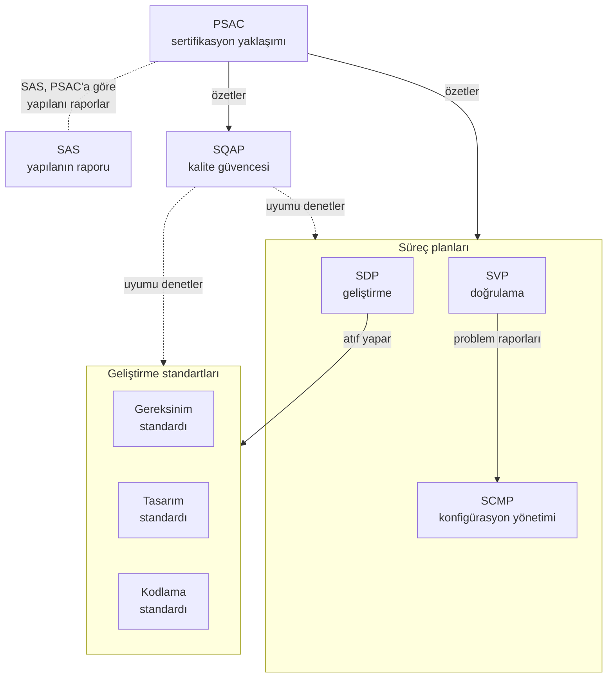

Bu sayfalar, DO-178C'nin beklediği beş yazılım planı ve üç geliştirme standardı için bölüm
bölüm şablon (template) ve yazım rehberi sunar. Her belge sayfasında önerilen içindekiler,
her bölümde verilmesi gereken kararlar, zayıf ve güçlü ifade örnekleri, seviyeye göre
farklar ve DO-178C maddeleriyle eşleşen bir uyum tablosu bulunur. Bu genel bakış sayfası ise
sekiz belgenin ortak yanlarını ve birbirine nasıl bağlandığını özetler.

Konu üç yerde, üç ayrı soruyla ele alınır. Planların neden var olduğunu ve neyi
düzenlediğini [5. Yazılım Planlama](../../03-do178c-ile-gelistirme/05-yazilim-planlama.mdx)
bölümü, sertifikasyon otoritesinin (certification authority) denetimde neye baktığını
[SW SOI-1](../06-kontrol-listeleri/soi-1.mdx) kontrol listesi anlatır. Bu sayfalar üçüncü soruyu cevaplar: belge
nasıl yazılır, hangi bölümde ne söylenir?

Şablon, boşlukları doldurulacak hazır bir metin değil, verilmesi gereken kararların
listesidir. Başka bir projenin planını alıp proje adını değiştirmek, katılım aşaması (Stage
of Involvement, SOI) denetimlerinin ilki olan SOI-1'in sık görülen bulgularındandır: belgede bu
projeye özgü bir karar yoksa ekibin fiilen hangi kurallarla çalıştığı da belirsiz kalır.
Belge sayfalarındaki "Verilecek kararlar" soruları bu yüzden yazının asıl girdisidir;
başlıkların adı ve sırası kurumun alışkanlığına göre değişebilir.

## Sekiz belge bir bakışta

DO-178C'nin planlama süreci beş plan üretir: yazılım sertifikasyon planı (Plan for Software
Aspects of Certification, PSAC), yazılım geliştirme planı (Software Development Plan, SDP),
yazılım doğrulama planı (Software Verification Plan, SVP), yazılım konfigürasyon yönetimi
planı (Software Configuration Management Plan, SCMP) ve yazılım kalite güvencesi planı
(Software Quality Assurance Plan, SQAP). Bunlara üç geliştirme standardı eşlik eder:
gereksinim standardı (software requirements standards, SRStd), tasarım standardı (software
design standards, SDStd) ve kodlama standardı (software code standards, SCStd). Kontrol
kategorisi (control category) sütunu Seviye A, B, C ve D için sırayla okunur.

| Belge | DO-178C | Kontrol kategorisi (A · B · C · D) | Otoriteye |
|---|---|---|---|
| [PSAC](01-psac.mdx) | §11.1 | CC1 · CC1 · CC1 · CC1 | Sunulur |
| [SDP](02-sdp.mdx) | §11.2 | CC1 · CC1 · CC2 · CC2 | Denetimde gösterilir |
| [SVP](03-svp.mdx) | §11.3 | CC1 · CC1 · CC2 · CC2 | Denetimde gösterilir |
| [SCMP](04-scmp.mdx) | §11.4 | CC1 · CC1 · CC2 · CC2 | Denetimde gösterilir |
| [SQAP](05-sqap.mdx) | §11.5 | CC1 · CC1 · CC2 · CC2 | Denetimde gösterilir |
| [Gereksinim standardı](06-gereksinim-standardi.mdx) | §11.6 | CC1 · CC1 · CC2 · – | Denetimde gösterilir |
| [Tasarım standardı](07-tasarim-standardi.mdx) | §11.7 | CC1 · CC1 · CC2 · – | Denetimde gösterilir |
| [Kodlama standardı](08-kodlama-standardi.mdx) | §11.8 | CC1 · CC1 · CC2 · – | Denetimde gösterilir |

Seviye D'de beş plan yine beklenir, üç standart beklenmez: DO-178C Tablo A-1'deki yedi
planlama hedefinden (objective) bu seviyede yalnızca #1 ve #4 aranır: yaşam döngüsü
faaliyetlerinin tanımlanması ve ek hususların (additional considerations) ele alınması.
Standartları çıktı olarak isteyen hedef #5 bunların arasında değildir. CC1, temel çizgi
(baseline), problem raporlama ve değişiklik onayı dahil tam konfigürasyon kontrolüdür; CC2
ise tanımlama, izlenebilirlik, değişiklikte kimliğin ve bütünlüğün korunması, yetkisiz
değişikliğe karşı koruma, geri getirme ve saklamayla sınırlı daha hafif bir rejimdir
(ayrıntısı
[10. Yazılım Konfigürasyon Yönetimi](../../03-do178c-ile-gelistirme/10-yazilim-konfigurasyon-yonetimi.mdx#kontrol-kategorileri-cc1-ve-cc2)
bölümünde). Tablodaki kategoriler asgaridir; proje bir belgeyi daha sıkı kontrol etmeyi
seçebilir, daha gevşek edemez.

DO-331 uygulanan projede model standardı (software model standards, MB.11.23) dördüncü
geliştirme standardıdır ve Tablo MB.A-1 #5'in çıktıları arasına girer. Bu sitede ayrı
şablonu yoktur: ayrı bir belge ya da gereksinim veya tasarım standardının eki olarak
yazılabilir; üç standart sayfasının teknoloji ekleri tabloları ona düşen kuralları anar
([14. DO-331 ve Model Tabanlı Geliştirme ve Doğrulama](../../04-arac-kalifikasyonu-ve-ekler/14-do331-model-tabanli-gelistirme.mdx#planlama-ve-modelleme-standartları)).

"Otoriteye" sütununda "sunulur" yalnızca PSAC'ta görünür, çünkü DO-178C'nin otoriteye
asgari olarak sunulmasını beklediği veri PSAC, yazılım konfigürasyon indeksi (Software
Configuration Index, SCI) ve yazılım başarım özetidir (Software Accomplishment Summary,
SAS) (§9.3). Otorite başka planları da önceden isteyebilir. Kalifiye edilecek bir aracın
araç kalifikasyon seviyesi (tool qualification level, TQL) TQL-1 ile TQL-4 arasındaysa
DO-330'a göre araç kalifikasyon planı (Tool Qualification Plan, TQP) da sunulur.
"Denetimde gösterilir", belgenin kendiliğinden gönderilmediğini (otorite isterse gönderilir)
söyler; hazır olmayabilir demek değildir: belge denetim günü kontrol altındaki sürümüyle
açılabilmelidir.

## Belgeler arası ilişki

PSAC, plan setinin otoriteye bakan yüzüdür: diğer dört planı ayrıntıya girmeden özetler ve
ayrıntı için onlara atıf yapar. Proje sonunda yazılan SAS, PSAC ile aynı başlık düzenini
izleyerek söz verilenin ne ölçüde yapıldığını ve nerede sapıldığını raporlar; planlama
setinin parçası değildir ama PSAC'ın karşılığı olarak baştan düşünülür. SDP gereksinim,
tasarım ve kod kurallarını kendisi yazmaz, üç standarda atıf yapar. Doğrulama sırasında
bulunan hatalar SVP'de tanımlı yoldan SCMP'nin problem raporlama akışına girer. SQAP ise
PSAC dahil planların ve standartların gözden geçirildiğini ve süreçlerin onlara uyduğunu
güvenceye alan faaliyetleri tanımlar (Tablo A-9 #1–#3); şekilde ayrı durması bu yüzdendir.

Her ok bir tutarlılık yükümlülüğüdür: bir belgenin söylediği şeyin ötekinde karşılığı
olmalıdır. Hangi konunun hangi belgede tanımlandığını aşağıdaki tutarlılık matrisi
gösterir.

## Ortak ön bölümler

Sekiz belgenin hepsi aynı ön bölümlerle başlar. Belge sayfalarındaki önerilen içindekiler
bunları tekrarlamaz; aşağıdaki açıklamalar hepsi için geçerlidir.

- **Belge kimliği ve kapak.** Belge adı, numarası, sürümü, yayım tarihi ve ait olduğu proje
  ya da yazılım parçası. Numara ve sürüm SCMP'deki adlandırma ve sürümleme kuralına uyar
  (SCMP'nin kendisi dahil). Kapaktan belgenin konfigürasyon yönetimi altında olduğu ve hangi
  durumda bulunduğu (taslak, gözden geçirmede, yayımlanmış) anlaşılmalıdır.
- **Onay sayfası.** Yazar, gözden geçiren, onaylayan ve kalite güvencesi; her biri için ad,
  rol ve tarih. Islak imza şart değildir: belge yönetim aracındaki elektronik onay kaydı da
  kullanılabilir, yeter ki kayıt belgenin hangi sürümünü onayladığını göstersin. Bir gözden
  geçirmede bağımsızlık (independence) aranıyorsa, yazar ile gözden geçirenin farklı kişiler
  olduğu bu sayfadan açıkça okunabilmelidir.
- **Revizyon geçmişi.** Her sürüm için değişen bölümler, değişikliğin nedeni ve dayandığı
  problem raporu (problem report) ya da değişiklik talebinin (change request) kimliği.
  "Genel güncelleme" gibi bir satır, değişikliğin neden ve hangi kontrolle yapıldığını
  göstermez.
- **Referans belgeler.** Zorunlu referanslar (DO-178C, uygulanan ekler, otorite belgeleri,
  sistem gereksinimleri, emniyet değerlendirmesi çıktıları, plan setindeki diğer belgeler)
  ile bilgi amaçlı referanslar ayrı listelenir. Dış belgeler kimliği ve sürümüyle verilir;
  sürümsüz atıf, atıf yapılan belge değiştiğinde hangi sürüme uyulduğunu belirsiz bırakır.
  Plan setindeki kardeş belgelere sürümsüz atıf yapılabilir; o zaman geçerli sürümler temel
  çizgi kaydında, proje sonunda da SCI'de izlenir.
- **Kısaltmalar ve tanımlar.** Belgede geçen kısaltmalar ve projeye özgü terimler. Plan
  setinde tek bir terim listesi tutulup diğer belgelerin ona atıf yapması önerilir; aynı
  terimin iki planda farklı tanımlanması tutarsızlık bulgusuna dönüşür. Kitapta geçen
  kısaltmalar [Kısaltmalar](../../kisaltmalar.mdx) sayfasındadır.

DO-178C, yazılım yaşam döngüsü verisinin (software life cycle data) altı niteliği taşımasını bekler
(§11.0.a). Planlar ve standartlar da bu veridir; nitelikler yazım sırasında birer öz denetim
sorusu olarak kullanılabilir:

- **Belirsiz olmayan:** aynı cümleyi okuyan iki mühendis aynı işi mi yapar?
- **Eksiksiz:** seviyenin gerektirdiği her hedefe bir faaliyet ve o faaliyetin kaydı
  bağlanmış mı?
- **Doğrulanabilir:** her taahhüt bir kayda bakılarak "yapıldı / yapılmadı" diye
  yanıtlanabilir mi?
- **Tutarlı:** belge kendi içinde ve plan setindeki öteki belgelerle çelişkisiz mi?
- **Değiştirilebilir:** bir karar değiştiğinde güncellenecek yer tek mi?
- **İzlenebilir:** her kuralın ve kararın kaynağı (hedef, sistem gereksinimi, otorite
  kararı) gösterilebiliyor mu?

## Paketleme seçenekleri

Sekiz belgenin sekiz ayrı dosya olması gerekmez. Yaygın seçenekler şunlardır:

| Seçenek | Ne zaman uygun | Dikkat |
|---|---|---|
| Beş ayrı plan, üç ayrı standart | Büyük ya da dağıtık ekip; her belgenin ayrı sahibi var | Çapraz atıflar çoğalır; set birlikte gözden geçirilmezse çelişki birikir |
| PSAC ayrı, diğer dört plan tek "yazılım planı" belgesinde | Küçük ve orta ekipler | Kalite güvencesi bölümünün yetkisi ve onayı geliştirmeden ayrı görünmeli |
| Standartlar SDP'nin eki | Tek dil ve tek tasarım yöntemi kullanan küçük projeler | Kurallar numaralı ve atıf yapılabilir kalmalı; standart değişikliği SDP'nin de yeni sürümü demektir |
| Kurum süreci ve projeye özgü ince plan | Aynı kurumda benzer projeler | Kurum belgesinin sürümü yazılır; projeye özgü farklar ince planda durur |
| Tedarikçi planlarına atıf | Yazılımın bir bölümü tedarikçide geliştiriliyor | Atıf yapılan sürüm ve başvuru sahibinin planlarıyla uyumu gösterilir; gözetim PSAC'ta |
| Önceki onaylı plan setine atıf | Onaylı bir sistemde değişiklik ya da türev projesi | Sadeleştirilmiş paket otoriteyle önceden kararlaştırılır; hedeflerin hepsi yine karşılanır, kapsam büyükse planlar güncellenir (DO-248C, FAQ #60) |

DO-178C, verinin nasıl paketleneceğini başvuru sahibine (applicant) bırakır (§11.0.b
Not 2): planlar birleştirilebilir ya da başka belgelere gömülebilir. Bazı otoriteler ise
PSAC ve SAS'ı ayrı belge olarak ister (Not 3); PSAC'ı başka bir belgeye gömmeden önce bu
yüzden otoriteye sorulur. Paketlemenin kontrol kategorisine de etkisi vardır: farklı
kategorideki veri tek belgede birleşirse belge, içindekilerin en sıkısına göre yönetilir.
Örneğin Seviye C'de PSAC içeriğinin bir kısmı SDP'ye taşınırsa SDP CC1 olur ve otoriteye
sunulması da gerekebilir (DO-248C, FAQ #55). Belge sayısını azaltmak kanıtı azaltmaz: küçük
bir projede de seviyenin gerektirdiği her hedefin kaydı bulunur (DO-248C, FAQ #54).
Belirleyici olan her içeriğin bulunabilir olmasıdır; bunu her şablon sayfasındaki uyum
tablosu gösterir.

## Tutarlılık matrisi

Plan setindeki çelişkilerin çoğu, aynı konunun iki belgede ayrı ayrı tanımlanmasından
doğar. Kural basittir: her konu tek belgede tanımlanır, öteki belgeler ona atıf yapar ya da
yalnızca özetler. Aşağıdaki dağılım bu sitedeki sekiz şablonun izlediği dağılımdır; kurum
farklı bir dağılım seçebilir, ama seçim plan setinde bir kez yapılmalıdır.

| Konu | Tanımlandığı belge | Atıf yapan ya da örtüşmesi gereken |
|---|---|---|
| Yazılım seviyesi ve gerekçesi | PSAC | Tüm planlar (seviyeye bağlı faaliyetler) |
| Yaşam döngüsü modeli ve geliştirme geçiş kriterleri | SDP | PSAC (özet), SQAP (izleme) |
| Doğrulamaya giriş kriterleri ve doğrulama bağımsızlığı | SVP | PSAC (özet, organizasyon), SQAP |
| Kalite güvencesinin yetkisi ve bağımsızlığı | SQAP | PSAC (organizasyon) |
| Araç envanteri | SDP (geliştirme), SVP (doğrulama), SCMP (konfigürasyon yönetimi) | PSAC (kalifikasyon kararı ve TQL), SECI (sürümler) |
| Yaşam döngüsü ortamının kontrolü | SCMP | SDP, SVP (ortam tanımı) |
| Derleyici, bağlayıcı ve yükleyici: seçenekler / varsayımlar | SDP (seçenekler) / SVP (varsayımlar) | Kodlama standardı (dil ve derleyici kuralları) |
| Problem raporlama (bulgu–problem raporu sınırı, alanlar, durum akışı) ve değişiklik kontrolü | SCMP | SVP (test hatası → problem raporu), SQAP (izleme), PSAC (açık problem raporu yaklaşımı) |
| Temel çizgiler | SCMP | SDP ve SVP geçiş kriterleri |
| Standartlardan sapma (deviation) | İlgili standart (ayrıntısı kodlama standardında) | SQAP (sapma kayıtlarının denetimi) |
| Türetilmiş gereksinimlerin sistem süreçlerine iletimi | Gereksinim standardı (Seviye D'de SDP) | Tasarım standardı, SDP, PSAC (özet) |
| Karmaşıklık sınırları | Kodlama standardı (fonksiyon içi) | Tasarım standardı (bileşen ve mimari düzeyi; aynı sayılar ya da atıf) |
| Kural numaraları (GS-, TS-, KS-) | İlgili standart | SVP (gözden geçirme kontrol listeleri numarayla atıf yapar) |
| Doğrulama yöntemi adları (Test, Analiz, Gözden geçirme) | SVP | Gereksinim standardı (doğrulama yöntemi özniteliği) |
| Değişiklik sonrası yeniden doğrulama | SVP | SCMP (değişiklik kontrolü), PSAC (değişiklik yaklaşımı) |
| Yazılım yükleme kontrolü | SCMP | PSAC (sahada yüklenebilir yazılım varsa) |
| Tedarikçi gözetimi | PSAC (yaklaşım) | SQAP (denetim), SCMP (teslim kabulü) |
| Ek hususlar (PDS, COTS, PDI, devre dışı kod …) | PSAC (liste ve yaklaşım) | SDP, SVP, SCMP (ayrıntı) |
| Yazılım uygunluk gözden geçirmesi | SQAP | PSAC (süreç özeti ve takvimdeki yeri), SAS (sonuç) |
| Takvim ve SOI zamanları | PSAC | SQAP (iç denetim takvimi) |

Tablodaki kısaltma ve terimler: SECI yazılım yaşam döngüsü ortam konfigürasyon indeksi
(Software Life Cycle Environment Configuration Index), PDS önceden geliştirilmiş yazılım
(previously developed software), COTS ticari hazır yazılım (commercial off-the-shelf), PDI
parametre verisi öğesi (parameter data item) demektir; "devre dışı kod", devre dışı
bırakılmış kodun (deactivated code) kısa yazımıdır. Bağlayıcı (linker) ve yükleyici
(loader) derleme zincirinin parçalarıdır. Sahada yüklenebilir yazılım (field-loadable
software), donanım uçaktan sökülmeden yüklenebilen yazılımdır. Geçiş kriteri (transition
criteria), bir sürece girmenin kayıtla denetlenebilen koşuludur
([Ek A: Örnek Geçiş Kriterleri](../01-ek-a-ornek-gecis-kriterleri.mdx)); yazılım
uygunluk gözden geçirmesi (software conformity review) ise kalite güvencesinin
sertifikasyona sunulan sürüm için yaptığı kapanış denetimidir.

Matris, plan setinin birlikte gözden geçirilmesinde (Tablo A-1 #7) kontrol listesi olarak
da kullanılır: her satır için tanımlandığı belgedeki ifade ile atıf yapan belgedeki ifade
yan yana okunur. Araç sürümü, sorumlu rol ya da akış adımı iki yerde farklıysa bu, SOI-1'den
önce kapatılması gereken bir tutarsızlıktır.

## Yazım sırası

Belgelerin hepsi aynı anda yazılmaz; bazı kararlar ötekilerin girdisidir. Tipik sıra şöyledir:

1. **Sistem girdileri hazırdır.** Yazılım seviyesi ve dayandığı emniyet değerlendirmesi
   çıktıları, yazılıma tahsis edilen sistem gereksinimleri ve donanım kararları bilinmeden
   yazılan plan, hangi hedeflerin aranacağını ve hangi ek hususların doğacağını bilemez.
2. **Yaşam döngüsü kararları ve araç envanteri.** Yaşam döngüsü modeli, artımlar, ekip ve
   tedarikçi dağılımı ile geliştirme, doğrulama ve konfigürasyon yönetimi zincirindeki her
   aracın listesi ve kalifikasyon ön değerlendirmesi. Bu kararlar beş planın hepsine girer.
3. **SDP ve üç standart.** Yüksek seviyeli gereksinimler (high-level requirements) yazılmaya
   başlanmadan hazırdır; standart olmadan yazılan gereksinim, standart çıktıktan sonra
   yeniden gözden geçirilir. Planlama tamamlanmadan geliştirmeye başlanabilir, ama yalnızca
   o faaliyetin geçiş kriteri sağlanıyorsa.
4. **SVP, SCMP ve SQAP birlikte.** Test hatasından problem raporuna, temel çizgiden
   doğrulamaya giriş kriterine ve denetim noktalarına uzanan akışlar bu üç belgede örtüşür;
   aynı dönemde ve birbirinden haberli yazılmaları çelişkiyi baştan önler.
5. **PSAC en son kesinleşir, ilk taslağı erken yazılır.** Taslak, otoriteyle ilk görüşmede
   yazılım seviyesinin, ek hususların ve yeniliklerin konuşulmasına zemin olur; diğer
   planlar olgunlaştıkça özetleri ve atıfları güncellenir.
6. **Plan seti birlikte gözden geçirilir.** Gözden geçirme hem uyuma (her hedefe faaliyet ve
   kayıt bağlanmış mı) hem tutarlılığa (tutarlılık matrisi) bakar; Seviye A–C'de bu, Tablo
   A-1 #6 ve #7'nin kanıtıdır. Kalite güvencesi plan ve standartlara ilişkin güvencesini
   kayda geçirir (Tablo A-9 #1, Seviye A–C) ve belgeler konfigürasyon kontrolüne alınır
   (CC1 olanlar temel çizgiye).
7. **PSAC otoriteye gönderilir.** SOI-1'den, otoritenin okuyup soru sormasına yetecek süre
   önce; TQL-1 ile TQL-4 arasında kalifiye edilecek araç varsa araç kalifikasyon planıyla
   birlikte.

Planlar proje boyunca değişir; DO-178C, planların nasıl revize edileceğinin de planlamada
belirlenmesini bekler (§4.2.e). Onaylı bir plan değiştiğinde üç şey olur. Birincisi,
değişiklik SCMP'de tanımlı değişiklik kontrolünden geçer. CC1 olan belgede (PSAC her
seviyede, öteki planlar ve standartlar Seviye A ve B'de) bu, değişiklik talebi ya da problem
raporu, etki değerlendirmesi, onay ve yeni sürüm demektir. CC2 olan belgede asgari olan,
değişen belgenin kimliğinin değişmesi ve bütünlüğünün korunmasıdır; birçok proje yine de
plan setinin tamamını CC1'de tutmayı seçer. İkincisi, tutarlılık matrisi üzerinden
etkilenen öteki planlar bulunur ve aynı değişiklik kapsamında güncellenir; tek planın
değiştiği, ötekilerin eski akışı anlatmaya devam ettiği bir set, planların eşgüdümünü
isteyen Tablo A-1 #7'yi karşılamaz. Üçüncüsü, değişiklik PSAC'ı etkiliyorsa (yazılım
seviyesi, kapsam, araç, yöntem ya da ek husus) otoriteyle yeniden konuşulur; mutabakattan
önce yeni yola geçmek, sonradan yeniden iş yapma riskini üstlenmektir. Plan değişmeden önce
plandan farklı yapılmış iş bir uygunsuzluktur (nonconformance): SCMP'nin tanımladığı yoldan
problem raporuna ya da kalite güvencesi kaydına bağlanır. Faaliyetten önce istenip
onaylanan ayrılma ise onaylı sapmadır. Plandan kalıcı olarak ayrılınan her yer, kaydı
hangisi olursa olsun, proje sonunda SAS'ta özetlenir.

## Şablonları kullanırken

- **Kopyalama değil karar.** Her başlığın altına, belge sayfasındaki "Verilecek kararlar"
  sorularının bu projedeki cevabı yazılır. Cevabı olmayan başlık ya bu projede geçersizdir
  (o zaman nedeni bir cümleyle yazılır) ya da karar henüz verilmemiştir (o zaman belge
  yayımlanmaya hazır değildir).
- **Ölçülebilir taahhüt.** Plana yalnızca yapılacak ve kayıtla gösterilebilecek şey
  yazılır. "Gerektiğinde" ya da "uygun görülen durumlarda" gibi ifadeler, kimin neye bakarak
  karar vereceğini söylemiyorsa denetimde boşluk olarak okunur. Belge sayfalarındaki "Zayıf
  ifade / Güçlü ifade" tabloları bu dönüşümün örnekleridir.
- **Tek terim listesi, her araç tek yerde.** Terim listesi plan setinde tek yerde tutulur,
  öteki belgeler ona atıf yapar. Her araç rolüne göre tek planda tanımlanır (geliştirme
  aracı SDP'de, doğrulama aracı SVP'de, konfigürasyon yönetimi aracı SCMP'de); PSAC
  kalifikasyon kararını ve TQL'yi verir. Sürümün esas kaydı SECI'dir: bir plan sürüm
  anıyorsa SECI'deki sürümle aynı olmalıdır. Aynı aracın iki planda farklı sürümle anılması
  SOI-1'in bilinen tutarsızlık bulgularındandır.
- **Kurum süreçlerine atıf varsa fark yazılır.** İnce proje planı, kurum sürecinin hangi
  sürümüne uyulduğunu ve bu projede neyin farklı yapıldığını (uyarlama, muafiyet, ek adım)
  açıkça söyler. Fark yazılmazsa denetçi kurum sürecinin tamamının uygulandığını varsayar ve
  her adımın kanıtını ister.
- **Seviye D'de de standart yararlıdır.** Seviye D'de üç standart beklenmez, ama ekibin
  gözden geçirmede başvuracağı kısa bir kural seti, bulguların öznel tartışmaya dönmesini
  önler. Böyle bir belge kanıt olarak kullanılacaksa en az CC2 altında tutulur (§11.0.c).
- **Uyum tablosu standardın yerine geçmez.** Her şablon sayfasındaki uyum tablosu, belgenin
  DO-178C maddelerini nerede karşıladığını bulmaya yarayan bir başvuru aracıdır; maddelerin
  tam anlamı için standardın kendisi, uygulanan ekler ve otorite belgeleri okunur.

## Şablonlar

- [PSAC](01-psac.mdx): sistemin ve yazılımın tanıtımı, yazılım seviyesi, uyum yöntemi, ek
  hususlar ve otoriteyle iletişim; otoriteye sunulan plan.
- [SDP](02-sdp.mdx): yaşam döngüsü modeli, geliştirme geçiş kriterleri, standartlara atıf ve
  dil, derleyici ve araçlarla geliştirme ortamı.
- [SVP](03-svp.mdx): doğrulama organizasyonu ve bağımsızlık; gözden geçirme, analiz ve test
  yöntemleri; doğrulama ortamı ve yeniden doğrulama.
- [SCMP](04-scmp.mdx): konfigürasyon tanımlama, temel çizgiler, problem raporlama ve
  değişiklik kontrolü, arşiv, yazılım yükleme ve ortam kontrolü.
- [SQAP](05-sqap.mdx): kalite güvencesinin yetkisi ve bağımsızlığı, denetim takvimi,
  uygunsuzluk yönetimi ve yazılım uygunluk gözden geçirmesi.
- [Gereksinim standardı](06-gereksinim-standardi.mdx): yüksek seviyeli gereksinimlerin
  yazım kalıpları, denetlenebilir kurallar ve türetilmiş gereksinimlerin işaretlenmesi.
- [Tasarım standardı](07-tasarim-standardi.mdx): mimari gösterim, düşük seviyeli
  gereksinimlerin ayrıntı düzeyi ve tasarım kısıtları.
- [Kodlama standardı](08-kodlama-standardi.mdx): dil alt kümesi, MISRA C tabanlı kurallar,
  karmaşıklık sınırları ve sapma süreci.

## İlgili bölümler

- [5. Yazılım Planlama](../../03-do178c-ile-gelistirme/05-yazilim-planlama.mdx)
- [10. Yazılım Konfigürasyon Yönetimi](../../03-do178c-ile-gelistirme/10-yazilim-konfigurasyon-yonetimi.mdx)
- [11. Yazılım Kalite Güvencesi](../../03-do178c-ile-gelistirme/11-yazilim-kalite-guvencesi.mdx)
- [12. Sertifikasyon İrtibatı](../../03-do178c-ile-gelistirme/12-sertifikasyon-irtibati.mdx)
- [SW SOI-1](../06-kontrol-listeleri/soi-1.mdx)
- [Ek A: Örnek Geçiş Kriterleri](../01-ek-a-ornek-gecis-kriterleri.mdx)
- [Kısaltmalar](../../kisaltmalar.mdx)
