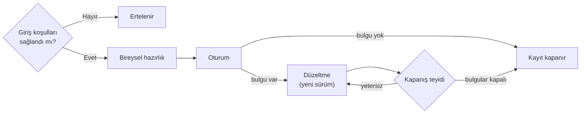

Bu ek, DO-178C projesinde yaşam döngüsü verisinin (software life cycle data) gözden
geçirilmesi (review) ve süreçlerin denetlenmesi için on üç kontrol listesi (checklist) sunar.
Her liste, bir iş ürününün ya da sürecin içeriğine bakan, evet/hayır ile yanıtlanan numaralı
sorulardan oluşur; her madde dayandığı DO-178C maddesini ya da Ek A hedefini (objective) ve
geçerli olduğu yazılım seviyelerini (software level) taşır. Liste, projeye uyarlanacak
kopyanın başlangıç dosyası olarak CSV biçiminde indirilebilir.

Kontrol listesi, gözden geçirmenin kişisel deneyime bırakılmasını önler: her gözden geçiren
aynı asgari soruları sorar, cevaplar kayda aynı biçimde geçer
([9. Yazılım Doğrulama](../../03-do178c-ile-gelistirme/09-yazilim-dogrulama.mdx#kontrol-listeleri-ve-kayıt)).
Konuların anlatımı kitap bölümlerindedir; listeler o anlatımı tekrarlamaz, gözden geçirme
masasında kullanılabilir sorulara çevirir. Kitapta kontrol listesi üç ayrı iş için kullanılır:

| Tür | Kim, ne zaman | Nerede |
|---|---|---|
| Yazarın öz denetimi | Yazar; planı ya da standardı gözden geçirmeye sunmadan önce | [Ek E](../05-sablonlar/index.mdx) şablon sayfalarının sonundaki "Yayımlamadan önce" listeleri |
| Akran gözden geçirmesi (peer review) ve süreç denetimi | Gözden geçirenler, değişiklik kontrol kurulu (change control board) ve kalite güvencesi (quality assurance); iş ürünü temel çizgiye (baseline) girmeden, geçiş kriterlerinde (transition criteria) ve her değişiklikte | Bu ek: aşağıdaki on üç liste |
| Otorite denetimine hazırlık | Proje ekibi ve kalite güvencesi; katılım aşaması (Stage of Involvement, SOI) denetiminden birkaç hafta önce, iç ön denetimde (mock audit) | SW SOI-1 … SW SOI-4; bu ekin parçasıdır, sayfa sırasında sondadır |

İkinci ve üçüncü tür kolayca karışır. Akran gözden geçirmesi listesi ürünün kendisini sorar:
bu gereksinim doğrulanabilir mi? SOI listesi süreç kanıtını sorar: gereksinimin gözden
geçirildiğini gösteren kayıt var mı, yazar ile gözden geçiren ayrı mı? Yazar listeyi kendi
işine önceden de uygulayabilir; bağımsızlığın (independence) arandığı hedeflerde bu, yazar
dışındaki gözün yerine geçmez, aranmayanlarda da yazar dışı bir göz iyi uygulamadır.

:::note[Listeler standardın yerine geçmez]
Maddeler DO-178C metninin çevirisi değildir; sahada işe yarayan, özgün sorulardır. Dayanak
etiketi maddenin hangi standart maddesine ya da hedefe hizmet ettiğini gösterir; bağlayıcı
olan DO-178C'nin kendisi, uygulanan ekler ve otorite belgeleridir. Listenin eksiksiz
işaretlenmesi de hedefin karşılandığını kendiliğinden göstermez: kayıt, neye hangi sürümde
bakıldığını söylemelidir
([4. bölüm](../../03-do178c-ile-gelistirme/04-do178c-genel-bakis.mdx#hedef-faaliyet-ve-yaşam-döngüsü-verisi)).
:::

## Listeler

Her liste aynı düzeni izler: bir bakışta tablosu, giriş koşulları, gruplanmış numaralı
maddeler, araçla denetlenebilecek maddeler, sık bulgular (finding) ve seviyeye göre uyarlama.
Maddenin başında önek ve sıra numarası (**YGR-07** gibi), sonunda seviye ve dayanak bulunur.
Örneğin *(A–C · §6.3.1.e)*, bağlı hedefin Seviye A, B ve C'de arandığını ve §6.3.1.e'ye
dayandığını söyler. "İyi uygulama" dayanaklı maddeyi standart açıkça istemez; sahada sık görülen bir
hatayı yakalamak için eklenmiştir.

| Liste | DO-178C | Ek A hedefleri | Önek |
|---|---|---|---|
| [Planlar ve standartlar](01-planlar-ve-standartlar.mdx) | §4.6 | A-1 #6, #7 | PLS |
| [Yüksek seviyeli gereksinimler](02-yuksek-seviyeli-gereksinimler.mdx) | §6.3.1 | A-3 | YGR |
| [Yazılım mimarisi](03-yazilim-mimarisi.mdx) | §6.3.3 | A-4 #8–#13 | MIM |
| [Düşük seviyeli gereksinimler](04-dusuk-seviyeli-gereksinimler.mdx) | §6.3.2 | A-4 #1–#7 | DGR |
| [Kaynak kod](05-kaynak-kod.mdx) | §6.3.4 | A-5 #1–#6 | KOD |
| [Entegrasyon çıktıları](06-entegrasyon-ciktilari.mdx) | §6.3.5 | A-5 #7 | ENT |
| [Test durumları ve prosedürleri](07-test-durumlari-ve-prosedurleri.mdx) | §6.4.2, §6.4.3, §6.4.5.a–b | A-7 #1 (A-6 hedeflerine kanıt) | TDP |
| [Test sonuçları](08-test-sonuclari.mdx) | §6.4.5.c | A-7 #2 | TSN |
| [Kapsam analizleri](09-kapsam-analizleri.mdx) | §6.4.4 | A-7 #3–#9 | KAP |
| [Konfigürasyon denetimi](10-konfigurasyon-denetimi.mdx) | §7.2.1–§7.2.2, §7.2.4.a–b, §7.2.6–§7.2.7, §7.3–§7.5 | A-8 (#3'te yalnız durum muhasebesi) | KYD |
| [Problem raporu ve değişiklik](11-problem-raporu-ve-degisiklik.mdx) | §7.2.3–§7.2.5 | A-8 #3 | PRD |
| [Kalite güvencesi denetimi](12-kalite-guvencesi-denetimi.mdx) | §8.1, §8.2 | A-9 #1–#4 | KGD |
| [Uygunluk gözden geçirmesi](13-uygunluk-gozden-gecirmesi.mdx) | §8.3 | A-9 #5 | UGG |

Hedefler seviyeye göre [DO-178C Hedef Gezgini](/araclar/sertifikasyon/do178c-hedef-gezgini)
aracında süzülebilir. Parametre verisi öğesinin (parameter data item, PDI) doğrulaması (A-5
#8, #9) bu listelerin kapsamı dışındadır.

### Otorite denetimine hazırlık

Dört SOI sayfası, otoritenin SOI denetiminde soracaklarına hazırlık içindir. Maddeleri
numarasızdır ve CSV düğmesi yoktur; bir iş ürününün gözden geçirme kaydına girmez, iç ön
denetimde kullanılırsa sonucu kalite güvencesi kaydına yazılır.

| Liste | Ne zaman | Bakılan |
|---|---|---|
| [SW SOI-1](soi-1.mdx) | Planlar yayımlandıktan sonra, geliştirme verisi üretimi hızlanmadan önce | Planlar, standartlar, araçlar ve plan setinin tutarlılığı |
| [SW SOI-2](soi-2.mdx) | Gereksinim, tasarım ve kodun temsil edici bir bölümü üretilip gözden geçirildiğinde | Geliştirme verisi, izlenebilirlik (traceability), standart uyumu, gözden geçirme kayıtları |
| [SW SOI-3](soi-3.mdx) | Doğrulama verisinin temsil edici bir bölümü tamamlanıp kapsam analizi sonuç vermeye başladığında | Testlerin türetilmesi ve sonuçları, kapsam analizleri, test ortamı, problem raporları (problem report) |
| [SW SOI-4](soi-4.mdx) | Faaliyetler tamamlanıp sertifikasyona esas sürüm belirlendiğinde | Önceki bulguların kapanışı, yazılım başarım özeti (Software Accomplishment Summary, SAS) ve yazılım konfigürasyon indeksi (Software Configuration Index, SCI), açık problem raporları, uygunluk gözden geçirmesi |

## Bağımsızlık

Bağımsızlık, işi yapan kişinin kendi işini gözden geçiren sayılmaması demektir
([9. bölüm](../../03-do178c-ile-gelistirme/09-yazilim-dogrulama.mdx#bağımsızlık)); kalite
güvencesi hedeflerinde (KGD, UGG) düzeltici faaliyetin (corrective action) yapılmasını
sağlama yetkisini de kapsar
([11. bölüm](../../03-do178c-ile-gelistirme/11-yazilim-kalite-guvencesi.mdx#bağımsızlık-ve-yetki)).
Ek A, hangi hedefte arandığını seviye seviye işaretler; listelerin dayandığı hedeflerden
bağımsızlıkla karşılanması gerekenler şunlardır:

| Liste | A | B | C |
|---|---|---|---|
| Yüksek seviyeli gereksinimler (YGR) | A-3 #1, #2, #7 | A-3 #1, #2, #7 | – |
| Yazılım mimarisi (MIM) | A-4 #8, #9, #13 | – | – |
| Düşük seviyeli gereksinimler (DGR) | A-4 #1, #2, #7 | A-4 #1, #2, #7 | – |
| Kaynak kod (KOD) | A-5 #1, #2, #6 | A-5 #1 | – |
| Test durumları ve prosedürleri (TDP) | A-7 #1; A-6 #3, #4 | A-6 #3 | – |
| Test sonuçları (TSN) | A-7 #2 | – | – |
| Kapsam analizleri (KAP) | A-7 #3–#9 | A-7 #6, #7, #8 | – |
| Kalite güvencesi denetimi (KGD) | A-9 #1–#4 | A-9 #1–#4 | A-9 #1–#4 |
| Uygunluk gözden geçirmesi (UGG) | A-9 #5 | A-9 #5 | A-9 #5 |

Planlar ve standartlar, entegrasyon çıktıları, konfigürasyon denetimi ve problem raporu
listelerinin dayandığı hedeflerde (A-1 #6–#7, A-5 #7, A-8) bağımsızlık hiçbir seviyede
aranmaz. Seviye D'de bağımsızlık yalnızca iki kalite güvencesi hedefinde kalır: A-9 #2
(süreçler planlara uygun) ve #5 (yazılım uygunluk gözden geçirmesi). Tabloya PDI'nin iki
hedefi eklendiğinde 9. bölümdeki sayılar (Seviye A'da 30, B'de 18, C'de 5) elde edilir.

TDP satırındaki A-6 #3 ve #4'ün bağımsızlığı gözden geçirene değil test yazarına ilişkindir:
düşük seviyeli gereksinimlerden test durumu yazan kişi, aynı gereksinimlerden kaynak kodu
yazan kişi olmamalıdır (§6.2.e). Bir listede bağımsızlık gerektiren ve gerektirmeyen maddeler
bir aradadır; uygulamada listenin tamamı yazar dışındaki gözden geçirene verilir, maddeleri
kişilere bölmek kaydı karmaşıklaştırır.

## Gözden geçirme nasıl yürütülür?

Toplantının nasıl yönetileceği
[9. bölümdeki pratiklerde](../../03-do178c-ile-gelistirme/09-yazilim-dogrulama.mdx#etkili-akran-gözden-geçirmesi-için-pratikler)
anlatılır. Listelerle çalışırken akış üç adımdır:

1. **Hazırlık.** Gözden geçirme lideri (moderator) listenin giriş koşullarına bakar; koşul
   sağlanmıyorsa gözden geçirme ertelenir, yoksa çoğu zaman sonradan değişen bir sürüme
   bakılmış olur. Her gözden geçiren listeyi oturumdan önce tek başına uygular ve notunu madde
   numarasına bağlar.
2. **Oturum.** Bulgular madde numarasıyla toplanır, sınıflanır ve bir sahibe verilir; çözüm
   tartışması oturum dışına bırakılır. Kod gözden geçirme aracında yürütülen oturumsuz
   gözden geçirme de olur, yeter ki kayıt aynı alanları taşısın.
3. **Kapanış.** Bulgu varsa yazar düzeltmeyi öğenin yeni sürümünde yapar; teyidin kime
   düştüğü bulgu sınıfına bağlıdır (aşağıda).

## Gözden geçirme kaydı

Kayıtta bulunması gereken alanlar
[9. bölümdeki tabloda](../../03-do178c-ile-gelistirme/09-yazilim-dogrulama.mdx#kontrol-listeleri-ve-kayıt)
verilmiştir. Bu ekteki listelerle çalışırken o alanlar şöyle doldurulur:

- **Kontrol listesinin kimliği ve sürümü.** Kayıt, listenin projedeki sürümlü kopyasına atıf
  yapar (ör. "YGR kontrol listesi, proje sürümü 4"); bu sayfaların adresi yetmez. Sitedeki
  liste zamanla değişir, kayıt ise yıllar sonra da hangi sorunun sorulduğunu göstermelidir.
- **Madde bazında sonuç.** Her numaralı madde için Evet, Hayır ya da Uygulanmaz yazılır.
  Hayır'ın yanında bulgu numarası bulunur. Uygulanmaz gerekçesiz bırakılmaz; gerekçesiz
  Uygulanmaz, maddenin atlandığı biçiminde okunur. Örnek gerekçeler: "gözden geçirilen kümede
  türetilmiş gereksinim yok", "Seviye C; hedef bu seviyede aranmıyor".
- **Neye bakıldığı.** 01–09 arasındaki listeler gözden geçirilen öğenin tamamına uygulanır:
  doğrulama hedefleri örneklemeyle karşılanmaz (DO-248C, FAQ #75; tek istisna §11.8.b'deki
  kod sunum kurallarıdır). Öğe birkaç oturuma bölündüyse her oturumun baktığı gereksinim
  kimlikleri ve dosyalar yazılır; kayıtlar birlikte öğenin tamamını örtmelidir. Örneklem
  kalite güvencesi denetiminin yöntemidir; orada seçilen kayıtlar, araçla yanıtlanan maddede
  de aracın adı, sürümü ve rapor kimliği not sütununa yazılır.

CSV, projenin uyarlanmış listesinin başlangıç dosyasıdır: bir kez indirilir, uyarlanır ve
sürümlenir; gözden geçirmede siteden yeni dosya değil, bu kopyanın boş hâli kullanılır
(dosyadaki "Kaynak" satırı yalnızca çıkış noktasını gösterir). Sonuç ve not sütunları
doldurulur, başa öğenin kimliği ve sürümü yazılır, dosya kayda eklenir ya da kayıt aracına
aktarılır. Doldurulmuş liste, kaydın kendisi gibi CC2 altında saklanır. Kaydın gittiği yer
listeye göre değişir: 01–09 arasındaki listeler yazılım doğrulama sonuçlarına (Software
Verification Results, SVR), 10 ve 11 konfigürasyon yönetimi kayıtlarına, 12 ve 13 kalite
güvencesi kayıtlarına girer; kesin yeri her listenin "Bir bakışta" tablosundadır.

## Bulgu sınıfları ve kapanış

Bulgu, gözden geçirmede kayda geçen gözlemdir; Hayır yanıtı alan her madde en az bir bulgu
doğurur ve bulgu madde numarasını taşır. Hiçbir maddeye uymayan bulgu da kaydedilir;
tekrarlıyorsa listeye yeni madde adayıdır. Sınıflar 9. bölümdekilerdir:

| Sınıf | Tanım | Kapanış |
|---|---|---|
| Büyük | Öğenin doğruluğunu, bir hedefin karşılanmasını ya da üst ve alt veriyle tutarlılığı bozan kusur; ör. eksik ya da yanlış gereksinim, izlenmeyen kod, gereksinimden türetilmemiş beklenen sonuç | Bulguyu açan gözden geçiren yeni sürümde teyit eder; ilgili madde grubu yeniden uygulanır |
| Küçük | Anlamı ve doğrulanabilirliği değiştirmeyen kusur; ör. biçim, yazım, adlandırma, eksik belge ya da standart atıf numarası (eksik iz bağlantısı büyük bulgudur) | Düzeltme yapılır; gözden geçirme lideri ya da bulguyu açan kişi teyit eder |
| Öneri | Kusur değil, iyileştirme | Yazar kabul ya da ret eder; ret gerekçesi kayda yazılır, düzeltme şart değildir |

Proje standardına aykırılık, kuralın amacına göre sınıflanır: doğrulanabilirliği bozan bir
ifade büyük, biçim kuralına aykırılık küçük bulgudur. Büyük ya da küçük, açık bulgusu olan
gözden geçirme kapanmış sayılmaz ve öğe temel çizgiye girmez; öneri, kabul ya da ret kararıyla
kapanır. Bağımsızlığın arandığı yerde kapanışı teyit eden de yazar dışında biridir.

Bir bulgunun ne zaman problem raporuna dönüştüğü yazılım konfigürasyon yönetimi planında
tanımlanır ([SCMP şablonu](../05-sablonlar/04-scmp.mdx)). Savunulabilir bir kural şudur: temel
çizgi öncesindeki akran gözden geçirmesi bulgusu gözden geçirme kaydında kapanır; temel
çizgiye alınmış bir öğedeki kusur problem raporudur. Öğe problem raporu ya da değişiklik
talebiyle değiştiğinde liste yeniden uygulanır (§6.2.d); listenin tamamının mı, yalnız
değişiklik etki analizinin (change impact analysis) gösterdiği grupların mı uygulandığı
gerekçesiyle kayda yazılır ([PRD listesi](11-problem-raporu-ve-degisiklik.mdx)). Kalite güvencesi
denetiminde (KGD, UGG) verilen Hayır yanıtı ise bir uygunsuzluktur (nonconformance) ve SQAP'ta
tanımlı akışla kayda geçer
([11. Yazılım Kalite Güvencesi](../../03-do178c-ile-gelistirme/11-yazilim-kalite-guvencesi.mdx#uygunsuzluk-yönetimi)).
Kalite güvencesi gözden geçirme kapanışlarını örnek kayıtlar üzerinden denetler.

## Listeyi projeye uyarlama

Listeler başlangıç noktasıdır; proje uyarlanmış hâlini kendi belgesi olarak yönetir.

- **Proje standardına numarayla atıf.** Maddeler proje standardındaki kurala konuyla atıf
  yapar ("proje gereksinim standardının yasaklı ifade kuralı" gibi). Projeye alınırken kuralın
  numarası yazılır; [Ek E](../05-sablonlar/index.mdx)'deki standart şablonları kuralları bu
  yüzden numaralı verir ve [SVP](../05-sablonlar/03-svp.mdx) listelerin bu numaralara atıf
  yaptığını söyler. Standart değiştiğinde etkilenen madde böylece aranarak bulunur.
- **Proje maddeleri.** Projede tekrarlayan bir hata türü yeni madde olur. Yeni maddeler
  listenin sonunda "Proje maddeleri" grubunda, sıradaki numarayla toplanır; mevcut numaralar
  değiştirilmez, çıkarılan maddenin numarası yeniden kullanılmaz. Eski kayıtlar ancak böyle
  okunabilir kalır.
- **Seviyeye göre budama.** Seviye etiketi projenin seviyesini içermeyen madde o seviyede
  beklenmez: dayanağı bir hedefse hedef aranmaz, iyi uygulamaysa pratik o seviyede gerekli
  görülmemiştir. Madde çıkarılabilir ya da kayıtta gerekçesiyle Uygulanmaz işaretlenir.
  Farklı seviyelerde bileşen içeren projede liste tam kalır. Ayrıntı her listenin "Seviyeye
  göre uyarlama" bölümündedir.
- **Sürüm ve kontrol kategorisi.** Gözden geçirme listesi bir gözden geçirme prosedürüdür;
  doğrulama durumları ve prosedürlerinin (Software Verification Cases and Procedures, SVCP;
  §11.13.a) parçası olarak onun kontrol kategorisini taşır: Seviye A ve B'de CC1, C ve D'de
  CC2 ([10. bölüm](../../03-do178c-ile-gelistirme/10-yazilim-konfigurasyon-yonetimi.mdx#kontrol-kategorileri-cc1-ve-cc2)).
  SCMP ve SQAP'ın atıf yaptığı denetim listeleri en az CC2 altında tutulur.
- **Araçla denetlenen maddeler.** Bazı maddeler araçla yanıtlanabilir (statik analiz, iz
  aracı sorgusu, bellek haritası betiği); her listenin "Araçla denetlenebilecek maddeler"
  tablosu bunları gösterir. Madde araç raporuna bakılarak işaretleniyor ve rapor ayrıca
  doğrulanmıyorsa araç bir doğrulama faaliyetini üstlenmiş olur; kalifikasyon gereği
  [13. bölümdeki](../../04-arac-kalifikasyonu-ve-ekler/13-do330-arac-kalifikasyonu.mdx#kalifikasyon-ihtiyacının-ve-seviyesinin-belirlenmesi)
  ölçütlerle değerlendirilir, karar PSAC'a yazılır.
- **20–30 madde.** İyi liste kısadır; uzadıkça mekanik işaretlenir. Yeni madde eklenirken
  uzun süredir bulgu üretmeyen iyi uygulama maddesi çıkarılabilir; bir Ek A hedefinin tek
  karşılığı olan madde ise kalır, çünkü kayıtta o hedefin gözden geçirildiğini o gösterir.
  Araçla yakalanan madde silinmez, araç raporuna atıfla yanıtlanır. Bulguların madde numarası
  taşıması, bu kararları izlenim yerine sayıyla vermeyi sağlar.

## CSV olarak kullanma

Her liste sayfasındaki "CSV olarak indir" düğmesi, sayfadaki numaralı maddeleri tek dosyaya
aktarır. Düğme tarayıcıda JavaScript ile çalışır; kitabın PDF sürümünde ve JavaScript
kapalıyken görünmez. Dosyanın ilk iki satırı `#` ile başlar ve listenin adını ve sayfanın
adresini verir; ardından başlık satırı ve her madde için bir satır gelir:

| Sütun | İçerik |
|---|---|
| Grup | Maddenin altında durduğu alt başlık |
| No | Madde numarası, ör. YGR-07 |
| Soru | Madde metni |
| Seviye | Maddenin geçerli olduğu yazılım seviyeleri, ör. A–C |
| Dayanak | DO-178C maddesi, Ek A hedefi ya da "iyi uygulama" |
| Sonuç (Evet / Hayır / Uygulanmaz) | Boş; gözden geçiren doldurur |
| Bulgu ya da not | Boş; bulgu numarası, Uygulanmaz gerekçesi, araç raporu ya da (denetim listelerinde) örneklem |

Dosya UTF-8 (BOM'lu) kodlanmış ve noktalı virgülle ayrılmıştır. Liste ayırıcısı noktalı
virgül olan bölge ayarlarında (Türkçe dahil) Excel onu doğrudan sütunlara böler; satırlar tek
sütunda görünürse ayırıcı olarak noktalı virgül seçilerek içe aktarılır. Numarasız giriş
koşulları dışa aktarılmaz; onlar kaydın başında bir kez teyit edilir.

## İlgili bölümler

- [5. Yazılım Planlama](../../03-do178c-ile-gelistirme/05-yazilim-planlama.mdx)
- [6. Yazılım Gereksinimleri](../../03-do178c-ile-gelistirme/06-yazilim-gereksinimleri.mdx)
- [7. Yazılım Tasarımı](../../03-do178c-ile-gelistirme/07-yazilim-tasarimi.mdx)
- [8. Yazılım Gerçekleştirme: Kodlama ve Entegrasyon](../../03-do178c-ile-gelistirme/08-yazilim-gerceklestirme-kodlama-entegrasyon.mdx)
- [9. Yazılım Doğrulama](../../03-do178c-ile-gelistirme/09-yazilim-dogrulama.mdx)
- [10. Yazılım Konfigürasyon Yönetimi](../../03-do178c-ile-gelistirme/10-yazilim-konfigurasyon-yonetimi.mdx)
- [11. Yazılım Kalite Güvencesi](../../03-do178c-ile-gelistirme/11-yazilim-kalite-guvencesi.mdx)
- [12. Sertifikasyon İrtibatı](../../03-do178c-ile-gelistirme/12-sertifikasyon-irtibati.mdx)
- [13. DO-330 ve Yazılım Aracı Kalifikasyonu](../../04-arac-kalifikasyonu-ve-ekler/13-do330-arac-kalifikasyonu.mdx)
- [Ek E: Plan ve Standart Şablonları](../05-sablonlar/index.mdx)
- [SW SOI-1](soi-1.mdx), [SW SOI-2](soi-2.mdx), [SW SOI-3](soi-3.mdx), [SW SOI-4](soi-4.mdx)
- [Ek A: Örnek Geçiş Kriterleri](../01-ek-a-ornek-gecis-kriterleri.mdx)
