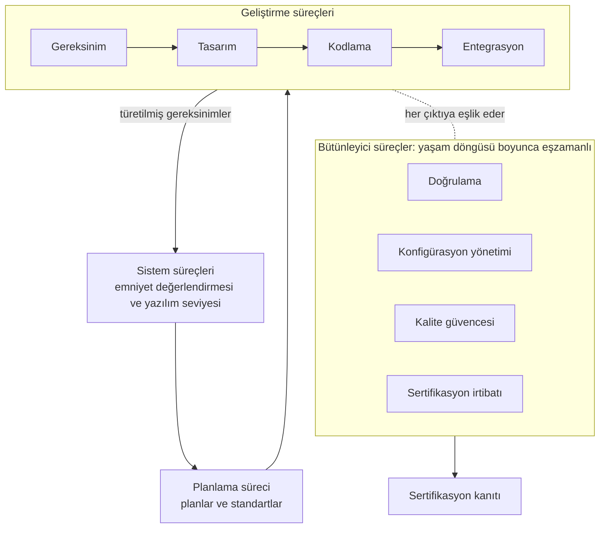

import KitapIcindekiler from '@site/src/components/KitapIcindekiler';

# DO-178C ile Emniyet-Kritik Aviyonik Yazılım

Bu kitap, DO-178C ekseninde emniyet-kritik aviyonik yazılım geliştirmeyi, doğrulamayı
ve sertifikasyon kanıtı üretmeyi Türkçe ve özgün bir dille anlatır. Amaç, standardı
yalnızca maddeler hâlinde özetlemek değil; neden bu beklentilerin bulunduğunu, pratikte
nasıl uygulandığını ve tipik proje kararlarını nasıl etkilediğini göstermektir.

Kitap, yazılımın sistem ve emniyet değerlendirmesi içindeki yerinden başlar; ardından
DO-178C'nin yaşam döngüsü süreçlerini (planlama, gereksinim, tasarım, kodlama ve
entegrasyon, doğrulama, konfigürasyon yönetimi, kalite güvencesi, sertifikasyon
irtibatı), araç kalifikasyonunu ve teknoloji eklerini (supplement), son olarak da gerçek
zamanlı işletim sistemleri, yazılım bölümlemesi, sahada yüklenebilir yazılım ve yeniden
kullanım gibi özel konuları aynı çerçevede ele alır. Böylece okuyucu yalnızca belge
isimlerini değil, o belgelerin proje akışındaki yerini, birbirleriyle olan bağıntısını
ve emniyet hedefleriyle ilişkisini de görür.

Bu içerik, yeni başlayan bir mühendisin konuyu sistemli biçimde öğrenmesine yardımcı
olacak kadar açıklayıcı; deneyimli bir ekip üyesinin ise kavramlar arasındaki ilişkiyi
daha net kurmasını sağlayacak kadar ayrıntılı olacak şekilde yazılmıştır.

## Kitap nasıl okunmalı?

Kitabı baştan sona sıralı okumak en iyi yaklaşımdır: kısımlar girişten bağlama, DO-178C
süreçlerinden araç kalifikasyonu ve teknoloji eklerine, oradan özel konulara ilerler ve
ilk kez okuyan biri için en az sürtünmeli rotayı verir. Bu sıra zorunlu bir okuma emri
değildir; belirli bir iş üzerindeyseniz aşağıdaki rotalardan birini izleyebilirsiniz.

| Durumunuz | Önerilen rota |
|---|---|
| Konuya yeni başlıyorsunuz | [1. Giriş ve Genel Bakış](./01-giris/01-giris-ve-genel-bakis.mdx), ardından [4. DO-178C ve Destekleyici Dokümanlara Genel Bakış](./03-do178c-ile-gelistirme/04-do178c-genel-bakis.mdx) |
| Yazılım seviyesinin nereden geldiğini anlamak istiyorsunuz | [2. Sistem Bağlamında Yazılım](./02-baglam/02-sistem-baglaminda-yazilim.mdx) ve [3. Sistem Emniyet Değerlendirmesi Bağlamında Yazılım](./02-baglam/03-sistem-emniyet-degerlendirmesi-baglaminda-yazilim.mdx) |
| Proje başlangıcındasınız | [5. Yazılım Planlama](./03-do178c-ile-gelistirme/05-yazilim-planlama.mdx) ve [12. Sertifikasyon İrtibatı](./03-do178c-ile-gelistirme/12-sertifikasyon-irtibati.mdx) |
| Bir gereksinim seti üzerinde çalışıyorsunuz | [6. Yazılım Gereksinimleri](./03-do178c-ile-gelistirme/06-yazilim-gereksinimleri.mdx) ve [7. Yazılım Tasarımı](./03-do178c-ile-gelistirme/07-yazilim-tasarimi.mdx) |
| Kod yazıyor ya da entegrasyon yapıyorsunuz | [8. Yazılım Gerçekleştirme: Kodlama ve Entegrasyon](./03-do178c-ile-gelistirme/08-yazilim-gerceklestirme-kodlama-entegrasyon.mdx) |
| Test aşamasındasınız | [9. Yazılım Doğrulama](./03-do178c-ile-gelistirme/09-yazilim-dogrulama.mdx), [17. Kapsanmayan Kodlar: Ölü, Gereksiz ve Devre Dışı Bırakılmış Kodlar](./05-ozel-konular/17-kapsanmayan-kodlar.mdx) ve [Ek A: Örnek Geçiş Kriterleri](./06-ekler/01-ek-a-ornek-gecis-kriterleri.mdx) |
| Değişiklik, sürüm ya da süreç denetimiyle uğraşıyorsunuz | [10. Yazılım Konfigürasyon Yönetimi](./03-do178c-ile-gelistirme/10-yazilim-konfigurasyon-yonetimi.mdx) ve [11. Yazılım Kalite Güvencesi](./03-do178c-ile-gelistirme/11-yazilim-kalite-guvencesi.mdx) |
| Araç kullanımı ya da model tabanlı geliştirme tartışıyorsunuz | [13. DO-330 ve Yazılım Aracı Kalifikasyonu](./04-arac-kalifikasyonu-ve-ekler/13-do330-arac-kalifikasyonu.mdx) ve [14. DO-331 ve Model Tabanlı Geliştirme ve Doğrulama](./04-arac-kalifikasyonu-ve-ekler/14-do331-model-tabanli-gelistirme.mdx) |

Bunların dışında:

- **Başvuru arıyorsanız** kitap sonundaki ekleri ve kısaltmalar sözlüğünü birlikte kullanın:
  [Ek E](./06-ekler/05-sablonlar/index.mdx) beş plan ve üç geliştirme standardı için şablonlar,
  [Ek F](./06-ekler/06-kontrol-listeleri/index.mdx) akran gözden geçirmesi ve süreç denetimi
  için kontrol listeleri verir; eklerden sonraki SOI Denetimleri başlığı, otoritenin katılım
  aşaması (Stage of Involvement, SOI) denetimlerine hazırlık listelerini
  ([SW SOI-1](./07-soi-denetimleri/soi-1.mdx) … [SW SOI-4](./07-soi-denetimleri/soi-4.mdx))
  toplar; kitabın en sonundaki [Kısaltmalar](./kisaltmalar.mdx) sayfası, kitapta ve aviyonik
  projelerinde geçen kısaltmaları açar.
- **Bir konuya takıldıysanız** blog yazılarını destekleyici kısa notlar gibi değerlendirin;
  çoğu yazı, kitabın daha geniş akışındaki bir kavrama açıklık getirmek için yazılmıştır.

## Bu kitap ne değildir?

- Bir standart çevirisi değildir.
- Belge maddelerini ezberleten bir özet kitap değildir.
- Tek bir proje tipine kilitlenmiş dar bir uygulama rehberi değildir.

## Bu kitap neyi hedefler?

- DO-178C'nin mantıksal yapısını açıklamak
- Emniyet hedefleri ile yazılım iş ürünleri arasındaki bağı kurmak
- Planlama, geliştirme, doğrulama ve güvence faaliyetlerini ilişkilendirmek
- Araç kalifikasyonunun ve teknoloji eklerinin ne zaman devreye girdiğini göstermek
- Özel konuların neden sertifikasyon açısından önemli olduğunu anlatmak

## Kapsam ve esas alınan dokümanlar

Anlatım sivil havacılık sertifikasyonu bağlamındadır ve şu dokümanları esas alır:

- **DO-178C / ED-12C** (2011). Yasa değildir; FAA'nın AC 20-115D, EASA'nın AMC 20-115D
  dokümanıyla (ikisi de 2017) kabul edilebilir uyum yöntemi olarak tanınır.
- Araç kalifikasyonu belgesi **DO-330** ile **DO-331**, **DO-332** ve **DO-333** teknoloji
  ekleri (hepsi 2011). DO-330 bir teknoloji eki değil, kendi başına duran bir belgedir.
- Sistem tarafında **ARP4754B** ve **ARP4761A** (ikisi de 2023).
- Uçuşa elverişlilik güvenliği için **DO-326A** (2014) ve yöntem belgesi **DO-356A** (2018).

Belge ailesinin tamamı, EUROCAE karşılıkları ve kullanım yerleriyle Bölüm 4'teki tabloda
verilir. Otorite dokümanları zamanla yenilenir; bir projede hangi sürümün geçerli olduğu
sertifikasyon otoritesiyle varılan mutabakata bağlıdır. Kitap yaşayan bir çalışmadır:
sitede her sayfanın altındaki son güncelleme tarihi, o sayfanın en son ne zaman elden
geçirildiğini gösterir.

## Kavramsal akış

Diyagramın üst yarısı işin ana hattını, alt yarısı bu hatta baştan sona eşlik eden
faaliyetleri gösterir. Doğrulama, konfigürasyon yönetimi, kalite güvencesi ve
sertifikasyon irtibatı geliştirmenin ardından gelen adımlar değildir; DO-178C bunları
bütünleyici süreçler (integral processes) olarak tanımlar ve planlamadan teslimata kadar
geliştirmeyle eşzamanlı yürürler. Ana hat da düz bir üretim hattı değildir, geri
beslemelidir: doğrulama bulguları gereksinim dilini düzeltebilir; tasarım eksikleri test
kapsamını etkileyebilir; konfigürasyon yönetimi ise tüm çıktılar arasındaki tutarlılığı
korur. Sertifikasyon kanıtı sonda derlenen bir paket değil, bu süreçlerin yol boyunca
ürettiği verinin toplamıdır.

## İçindekiler

Her satırın sağındaki süre, bölümün tahmini okuma süresidir.

{/* Liste elle yazılmaz: kenar çubuğundan (kitapSidebar) üretilir, bkz. src/components/KitapIcindekiler. */}

<KitapIcindekiler />

## Bu kitaba atıf ve bağlantı

Kitaptan yararlanıyorsanız kaynağı aşağıdaki biçimde gösterebilirsiniz; erişim tarihini kendiniz yazın:

> Aviyonik Yazılım topluluğu. DO-178C ile Emniyet-Kritik Aviyonik Yazılım. https://aviyonikyazilim.com/kitap. Erişim tarihi: GG.AA.YYYY

İçerik [CC BY-SA 4.0](https://creativecommons.org/licenses/by-sa/4.0/deed.tr) lisanslıdır: kitaba bağlantı verebilir, kaynağı belirterek alıntı yapabilir ve aynı lisansla paylaşabilirsiniz.

Bir web sayfasından ya da dokümandan bağlantı vermek için şu satırı kullanabilirsiniz: `<a href="https://aviyonikyazilim.com/kitap">DO-178C ile Emniyet-Kritik Aviyonik Yazılım</a>`

Yeni blog yazılarını RSS ile takip etmek için akış adresi `https://aviyonikyazilim.com/blog/rss.xml` şeklindedir. Düzeltme ve katkı önerileri için [GitHub deposunu](https://github.com/Mavrikant/aviyonikyazilim) ya da GitHub kullanmayanlar için e-posta yolunu da gösteren [ana sayfadaki katkı bölümünü](/#katki) kullanabilirsiniz.
